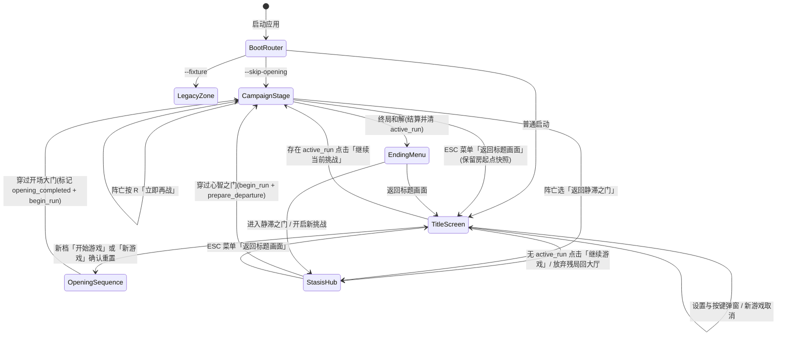

# Spec: 启动页、换房中途续关与 3D 静滞之门大厅（Title Screen, Mid-Run Resume & Stasis Hub）

## Problem Statement

当前《Mind Freak》的局外入口与成长循环存在三处明显的体验与架构断层：

1. **缺少真正的启动页（Title Screen）**：应用启动后入口路由即无条件调用 `RunDirector.begin_run()`（导致空开游戏也会自增挑战次数并写盘），首局直接强播开场演出（绕过原有标题卡），第 2 局起直接全屏弹窗进入战斗；玩家无法在进入游戏前选择「继续游戏」还是「新游戏」，也无法在开打前调整灵敏度、准星、音量或键位绑定。
2. **缺少单局中途续关能力**：`MetaProgression` 仅保存局外永久档案（货币、天赋、图鉴、心象日记、历史计数），而 `RunDirector` 的单局进度（领域洗牌顺序、当前层/房、赐福构筑、心智碎片、剥夺状态、血量、重抽次数、本局已赚货币与复活消耗状态）全部仅驻留内存；玩家在中途退出游戏后只能整局作废重来。
3. **局外成长仅表现为全屏弹窗，缺少实体空间**：`CrownForge` 虽标注「静滞之门」，但在游戏中并不存在对应的 3D 场景——每次死亡重开都会被强制全屏弹出锻造面板，既打断心流，又让心象日记与赐福图鉴缺乏战前触摸的载体，且随行皇冠的复盘历史对白被迫挤在第一关开打瞬间播放，容易被战斗音效淹没。

---

## Solution

在不破坏现有 `--fixture` / `--skip-opening` 直通机制、AC-07 确定性回放及单向依赖规则的前提下，建立完整的「**启动页 →（首次一镜到底开场 / 常驻 3D 静滞之门大厅）→ 四领域战役（含换房自动续关）→ 死亡双出口 / 终局和解**」闭环：

1. **左选项 + 右 3D 戴冠主角半身像启动页（Title Screen）**：
   - 沿用 Scheme B（Architectural Editorial）建筑画廊视觉语言与纯白静滞柱廊背景：左侧为标题与主菜单选项，右侧为实时 3D 渲染的白晶主角半身像（3/4 侧身朝向菜单、呼吸待机、随鼠标轻度视差，支持减少移动选项）。
   - **半身像与文案随存档状态真实演化**：
     - **全新档案（未完成开场）**：主角纯白无瑕，**皇冠微悬于头顶上方轻缓浮动（悬空待加冕）**；左侧主按钮为「开始游戏」，副标题为「在停摆的那一刻，醒来。」（严禁提前剧透 Pride / 完整主题）。
     - **已有档案（探索中）**：皇冠落位佩戴于头顶；主角按历史击败心魔数（`0..4`）呈现对应等级的黑色晶体接缝与剥离碎屑，同时皇冠金光按既定指数倍率递增，无声传递「越强越碎、皇冠越耀眼」的反差。
     - **终局和解后（`reconciled`）**：裂缝转为温润流动的暗金金缮与四色心魔微光节点，皇冠强光退去回归温和，副标题切换为「不再完美，但终于完整。」。
   - **完整入口操作**：支持「继续当前挑战（有未完单局时） / 继续游戏（进入静滞之门）」「返回静滞之门（有未完单局时提供放弃确认）」「新游戏（已有档时二次确认重置并保留旧档备份）」「设置与按键（复用 `PauseMenu` 的设置与键位页）」「退出游戏」。
2. **房间边界自动存盘与换房中途续关（Mid-Run Resume）**：
   - 在 `MetaProgression` v1 存档中以向后兼容的可选字段持久化 `opening_completed` 与 `active_run`（受既有 SHA-256 校验与 `.bak` 原子写盘保护）。
   - 每次进入新房间（含首局 `0:0` 入场、每次通过门扉调用 `advance_room()` 切房、以及抵达第 5 层终局返程回廊）与 `0:0` 开局三选一完成时，自动写入房间起点快照；战斗中途通过暂停菜单选择「返回标题画面」会保留至当前房间起点，**不计入未清房击杀收益、不刷新已消耗的「不屈意志」复活次数、也不重发已领取的开局三选一**，彻底杜绝 S/L 刷货币或刷卡漏洞。
   - 死亡结算（`record_death`）、终局和解（`finish_campaign`）或玩家在标题页确认放弃当前挑战时，原子结算已锁定收益并清空 `active_run`。
3. **标配 3D「静滞之门」局外成长场景（Stasis Hub）**：
   - 将原开场序列的纯白柱廊建筑语言统一演进为紧凑的 10–12 米常驻 3D 大厅，出生点距正前方出发门约 9 米（冲刺 3 秒即可入战，拒绝跑图拖沓）：
     - **中央苏醒区**：死后回到大厅苏醒时，由皇冠在宁静空间内播放结合历史次数与死因的动态复盘对白（从大厅穿门入战后不再在第一关重复播报同一句）。
     - **左侧 · 皇冠锻造台（实体白石祭坛）**：上方悬浮微缩皇冠投影，当钱包足够购买任意永久天赋时发出暗金呼吸脉冲；走近按 `interact`（默认 `F`）打开现有 `CrownForge` 面板，升级结果立即反映到大厅玩家属性。
     - **右侧 · 四心魔心象与图鉴碑**：四根建筑立柱分别映射怠惰/恐惧/愤怒/悲伤的真实档案进度（未访纯白 → 已访亮边 → 击败染色 → 和解金缮）；走近按 `F` 打开合并的只读「心象日记 + 赐福图鉴」面板（复用现有 `LoreDiary` 与 `DualBoonCodex`）。
     - **正前方 · 心智之门（出发门）**：穿过门扉（或门前按 `F`）才真正开启新局 `RunDirector.begin_run()` + `prepare_departure()`，保存初始 `active_run` 并淡入第一层第一房。
   - **死亡结算双出口**：领域死亡面板保留按 `R` 立即再战（零摩擦连刷），同时新增「返回静滞之门」按钮（本局有可锻造余额时给轻提示），兼顾叙事仪式感与 Roguelite 节奏。

---

## User Stories

1. **As a** 首次打开游戏的玩家，**I want** 看到简洁克制的启动页（左选项、右纯白主角半身像与悬空待加冕皇冠），点击「开始游戏」后才进入一镜到底开场演出，**so that** 我可以先调整设置再有心理预期地进入叙事体验，而不会被直接抛进过场。
2. **As a** 已经打过数局的回归玩家，**I want** 启动页直接以「继续游戏」为主入口，且右侧主角半身像直观呈现出我迄今击败心魔后的裂痕与皇冠亮度变化（和解后呈现暗金金缮），**so that** 每次打开游戏都能立刻感受到旅程沉淀，点击继续即进入静滞之门而不重看开场。
3. **As a** 打到第 3 层临时需要离开的玩家，**I want** 通过暂停菜单返回标题或关闭游戏后，下次启动能直接点击「继续当前挑战（第 3 层 · 领域 房 X/3）」恢复我的构筑、血量、碎片与剥夺状态继续游玩，**so that** 单局较长时不必被迫一次性打完或白白作废。
4. **As a** 想从零重体验开场与全部解锁流程的玩家，**I want** 在启动页点击「新游戏」并经过二次确认后重置本地档案，重新看到悬空皇冠并播放完整一镜到底开场，**so that** 我可以安全重开新档而不必手动去系统目录删存档文件。
5. **As a** 战死归来的玩家，**I want** 在死亡界面选择「返回静滞之门」后置身于纯白 3D 大厅里，听皇冠平静复盘、走到左侧锻造台升级永久天赋、到右侧四心魔碑翻看新解锁的心象日记与赐福图鉴，再穿过正前方心智之门出征（或直接在死亡界面按 `R` 立即再战），**so that** 局外成长具备真实的空间仪式感，又不会强迫弹窗拖慢连刷节奏。
6. **As a** 依赖既有自动化回归测试与 `--fixture` / `--skip-opening` 的开发者，**I want** 命令行直通路径与旧版 v1 存档继续无缝工作、AC-07 确定性哈希零漂移、且中途存档无法被用于 S/L 刷货币或重复复活，**so that** 新入口体系不会引入经济漏洞或测试回归。

---

## Implementation Decisions

### 1. 全局入口状态机与路由收敛



- **路由层职责**：入口节点不再在 `_ready()` 无条件调用 `RunDirector.begin_run()`，也不再由它直接实例化全屏 `CrownForge`。它只做一次性入口分发：检测 `--fixture` / `--skip-opening` 走旧直通契约；否则加载 `TitleScreen`。
- **单向依赖规则（守住 `ARCHITECTURE.md`）**：
  - `TitleScreen`、`StasisHub`、`OpeningSequence`、`PauseMenu`、`RealmHUD` 均不直接修改钱包或直接推进战役房间，统一通过公开信号或调用组合根 `RunDirector` / `MetaProgression` 的显式接口流转。
  - `RealmStage` 新增信号 `hub_requested(stage: RealmStage)` 与 `title_requested(stage: RealmStage)`，由 `RunDirector` 订阅处理；`RealmHUD` 仅调用注入的 `stage.request_hub()` / `stage.request_title()`，绝不反向读取 `RunDirector`。

### 2. 存档契约扩展（`MetaProgressionStore` · 兼容 v1 Schema）

保持 `VERSION := 1`、既有 SHA-256 校验和与 `.bak` 原子写盘流程，在 `payload` 中新增两个**向后兼容的可选字段**（旧档缺失时按规则安全回落，不视为损坏）：

```json
{
  "opening_completed": true,
  "active_run": {
    "run_id": "1732400000-1234-99",
    "run_seed": 91234,
    "order": [1, 0, 2, 3],
    "floor_index": 2,
    "room_index": 1,
    "defeated": [1, 0],
    "deprivations": [1, 0],
    "shards": [1, 0],
    "hp": 96.5,
    "boon_ids": ["sloth_gun_latency", "fear_dash_decoy"],
    "fragment_state": {
      "barrier": 40.0, "recovery": 0.0, "counter": 0.0,
      "charge": 1, "since_combat": 0.0, "resonance": 0.0, "room_healed": 0.0
    },
    "rerolls": 2,
    "selections": [{"floor": 1, "room": 0, "realm": 1, "boon_id": "sloth_gun_latency"}],
    "entry_reward_claimed": true,
    "earned_will": 145,
    "earned_anchors": 2,
    "defiance_consumed": false
  }
}
```

- **严格校验不变量**：
  - `opening_completed`：必须是 `bool`；旧档缺失时推断为 `history.run_count > 0 or not settled_runs.is_empty() or not visited_realms.is_empty()`。
  - `active_run`：可为空字典 `{}`（表示无未完单局）；非空时逐字段严格校验：
    - `run_id` 非空且长度 ≤ 128，且**不得已在 `settled_runs` 中**（防已结算局重放刷钱）；
    - `order` 必为 `[0, 1, 2, 3]` 的无重复排列；
    - `floor_index ∈ [0, 4]`，`room_index ∈ [0, 2]`（`floor_index == 4` 时 `room_index == 0` 且 `defeated.size() == 4`、`shards.size() == 4`）；
    - `defeated` / `deprivations` / `shards` 元素均在 `[0, 3]` 且无重复，`defeated.size() <= floor_index + (1 if room_index == 2 else 0)`；
    - `boon_ids` 必须全部能在 `BoonCatalog` 中解析到真实 `BoonData` 资源，且核心槽位不冲突；
    - `hp` 有限且 `> 0`、`rerolls ∈ [0, 10]`、`earned_will >= 0`、`earned_anchors >= 0`、`entry_reward_claimed` 与 `defiance_consumed` 均为 `bool`。
  - 若 `active_run` 校验失败但整份文件签名异常，沿用现有 `.bak` 恢复与只读锁定机制，绝不静默覆盖玩家原文件。
- **档案查询与重置接口**：
  - `has_profile() -> bool`：`opening_completed` 或 `history.run_count > 0` 或已持有任意货币/天赋/发现/档案/残局。
  - `has_active_run() -> bool`：`not active_run.is_empty()`。
  - `mark_opening_completed() -> bool`：事务写盘标记开场已完成。
  - `save_active_run(snapshot: Dictionary) -> bool` / `clear_active_run() -> bool`：原子更新快照（失败回滚内存状态）。
  - `reset_profile() -> bool`：用于启动页「新游戏」二次确认。重置前先把当前有效存档复制到 `.bak`（兜底防误删），随后清空货币、天赋、历史、图鉴、心象档案、`settled_runs`、`opening_completed = false`、`active_run = {}` 并原子落盘，发射 `changed` 信号。
  - `settle_run(...)` 同步支持原子清空 `active_run`（避免结算成功但清空残局失败造成双态不一致）。

### 3. 换房中途续关与防 S/L 机制（`RunDirector` + `RealmStage`）

- **落盘时机（严格限定于安全边界）**：
  1. **新局出发**：`prepare_departure()` 完成并安装 `0:0` 房间后，立即落盘 `active_run`（此时 `entry_reward_claimed = false`、`earned_will = 0`、`earned_anchors = 0`）。
  2. **首房开局选卡完成**：在 `0:0` 选完 `enter` 赐福后，`_reward_selected` 捕获玩家状态、置 `entry_reward_claimed = true` 并更新 `active_run`。
  3. **跨房推进**：`advance_room()` 推进到下一房（含进入 `floor_index == 4` 终局返程回廊）后，立即以当前已清房累计的 `earned_will` / `earned_anchors`、已捕获的 `hp` / `boons` / `shards` / `deprivations` / `fragment_state`（含清零后的 `room_healed = 0.0`）/ `rerolls` / `MetaProgression.defiance_consumed` 落盘 `active_run`。
- **防刷收益与防刷复活不变量**：
  - 房间战斗未完成时（未过门），击杀小怪累加的是内存里的 `earned_will`，**不会在暂停返回标题时写入 `active_run`**；再次续关会回到本房起点并重新按同一 `run_seed` 生成该房敌人，且 `earned_will` / `earned_anchors` 从上次安全边界恢复，彻底杜绝“杀怪→退标题→读档刷碎屑”。
  - 暂停菜单返回标题时的提示文案明确告知「进度已保存至本房间起点」。
  - 若在 `0:0` 完成开局选卡后中途退出并续关，恢复时向 `RealmStage` 注入 `skip_entry_reward = true`，跳过 `offer_entry_reward`，防止无限重复拿开局卡。
  - 恢复 `active_run` 时，`RunDirector.resume_run()` 同步恢复 `MetaProgression.active_run_id = snapshot.run_id` 与 `MetaProgression.defiance_consumed = snapshot.defiance_consumed`，并恢复 `crown_strength = 0.5 * pow(2.4, defeated.size())`；首次进入恢复的房间时不重播历史死亡对白（仅正常进入第 2–5 层时按原有楼层提示逻辑处理）。
- **主动放弃残局**：当存在 `active_run` 且玩家在启动页点击「返回静滞之门」并确认放弃当前挑战时，`RunDirector.abandon_active_run()` 先将 `active_run` 中已安全锁定的 `earned_will` / `earned_anchors` 按 `run_id` 去重结算入账（同时递增死亡/结束历史或保持原死因），并原子清空 `active_run`，再进入静滞之门大厅。

### 4. 启动页布局与 3D 戴冠半身像（`TitleScreen`）

- **画面构图（16:9 自适应，Scheme B 建筑画廊美学）**：
  - **底层 3D 视口（全屏或右侧主舞台平滑衔接纯白背景）**：纯白哑光柱廊远景 + 柔和定向光 + 共享 `default_env.tres` 的 SSAO/SSIL 副本。
  - **左侧菜单区（约 42% 宽）**：
    - 顶部眉标 `THRESHOLD // 静滞之门`、主标题 `MIND FREAK`、动态副标题（未和解：`在停摆的那一刻，醒来。`；已和解：`不再完美，但终于完整。`）与细横分割线。
    - 主操作按钮栈（完整支持鼠标、键盘方向键与手柄焦点）：
      - **新档（`not has_profile()`）**：`开始游戏`（主按钮）→ `设置与按键` → `退出游戏`。
      - **有档且无残局**：`继续游戏`（主按钮，副行显示 `静滞之门 · 第 N 次 · X/4 心魔 · Y 碎屑`）→ `新游戏`（弹出二次确认卡：说明会重置当前进度并保留 `.bak` 备份）→ `设置与按键` → `退出游戏`。
      - **有档且存在 `active_run`**：`继续当前挑战`（主按钮，副行显示 `第 X 层 · <领域名> 房 Y/3` 或 `终局返程回廊`）→ `返回静滞之门`（弹出确认卡：结算已清房收益并结束本次挑战）→ `新游戏`（二次确认重置）→ `设置与按键` → `退出游戏`。
  - **右侧 3D 主角半身像（约 58% 宽）**：
    - 实例化真实 `ProtagonistBody`（保留头部可见，不设 `SHADOWS_ONLY`），3/4 侧身朝向左下方菜单，取胸腹以上至头顶皇冠的特写机位，循环播放柔和待机呼吸动画，并支持极克制的鼠标位置微视差（关闭动态效果时静止）。
    - **皇冠与身躯三态演化**（纯只读消费 `MetaProgression` 快照，零剧透）：
      1. **未完成开场（新档）**：`fracture_level = 0`（纯白完整晶体），实体 `CrownModel`（`worn = false`）**悬空在头骨上方约 0.14m 处轻缓上下浮动**，`emission = 0.5`（悬空待加冕）。
      2. **已加冕探索中（`opening_completed and not reconciled`）**：`CrownModel` 稳稳落位佩戴在主角头顶；通过 `BodyFracture` 应用 `fracture_level = clampi(defeated_realms.size(), 0, 4)` 的真实黑接缝与局部松动碎屑；皇冠发光倍率同步设为 `0.5 * pow(2.4, fracture_level)`，右上角四枚极简菱形徽记点亮对应已击败心魔色。
      3. **已终局和解（`reconciled`）**：在主角晶面接缝上复用 `kintsugi_gold.gdshader` + `KintsugiFlow` 呈现暗金流光与四色微光节点，皇冠落位佩戴且光强回落至温和的 `0.55`。
- **设置菜单解耦（`PauseMenu`）**：
  - 允许 `PauseMenu` 在无 `Player` 注入的上下文（启动页、静滞之门）打开，保留全部可用设置（鼠标灵敏度、开镜灵敏度、准星样式/颜色/大小/粗细/透明度/动态张开与预览、音乐音量、全套按键重绑与恢复默认），关闭时照常写入 `GameSettings`；在战区内和静滞之门打开时，在底部操作栏提供「返回标题画面」按钮（战斗内附带「进度已保存至本房起点」说明，且在 `fixture` 模式下隐藏该按钮）。

### 5. 标配 3D「静滞之门」大厅（`StasisHub`）

- **空间拓扑与尺度（紧凑、无跑图疲劳）**：
  - 复用 `OpeningSequence` 的纯白柱廊、高反光浅灰地面与漫反射照明规范（总深约 22m、宽 16m；玩家出生在 `(0, 0.02, 2.0)`，面朝 `-Z` 出发门）。
  - 出生时挂载真实 `Player`（正常第一人称移动、视角、冲刺与低头身躯感知；默认收起武器禁止大厅内误开火；`MetaProgression.apply_to_player(player)` 立即注入永久天赋），并开启 `CrownVoiceSystem`（佩戴头顶投影）。
- **三处标配核心交互与一处叙事反馈**：
  1. **中央苏醒与皇冠复盘**：若本次由死亡返回大厅（`hub_reason == "post_death"`），`CrownVoiceSystem` 在苏醒后 0.4s 播放基于 `run_count / last_death_depth / last_death_cause` 的历史复盘语音；随后经大厅穿门出发时，`RunDirector` 标记 `suppress_entry_history_voice = true`，避免进第 1 房再次重播同一条语音。
  2. **左侧 · 皇冠锻造台（`x = -4.2, z = -1.5`）**：
     - 纯白斜切石座 + 悬浮缓慢自转的实体微缩 `CrownModel` + 柔和点光源；当 `MetaProgression.has_affordable_upgrade()` 为真时，台座金光轻度脉冲。
     - 玩家进入 3.0m 交互圈并面向时，HUD 显示极简画廊风交互提示 `[F] 皇冠锻造台`；按 `interact` 打开现有 `CrownForge`（传入 `MetaProgression` 与大厅 `player`），关闭后立即恢复大厅控制且不触发出发。
  3. **右侧 · 四心魔心象与图鉴碑（`x = +4.2, z = -1.5`）**：
     - 四根并列细长白晶立柱（按怠惰/恐惧/愤怒/悲伤顺序排列）与中央矮台：未访问纯白、已访问顶部镶边亮色、已击败柱身染对应情绪主题色、已和解出现暗金斜纹。
     - 走近按 `interact` 打开「静滞档案」双页签只读视图（页签 1：`心象日记` 复用 `LoreDiary`；页签 2：`赐福图鉴` 复用 `DualBoonCodex`，允许 `BoonManager` 为空时安全只读展示已发现与锁定的 54 张赐福及共振拓扑），按 `ESC` 回到大厅。
  4. **正前方 · 心智之门（`z = -10.5`）**：
     - 高 5.6m 对开白晶巨门（大厅常态敞开，门楣刻 `THRESHOLD / 心智之门`），走近提示「穿过心智之门 · 开启挑战」，走到 `z < -11.2`（或在门前按 `F`）触发防重保护并转交 `RunDirector` 执行 `begin_run()` + `prepare_departure()` + 保存初始 `active_run` + 淡出切入第一层第一房。
- **死亡结算双出口（`RealmHUD` 兼容约束）**：
  - 保留 `_death_panel` 既有节点索引顺序（`child 0` = `_death_reason`，`child 1` = `retry_button`），在其下方追加 `child 2` = `返回静滞之门` 按钮（若本局入账后 `MetaProgression.has_affordable_upgrade()` 为真，按钮文案附带「· 可锻造」轻标）。
  - 玩家按 `R` 或点「重新挑战」继续直接重开进战（跳过大厅，第一房正常播放皇冠历史对白）；点「返回静滞之门」则带 `post_death` 语境切入 `StasisHub`。

---

## Testing Decisions

### 什么是好的行为测试
- 通过真实入口路由、真实 `MetaProgressionStore` 隔离存档文件、真实 `RunDirector` 组合根与生产级 `TitleScreen` / `StasisHub` / `RealmStage` 验证**玩家可观测的端到端状态流转、持久化恢复与防刷不变量**，而不绑定私有动画坐标或内部布局细节。
- 重点守卫四类核心边界：
  1. **启动页状态与视觉绑定**：新档呈「悬空待加冕」且无继续按钮；有档呈「佩戴 + 对应 `defeated_realms` 裂痕/光强」；和解后呈「金缮 + 新副标题」；「新游戏」二次确认重置并留下 `.bak`。
  2. **换房中途续关与反 S/L 不变量**：跨房存盘 → 重建 `MetaProgressionStore` 与 `RunDirector` 模拟重启进程 → 续关精准还原 `order / floor / room / hp / boons / shards / deprivations / fragment_state / rerolls / defiance_consumed / earned_will / earned_anchors`；验证未清房中途退出**不保留本房击杀碎屑**、已选过 `0:0` 开局卡续关**不重复弹选卡**、已用复活续关**不重置复活**、终局/死亡结算后 `active_run` 被原子清空且旧 `run_id` 无法二次结算。
  3. **3D 静滞之门全流程**：走近左侧锻造台按交互打开 `CrownForge` 扣费升级并即时生效于大厅玩家；走近右侧心象碑按交互只读打开日记与图鉴且不改存档；死后回大厅触发皇冠复盘语音且穿门进第 1 房不重复播放；穿门进入真实第 1 房。
  4. **旧路径零回归**：`--fixture=FX-001/FX-002`、`--skip-opening`、历史 v1 存档（缺 `opening_completed` 与 `active_run` 字段）、AC-07 确定性哈希与 `RealmHUD` 死亡面板节点索引全部保持通过。

### 锁定的测试接缝（1 个主端到端集成接缝 + 既有回归对齐）
1. **主高层测试接缝（新增 `tests/title_hub_resume_test.tscn`）**：
   - 沿用本仓库 `opening_boot_test` / `meta_campaign_test` 的隔离档案会话模式，在同一真实场景树生命周期内串行覆盖：
     - **启动页三态与重置**：空白隔离档验证悬空皇冠与「开始游戏」→ 完成开场穿门后验证 `opening_completed == true`；注入 3 心魔与和解快照验证佩戴皇冠、裂痕等级、金缮切换与按钮摘要；验证「新游戏」确认重置及旧档备份。
     - **换房续关与防 S/L 闭环**：推进至 `0:0` 选完开局卡并记录快照 → 清房进 `0:1` 落盘 `active_run` → 消耗一次 `defiance` 并在未清房时击杀 1 名敌人后返回标题 → 模拟冷重启重新加载存档并点击「继续当前挑战」→ 断言精准落回 `0:1`、未重复弹 `0:0` 选卡、未把未清房击杀带入货币、`defiance_consumed` 保持为 `true`；随后阵亡并验证 `active_run` 清空且货币一次性入账。
     - **静滞之门 3D Hub 交互**：由死亡界面触发进入 `StasisHub` → 校验皇冠复盘语音触发 → 靠近左侧锻造台打开并购买升级、校验大厅 `Player` 属性刷新 → 靠近右侧档案碑打开日记/图鉴页签 → 穿过心智之门进入真实第 1 房并断言皇冠历史对白未重复播报。
     - **无 Player 设置弹窗**：在 `TitleScreen` 打开 `PauseMenu` 修改灵敏度与按键并关闭保存，校验无空引用报错且配置持久化。
2. **既有回归对齐与必跑套件**：
   - **定向对齐**：`tests/opening_boot_test.tscn` 与 `tests/meta_campaign_test.tscn`（原先假设 `GameStart` 直接自动进开场或在 `GameStart` 自动强弹 `CrownForge`，须更新为经启动页/静滞之门的新正式入口，同时保留对 `FX-001` / `FX-002` 与 `CrownForge` 事务的完整断言）。
   - **零改动回归必过**：`tests/meta_forge_test.tscn`（补充 `opening_completed` / `active_run` 校验与旧 v1 档兼容用例）、`tests/run_director_test.tscn`、`tests/lore_diary_test.tscn`、`tests/dual_boon_codex_test.tscn`、`tests/pause_menu_test.tscn`（如有）、`tests/fixture_test.tscn`（AC-07）。

---

## Out of Scope

- **不加入静滞大厅武器试炼木桩/靶场**：按确认范围仅做标配三区（皇冠锻造台 + 四心魔心象/图鉴碑 + 心智之门）。
- **不做多存档槽位管理系统**：本期维持单档案 + `.bak` 自动备份 + 「新游戏」二次确认重置；多槽位留待后续需要时扩展。
- **不做战斗中实时逐帧/逐敌存盘**：中途续关严格以**房间起点**为保存粒度，不序列化存活敌人坐标、飞行弹丸或临时状态计时器。
- **不制作新外部 3D 模型、贴图或新配音文件**：半身像、皇冠、白模柱廊、四心魔碑与语音全部复用项目已有模型、着色器与语音资源。
- **不改动核心战斗平衡、赐福卡池或局外货币数值**。

---

## Further Notes

- **文档同步**：实现完成后须在 `GLOSSARY.md` 登记「启动页半身像（悬空待加冕）」「静滞之门 3D 大厅（`StasisHub`）」「换房中途续关快照（`active_run`）」，并在 `ARCHITECTURE.md` 更新入口启动流程段落与 `docs/adr/0009-pride-opening-bootstrap.md` 文末修订注记（保留历史正文）。
- **视觉验收**：实现完成后须在非 headless 原生渲染下截图核查：① 启动页三态（新档悬空皇冠、探索期裂痕+耀眼皇冠、和解期金缮）的左右比例与文字可读性；② 静滞之门大厅第一人称视野、左侧锻造台、右侧四柱碑与正前方心智之门的尺度、光照与交互提示。
- **Git 分支提醒**：当前工作区停留在含未提交改动的 `feat/difficulty-curve-phase-b` 分支；正式进入实现阶段前，须先清理或切离至基于最新 `main` 的独立功能分支（如 `feat/title-screen-and-stasis-hub`），不混入无关改动。
- **下一步衔接**：确认本 Spec 及锁定测试接缝无误后，可执行 `$swe-to-tickets` 将其拆分为垂直可验收的 Ticket 与依赖 DAG。
