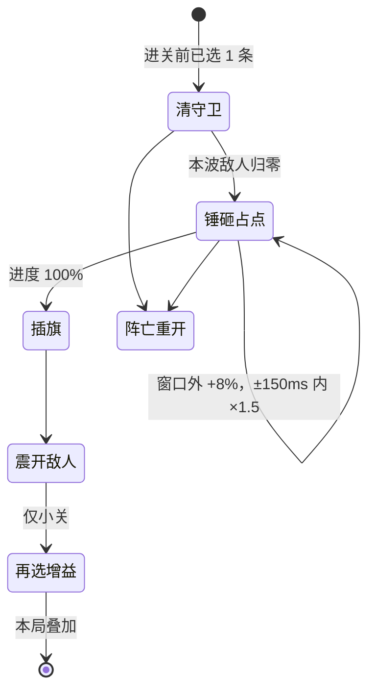
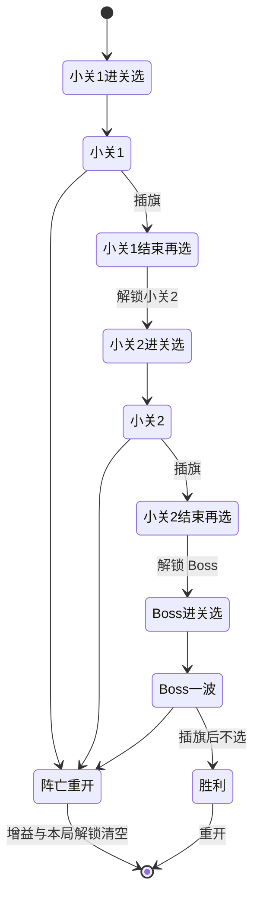

# 核心循环

> 腾讯游戏学堂《AI游戏进化论》EP.04。循环句不超过 100 字。验收编号在 [Cut-001b](Cut-001b.md) 的 AC-01 至 AC-08。
> 当前代码已是清守卫 → 锤砸占点 → 插旗，增援、冲击波和选择流程还没做；Boss 关已经可玩（AC-02）。设计以 Cut-001b 和 [MVP_Scope.md](MVP_Scope.md) 为准。

## 循环（96 字）

进每一关先选一个流派。小关先清守卫，再在增援里锤砸据点，完美打击加快摧毁，占满后插旗并震开敌人，然后再选一个流派并叠加。Boss 进入时也选，只打一波城市核心，占满即胜且不再选。阵亡清空重开。

「选一个流派」在这里指从该派的条目里确认 1 条。池子是 3 派 × 3 条。

## 临时默认（已锁定，可配置）

| 项 | 默认 | 验收 |
| --- | --- | --- |
| 小关两段 | 清到 0，再砸，再插旗 | AC-01 |
| 普通锤击 | 占点进度 +8% | AC-03，来自配置 |
| 完美打击 | 命中时刻 ±150ms；本次进度 ×1.5；专用音效和闪光 | AC-03 |
| 窗口外 | 只有普通进度，反馈与成功不同 | AC-03 |
| 增援 | 不回退进度，只造成生命压力 | 占点规则。进度数归 AC-03 |
| 占满 | 100% 插旗，冲击波推开剩余敌人，本关结束 | AC-01 |

作废 ±120ms、+12%、+20%。倍率 1.5 是配置项。试玩后只改变量。

## 文本箭头图

```text
一局
小关1 进关前选 1 条 → 清守卫到 0 → 锤砸（+8%，完美 ×1.5） → 100% 插旗 → 震开 → 结束再选 1 条
→ 小关2 进关前选 1 条 → 清守卫到 0 → 锤砸 → 100% 插旗 → 震开 → 结束再选 1 条
→ Boss 进关前选 1 条 → 一波城市核心（同一套锤击配置） → 100% 插旗 → 震开 → 胜利（不选）
任意关阵亡 → 清空增益与本局解锁 → 重开
```

进关前那一次和关末那一次是两次。一局打完是 5 次（AC-04）。解锁顺序仍是小关 1 → 小关 2 → Boss，这是规则，不是 AC 编号。Boss 胜负是 AC-02。同一起点复现是 AC-07。

## 动词对照

| 动词 | 功能名 | 验收 |
| --- | --- | --- |
| 进关前选 1 条（含 Boss） | 进关选择增益 | AC-04 |
| 清守卫到 0 | 清守卫 | AC-01 |
| 锤砸据点 | 锤砸占点 | AC-01。进度配置见 AC-03 |
| 完美打击 | 完美打击 | AC-03 |
| 插旗 | 插旗 | AC-01 |
| 震开敌人 | 冲击波推开 | AC-01 |
| 结束再选 1 条并叠加 | 小关结束再选增益 | AC-04 |
| 一波城市核心 | Boss 一波城市核心 | AC-02 |
| 胜利 | 胜利结算 | AC-02 |
| 阵亡清空重开 | 阵亡重开 | AC-02 的失败；同一起点见 AC-07 |

## 状态图

文本箭头图优先。




