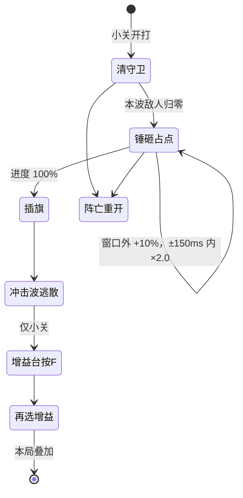
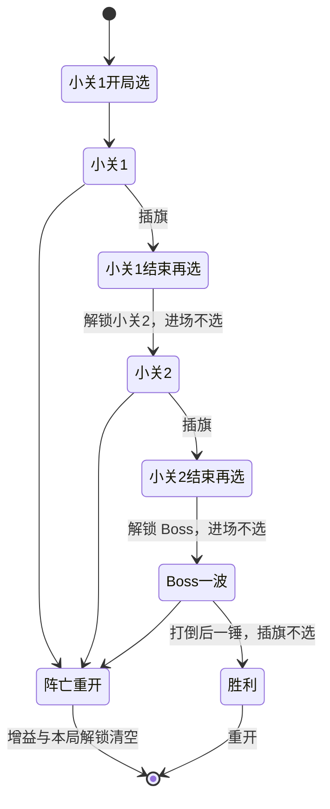

# 核心循环

> 2026-11-03：本文是早期 Battlefield Rouge 原型的规则，描述当前代码的行为，改动现有系统时仍以它为依据。游戏方向以 [Creative Vision](CREATIVE_VISION.md) 为准，冲突时以愿景为准；新的玩法范围按轮次写在 Cut 文档里（当前是 [Cut-002](Cut-002.md)）。

> 腾讯游戏学堂《AI游戏进化论》EP.04。循环句不超过 100 字。验收编号在 [Cut-001b](Cut-001b.md) 的 AC-01 至 AC-08。
> 当前代码已是清守卫 → 在增援里锤砸占点 → 插旗冲击波 → 增益台按 F 再选。增益 3 次：开局前 1 次（弹窗）+ 两个小关结束各 1 次（增益台）；小关 2 和 Boss 进场不选；Boss 后不选。Boss 关先打倒 Boss，再一锤击碎核心，没有增援和冲击波（AC-02）。设计以 Cut-001b 和 [MVP_Scope.md](MVP_Scope.md) 为准。节奏见 [ADR 0007](adr/0007-reinforcements-shockwave-pedestal.md)。

## 循环

开局前选一条增益。小关先清守卫，再在后方增援里锤砸据点，完美打击加快摧毁。占满插旗，冲击波驱散剩余小怪，到旗旁增益台按 F 再选一条并叠加。小关 2 和 Boss 进场不选。Boss 关先打倒 Boss，再一锤击碎核心，然后胜利不再选。阵亡清空重开。

「选一个流派」在这里指从该派的条目里确认 1 条。池子是 3 派 × 3 条。

## 临时默认（已锁定，可配置）

| 项 | 默认 | 验收 |
| --- | --- | --- |
| 小关两段 | 清到 0，再砸，再插旗 | AC-01 |
| 普通锤击 | 占点进度 +10% | AC-03，来自配置 |
| 完美打击 | 命中时刻 ±150ms；本次进度 ×2.0（= +20%）；专用音效和闪光 | AC-03 |
| 窗口外 | 只有普通进度，反馈与成功不同 | AC-03 |
| 增援 | 据点开放后每 8 秒 2 只，场上最多 6 只；不回退进度 | 占点规则。节奏在 `zone/reinforcement_config.tres` |
| 占满 | 100% 插旗，冲击波让小怪逃向后方刷怪点后消失，再到增益台按 F | AC-01 |

作废 ±120ms。+20% 是 +10% × 2.0 的结果，不是另设的配置数。倍率 2.0 是配置项。试玩后只改变量。

## 文本箭头图

```text
一局
开局前选 1 条 → 小关1 清守卫到 0 → 后方增援里锤砸（+10%，完美 ×2.0） → 100% 插旗 → 冲击波逃散 → 增益台按 F 再选 1 条
→ 小关2 进场不选 → 清守卫到 0 → 锤砸 → 100% 插旗 → 冲击波逃散 → 增益台按 F 再选 1 条
→ Boss 进场不选 → 打倒 Boss（核心关闭） → 一锤击碎城市核心 → 插旗 → 胜利（不选）
任意关阵亡 → 清空增益与本局解锁 → 重开
```

一局 3 次：开局前 1 次 + 两个小关结束各 1 次；小关 2 和 Boss 进场不选；Boss 后不选（AC-04）。（原为每关进场都选，打完 5 次。）解锁顺序仍是小关 1 → 小关 2 → Boss，这是规则，不是 AC 编号。Boss 胜负是 AC-02。同一起点复现是 AC-07。

## 动词对照

| 动词 | 功能名 | 验收 |
| --- | --- | --- |
| 开局前选 1 条 | 进关选择增益 | AC-04 |
| 清守卫到 0 | 清守卫 | AC-01 |
| 锤砸据点 | 锤砸占点 | AC-01。进度配置见 AC-03 |
| 完美打击 | 完美打击 | AC-03 |
| 插旗 | 插旗 | AC-01 |
| 震开敌人 | 冲击波推开 | AC-01 |
| 结束再选 1 条并叠加 | 小关结束再选增益 | AC-04 |
| 一波城市核心 | Boss 倒下后一锤击碎 | AC-02 |
| 胜利 | 胜利结算 | AC-02 |
| 阵亡清空重开 | 阵亡重开 | AC-02 的失败；同一起点见 AC-07 |

## 状态图

文本箭头图优先。




