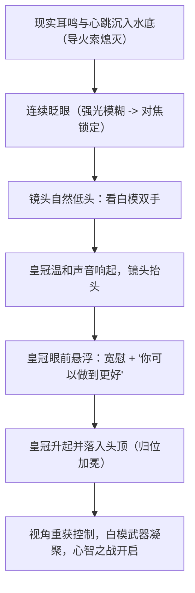
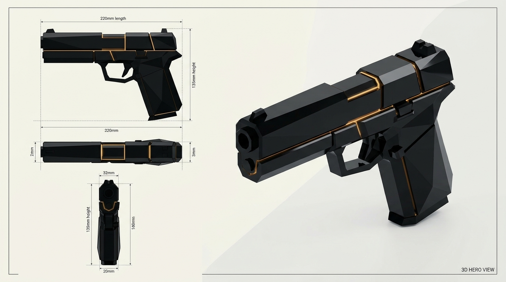
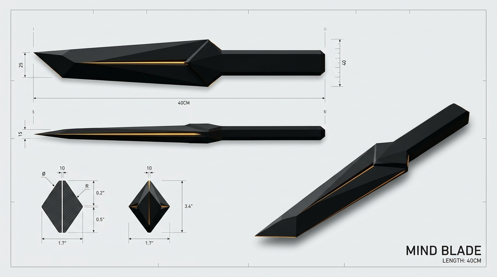

# 《Mind Freak》核心叙事与世界观基石（Narrative Foundation）

> **版本**：v1.5 · 2026-11-09  
> **性质**：叙事与世界观定案文档，指导开场演出、四大心魔关卡意象与色彩体系、敌人形态异化、一枪一刃武器系统、四大心魔完整赐福池与双重共鸣、局外成长机制、局内对白、局外循环与终局决战。  
> **上位文档**：`docs/CREATIVE_VISION.md`  

---

## 1. 核心主题与叙事北极星

* **主题句**：**From Perfection to Wholeness**（从追求完美，到理解完整的自己）。
* **核心隐喻**：
  > “我们不是要把心灵变成一块毫无瑕疵的白色石头。我们要学习与其中每一块碎片共同生活。”
* **主要矛盾**：
  * **不是**某一次具体的创伤或挂科，而是**主角长期以来对“更优秀、更完美”的绝对执念，与真实人类身心局限之间的根本冲突**。
  * **心魔的本质**：四大心魔（怠惰、恐惧、愤怒、悲伤）并列且等权，是人类情感与防御机制的四大基石。在皇冠眼里，它们是阻碍卓越的“绊脚石”；但消灭任何一个，都会引发致命的机制灾难与人性剥夺。
  * **叙事戒律**：
    1. **拒绝口号说教**：给机制、给感官反差、给线索（Hints），留白让玩家自己感知并得出结论。
    2. **心魔的双面性铁律**：表象是绊脚石，内核是不可剥夺的人性本能。
    3. **终局即终点**：击败并和解皇冠后，故事完整闭幕，重返现实；未通关前支持多次挑战与动态对白演进。

---

## 2. 引导者：皇冠（The Crown）

* **名称规范**：在全局游戏流程中，**严格统称为「皇冠」（The Crown）**。
  > [!IMPORTANT]
  > **严禁在前期直接暴露其“Pride（傲慢）”的身份！**
  > 皇冠追求极致卓越的偏执本质（傲慢），是终局的高潮揭示与反思，绝不能作为新手名片。

* **角色形象与长久渊源**：
  * 玩家头顶佩戴的一顶实体拟人化皇冠。象牙白弧面、暖金包边，拥有灵动、真诚直视玩家的复古手绘眼睛与手套。
  * **人设基准**：他**绝不是外来的反派或恶意欺骗的恶人**。他是主角内心的“超我”（Superego），是主角一路披荆斩棘、克己自律、追求卓越的意志化身。主角每次熬夜冲刺、战胜惰性、取得成绩，都有皇冠的加冕。他由衷地希望“我们”成为最顶尖的人。
* **致命缺陷（毒性积极）与光芒变化**：
  * **绝对的工具化思维与“往前看”的执念**：他本能地无视疲劳，认为一切停顿都是浪费。
  * **残酷的视觉反差**：随着流程推进、主角身上因消灭心魔而变得越来越**支离破碎**，皇冠自身反而吸收了所有“自律与成就”的荣光，变得**越来越刺目、越来越狂妄地闪耀（Blindingly Shining）**。

---

## 3. 起点事件与局外循环机制（Meta-narrative & Death Loops）

### 3.1 起点事件：导火索（The Breaking Point）
* 在一场极其关键的研究生申请面试/学术答辩中，面对台下神情严肃的教授委员会，面对一个核心提问，长期处于高压备战、身心早已耗尽的主角突发大脑空白（Freeze Response）。
* 耳鸣、心跳如雷、挂钟滴答、视线黑屏，促成了意识向精神空间的坍缩。

### 3.2 局外重复挑战与动态对白演化
* **重复挑战的合理性**：在彻底击碎“完美替身”并与皇冠和解之前，主角的心智反复在崩溃边缘徘徊，支持多次 Run（死亡重开）。
* **皇冠的动态反馈（根据挑战次数与死因演化）**：
  * **第 1 次出发**：温和、抚慰、充满希望：*“别去想刚才的意外，你比任何人以为的都要优秀。跟我来，消灭那些绊脚石。”*
  * **早期失败（第 2~4 次）**：理智鼓励与复盘：*“没关系，站起来。刚才只是节奏乱了一点，我们已经摸清它们的套路了。”*
  * **深层失败（死在第 3/4 层）**：略带焦躁但依然积极催促：*“只差一点点了！别让那些软弱把我们好不容易夺回的阵地抢回去！”*
  * **多次尝试（老练玩家）**：精简口吻，聚焦效率：*“深呼吸。路线已经刻在脑子里了，直接动手。”*
* **终局闭环**：一旦达成终局和解，游戏正式完结，不再循环，象征主角真正解开了心结、走出停摆、回到现实面对人生。

---

## 4. 第一人称开场镜头脚本（一镜到底）



1. **【坠落与苏醒】**：现实杂音沉入水底。玩家连续眨眼，眼前从纯黑转为纯白漫反射的静谧空间。
2. **【低头看手】**：第一人称下移。双手是一双线条利落、洁白光滑的**多面体几何白模手（SUPERHOT 质感）**，象征摆脱了肉体疲惫的心智投影。
3. **【抬头相遇】**：正前方传来优雅、关切的人声：*“醒了吗？……感觉好点了吗？”*
4. **【皇冠的定调对白】**：
   > *“别去想刚才的意外。那不是你的水平，你比任何人以为的都要优秀。”*  
   > *“只是那些潜伏在深处的老毛病——那些绊脚石，又在关键时刻绊了我们一跤。”*  
   > *“听我说：**你可以做到更好。**你生来就是属于顶峰的。”*  
   > *“来，我们一起把那些拖慢你脚步的心魔清理干净。下一次，我们要让他们心服口服。”*
5. **【归位加冕】**：皇冠升起，轻轻扣在玩家头顶。镜头微微一沉回弹，边缘闪过极淡金色护角，随后转为脑内随行语音，大门开启。

---

## 5. 敌人与主角的“全员 SUPERHOT-like 镜像设计”

### 5.1 镜像哲理：心魔皆为自我之投影
* **艺术统一性**：主角与所有敌人均共享一套 **SUPERHOT-like 低模多面体人形（基准素体）**。
* **叙事隐喻**：玩家在精神世界中消灭的不是外来怪物，而是**自己在各种情绪中异化、扭曲的投影切面**。
* **工程契合**：直接复用项目中成熟的 `red_crystal_enemy` 低模晶体系统（11 个解构部位、24 根骨骼、56 片预切碎屑），配合着色器与形态形变，实现高表现力与低美术负担。
* **击碎反馈**：击杀时敌人瞬间炸散成 56 片物理刚体多面体碎屑，并在空中爆发出对应心魔的专属主题色光芒。

---

## 6. 四大心魔关卡：空间意象、形态异化与感官剥夺

四大心魔在每局中**随机顺序出场**，主角身体的碎裂程度只与**消灭心魔的数量（1~4）**绑定：
```
消灭 1 个心魔：手腕出现第一道发光裂纹，皇冠冠尖微亮。
消灭 2 个心魔：裂痕如蛛网蔓延至手背，皇冠金边开始外溢强光。
消灭 3 个心魔：裂隙扩宽、多面体碎屑剥落，皇冠语气亢奋、光芒刺目。
消灭 4 个心魔：整具身躯裂痕密布摇摇欲坠，皇冠光芒夺目无法直视。
```

---

### 6.1 怠惰之境（Sloth）：静滞与凝固

* **主题色**：**暖琥珀色（Warm Amber）** —— 凝固的树脂、沉睡的余温、粘稠缓慢的时间流速。
* **空间意象（The Stillness）**：悬停在半空的建筑块体、断裂的台阶、静止的巨环钟摆与束缚线。
* **形态异化与专属敌人**：
  * *体态特征*：下盘融沉、驼背、动作如在蜜糖中跋涉。
  1. **迟滞者**：肩膀下沉，四肢末端多面体呈熔融下垂状，环绕极慢的琥珀色脉冲；延迟爆发攻击。
  2. **锚定者**：双腿与地面方块基座融为一体的琥珀石桩；生成重力约束场，剥夺冲刺与机动。
  3. **退缩者**：身躯内缩成团，四肢纤长内抱；受击逃跑并投射回马枪。
* **聚合体 Boss**：【沉眠巨像（Sleeping Colossus）】——放大数倍的多面体巨人，如胎儿般蜷缩，背负厚重琥珀色几何装甲板。
* **战后灾难（失去）**：世界暴走狂转（140+ bpm 机械噪音），**所有温暖的 Rest Zone 全部熄灭**，世界逼迫玩家永不停歇地狂奔。
* **核心碎片【沉睡的碎片】**：脱战后缓慢回血。
  > *“它依然保持着沉睡时的温度。缓慢，稳定，与周围飞速旋转的世界格格不入。”*

---

### 6.2 恐惧之境（Fear）：深渊与凝视

* **主题色**：**冷幽夜紫（Spectral Violet）** —— 未知深渊的冷光、被审判视线扫过的冷颤、病态的战栗。
* **空间意象（The Abyssal Gaze）**：没有护栏的悬空狭桥、无底的纯黑深渊、失重眩晕、虚空中缓慢扫视的巨大光锥。
* **形态异化与专属敌人**：
  * *体态特征*：关节悬空未连拢、比例失调、神经质高频抖动。
  1. **窥视者**：双脚离地悬浮，四肢如针，面部退化为单颗泛着紫光的尖锐晶面；在暗处以细长红线锁定蓄力，必须对视打断。
  2. **战栗者**：躯块多面体每时每刻都在高频抖动；以瞬移步法逼近，受击分裂紫色残影。
  3. **坠落者**：反向关节四足爬行，十指异化为倒钩状几何爪；抽离或翻转脚下地块制造跌落陷阱。
* **聚合体 Boss**：【审判之瞳（The Suspended Oculus）】——多面体人体像折纸一样扭曲重组成的多重同心环巨眼，释放全屏凝视光幕与毁灭性光束。
* **战后灾难（失去）**：**所有危险预警机制永久失效**——无受击方向弧、无敌人开火红光、无陷阱声音警报。
* **核心碎片【警醒的碎片】**：强化极限反应与危险感知。
  > *“冰冷而敏锐的战栗。它让你看清脚下的悬崖。”*

---

### 6.3 愤怒之境（Wrath）：裂变与熔炉

* **主题色**：**炽裂绯红（Molten Crimson）** —— 炸裂的高温火星、白瓷缝隙中涌出的熔岩朱红、高压蒸汽与刺目的锋芒。
* **空间意象（The Kiln & Fracture）**：白色多面体被撕裂出尖锐倒刺与倾斜断壁，裂缝深处透出炽热白橙火光，伴随高压蒸汽与金属尖啸。
* **形态异化与专属敌人**：
  * *体态特征*：极具侵略性的前倾姿态、不对称、全身长满破坏性倒刺。
  1. **突刺者**：头部与右臂融合成一根极长的高速穿刺棱锥，肩膀爆张绯红晶刺；自杀式狂冲并炸散跳弹。
  2. **蓄压体**：躯干膨胀为巨盾，挨打时白壳裂隙由白转为炽烈亮红；正面免疫子弹，充能后释放全场击飞震荡波。
  3. **侵犯者**：双臂异化为锯刃，狂暴前扑撕咬，无视硬直强行挤占玩家空间。
* **聚合体 Boss**：【狂暴尖塔（The Iron Spire）】——由狂暴旋转的人形四肢与利刃碎片聚合而成的巨型风暴棱锥，释放全场烈性冲击波切割战场。
* **战后灾难（失去）**：**所有武器的击退（Knockback）归零**。敌人肆意穿透贴脸，玩家沦为任人挤压践踏的沙袋。
* **核心碎片【锋芒的碎片】**：赋予武器极强的击退与硬性反震。
  > *“一把微小但锋利的尖刺。它拒绝被任何人任意踩踏。”*

---

### 6.4 悲伤之境（Sorrow）：沉溺与泪海

* **主题色**：**沉溺苍蓝（Weeping Cyan-Blue）** —— 墨色镜潭的冷冽反光、垂落的细雨丝、融化蜡泪的冰蓝。
* **空间意象（The Hollow & Drowning）**：没过脚踝的墨色镜面水潭、如蜡烛般融化下垂的立柱建筑、虚空中无声落下的白色雨丝。
* **形态异化与专属敌人**：
  * *体态特征*：流线型下垂、融化滴落、无力支撑重力。
  1. **溶蚀者**：下半身彻底融化平摊在水面中，像水滩般潜入水底重新浮起，喷吐减速黏液。
  2. **沉沦者**：头部沉垂至胸口，双手如铅块在水底拖行；散发强重力场压制跳跃与冲刺。
  3. **哀泣者**：双手死死掩面跪在空中，缝隙中淌落微光晶滴；定期释放声波短暂黑白屏幕并剧烈延长换弹与冷却。
* **聚合体 Boss**：【哀泣巨碑（The Weeping Monolith）】——掩面跪在水中的半身巨像，随着战斗进行水位不断上涨淹没高台。
* **战后灾难（失去）**：水流蒸发，**世界陷入极度干旱与脆裂**——伤害缓冲彻底消失，微小碰撞引发脆裂声，生命受损变成不可逆的硬性粉碎。
* **核心碎片【温润的碎片】**：大幅提高护盾与韧性吸收。
  > *“一抹潮湿的痕迹。在坚硬干裂的荒原上，洗刷掉死去的尘土。”*

---

## 7. 色彩体系矩阵与终局对照

精神世界以**极简纯白 / 哑光浅灰**为统一画布，颜色仅作为**人性情绪与机制符号**出现：

| 实体 / 维度 | 专属色彩 | 色彩意境 | 视觉载体 | 哲学内涵 |
| :--- | :--- | :--- | :--- | :--- |
| **怠惰 (Sloth)** | **暖琥珀 (Amber)** | 温暖、沉凝、炉火余温 | Rest Zone 暖光、残存慢速齿轮 | 喘息与恢复的权利 |
| **恐惧 (Fear)** | **冷幽紫 (Violet)** | 战栗、深渊、敏锐感知 | 悬崖冷雾、窥视射线、警报晶体 | 敬畏与危机本能 |
| **愤怒 (Wrath)** | **炽绯红 (Crimson)** | 刚烈、爆裂、锋芒拒止 | 裂缝熔岩光、蒸汽跳弹、尖刺 | 守卫底线与说‘不’ |
| **悲伤 (Sorrow)** | **苍水蓝 (Cyan-Blue)**| 潮湿、沉溺、宣泄抚平 | 镜潭波纹、雨丝、泪滴碎块 | 允许脆弱与悼念自我 |
| **皇冠 (The Crown)**| **刺目白金 (Blinding Gold)**| 绝对、不容杂质、傲慢强光 | 皇冠光芒、完美替身的全镜面反光 | 抹杀个性的极端完美主义 |
| **重塑自我 (Kintsugi)**| **暗金熔线 (Dark Kintsugi)**| 温润、包容、五色并存 | 主角多面体裂痕中流动的暗金线 | 接纳所有碎片，重归完整 |

---

## 8. 武器系统：一枪一刃，去繁就简（The Obsidian Pistol & The Mind Blade）

### 8.1 远程主手：单手黑晶手枪（The Obsidian Pistol）



放弃双手步枪/卡宾枪的传统军武惯性，采用**单手持握的极低面数黑晶手枪**：
* **为什么是单手手枪？**
  * **解放左手，观察自身裂痕**：右手持枪，左手自由活动；随着流程推进，玩家能清晰、实时地观察到自己左臂多面体从纯白 $\rightarrow$ 裂隙蔓延 $\rightarrow$ 崩落碎屑 $\rightarrow$ 终局金缮流光的全过程；
  * **SUPERHOT 极简精神传承**：致敬经典的黑色多面体手枪，轮廓辨识度极高；
  * **轮廓与质感优先**：Blender 矿物切角建模，平面着色（Flat Shaded）；允许增加必要倒角与切面，面数作为记录项而非硬上限。无扳机护圈、无机械螺栓；
  * **手感节奏**：清脆干脆的单发点击穿，长按或开镜蓄力。
  * **尺寸标注**：全长 220mm，高 135mm，握把厚度 32mm，包含 4 块可分离晶体部件。

### 8.2 近战副手：意志战刃（The Mind Blade）



* **独立按键直发**（无需掏刀收枪切换），无缝穿插在射击间隙；
* **功能三合一**：近战斩杀与破盾 + 挥刃弹反投射物 + **按节奏敲击停摆之钟**（代替大铁锤）。
* **材质与形态**：
  * 与手枪完全统一的黑曜石晶体质感；
  * 无护手、极简几何切角短刃（Tanto / 矿物短刃）；以轮廓、双坡面与黑曜石质感优先，允许增加必要面数并记录实际拓扑；
  * 刀背脊线嵌有一道发光能量缝，挥砍时在纯白虚空中拉出纯黑与彩色流光的残影轨迹；
  * **尺寸标注**：全长 400mm，菱形切削截面厚度 15mm，刃宽 40mm。

彻底取消旧原型中同时携带多把枪/刀的背包切换，以及独立的敲点铁锤（E键）：

1. **【心智卡宾（The Focus Carbine）】**：
   * **左键**：脉冲点射 / 连发，清脆节奏感；
   * **右键**：快速聚光瞄准（ADS），视线对焦。
2. **【意志战刃（The Mind Blade）】**：
   * **独立按键直发**（无需掏刀收枪切换），无缝穿插在射击间隙；
   * **功能三合一**：近战斩杀与破盾 + 挥刃弹反投射物 + **按节奏敲击停摆之钟**（代替大铁锤）。

---

## 9. 心魔赐福体系：类 Hades 动作槽位与核心机制（The Psyche Boons）

四大心魔不仅是故事里的关卡，更是提供构筑流派的“四位内在神祇”。每个心魔均拥有专属的**核心状态词条（Signature Status）**：

### 9.1 四大心魔核心状态词条（Core Mechanics）

| 心魔 | 专属色彩 | 核心状态词条 | 机制运转逻辑 | 爽感与操作风格 |
| :--- | :--- | :--- | :--- | :--- |
| **怠惰 (Sloth)** | 暖琥珀 | **【滞后 (Latency)】** | 攻击钉入时钟刻印，1.5s内目标减速40%并累积伤害；倒计时结束爆发【琥珀碎裂波】结算巨额伤害 | **延迟爆发、节奏控制**<br>掐表看大数字爆炸的沉闷重击感 |
| **恐惧 (Fear)** | 冷幽紫 | **【惊悸 (Panic)】** | 赋予目标【惊悸】，体表暴露冷紫色高亮“破绽晶面”，命中破绽必定造成200%极速暴击并爆裂声响 | **弱点追踪、精准狙杀**<br>远距与爆头的致命点杀快感 |
| **愤怒 (Wrath)** | 炽绯红 | **【锋芒 (Spite)】** | 附带霸道击退力（Knockback），将敌人暴力轰飞撞击白模墙体/立柱，触发【撞墙破裂】并激射绯红跳弹 | **空间压迫、物理击飞**<br>保龄球式的大面积撞击碎裂爽感 |
| **悲伤 (Sorrow)** | 沉溺蓝 | **【溶蚀 (Erosion)】**| 赋予水滴浸润，每0.5s造成融化DoT且受伤加深25%；击杀掉落【苍蓝泪晶】，拾取回流护盾/生命缓冲 | **持续削甲、防御续航**<br>以柔克刚的融蚀与自愈韧性 |

### 9.2 四大核心动作槽位（Core Action Slots）

| 槽位 / 动作 | 怠惰之赐 (Amber · 滞后) | 恐惧之赐 (Violet · 惊悸) | 愤怒之赐 (Crimson · 锋芒) | 悲伤之赐 (Cyan · 溶蚀) |
| :--- | :--- | :--- | :--- | :--- |
| **1. 枪 (Gun)**<br>*(左键射击)* | **延爆脉冲**<br>子弹附加【滞后】，1.5s后引爆巨额范围碎裂 | **凝视穿刺**<br>子弹附加【惊悸】，远距或准星中心必出暴击 | **高爆破甲**<br>子弹强力击退，将敌人轰飞撞墙二次爆碎 | **溶蚀泪弹**<br>子弹附加【溶蚀】，持续削甲掉血并减速 |
| **2. 刀 (Blade)**<br>*(近战斩/弹反/敲钟)* | **蓄力重劈**<br>慢起手霸体，斩中植入大范围群体【滞后】；敲钟进度翻倍 | **极速背刺**<br>出刀极快，弹反敌方投射物时自动追踪引爆所有【破绽】 | **倒刺横斩**<br>挥刀将面前扇形敌人粗暴拍飞撞墙，溅射跳弹 | **凝水横扫**<br>斩击扩散【溶蚀】水浪，斩杀直接凝结多颗【泪晶】 |
| **3. 冲刺 (Dash)**<br>*(Shift位移)* | **凝滞光环**<br>冲刺起点与落点留下停滞场，进入的敌人直接被【滞后】定身 | **战栗残影**<br>原地留下诱饵，被击破时向周围全员施加【惊悸】 | **铁山靠**<br>霸体冲撞，将沿途所有敌人推开砸向障碍物 | **苍蓝水带**<br>地面留下持久减速水痕，踩踏敌人持续叠【溶蚀】 |
| **4. 其他 (Other)**<br>*(被动特质/状态反抗)* | **惯性蓄压**<br>滞后期间造成的伤害提升最终爆发倍率；脱战静止增伤 | **疑神疑鬼**<br>惊悸目标受暴击时短暂反叛；低血量暴击狂飙 | **反噬外壳**<br>受击向外爆发拒止冲击波；濒死全武器攻速暴增 | **潮湿缓冲**<br>将爆发伤转化为缓释流血；泪晶拾取范围与护盾翻倍 |

### 9.4 怠惰之境完整赐福池（Sloth Boons · 暖琥珀）
* **核心机制【滞后 (Latency)】**：命中植入琥珀刻印，1.5s内目标减速40%并累积伤害，倒计时结束爆发【琥珀碎裂波】。
* **核心槽位**：
  1. *枪·延爆脉冲*：子弹命中附加【滞后】（1.5s后造成60范围伤害），重复命中追加25累积伤害。
  2. *刀·沉眠重劈*：出刀带霸体，扇形施加【滞后】；若命中已有【滞后】目标，直接强制提前引爆并造成150%伤害，敲钟翻倍。
  3. *冲刺·凝固涟漪*：起点终点扩散琥珀光环定身1秒并挂【滞后】；位移后短暂停留0.5秒下一次攻击伤害+50%。
* **次级特质**：
  4. *惯性累积*：滞后期间受到的全部伤害使最终爆发伤害+50%。
  5. *钟摆共振*：爆发范围+60%，若击杀目标在原地触发同等伤害的二次回弹爆破。
  6. *静定修养*：站立不动超1.2秒，受到伤害-40%，手枪充能速度+100%。
  7. *从容装填*：手枪打空绽放期间未受伤害，重组瞬间获35点过载护盾。
  8. *沉重节拍*：每隔1.5秒的下一次攻击必定造成【深度滞后】（减速70%）。
  9. *睡意浸染*：带滞后的敌人其发射的子弹飞行速度-50%。
* **高阶特质**：
  10. *深度沉沦*（需枪/刀）：对带滞后目标暴击率+25%，爆发使周围敌人昏睡1秒。
  11. *时滞场域*（需冲刺/被动）：场上至少2个滞后目标时全场时间流速相对放慢20%（子弹时间），冲刺充能+50%。
* **传奇觉醒**：
  12. *永恒停滞*：滞后击杀精英怪或连续击杀3名敌人时，全场时间绝对冻结2秒（真时停）。

### 9.5 恐惧之境完整赐福池（Fear Boons · 冷幽紫）
* **核心机制【惊悸 / 破绽 (Panic & Flaw)】**：命中赋予【惊悸】，暴露紫色高亮“破绽晶面”，再次命中破绽（或爆头/背刺）必定触发200%极速暴击。
* **核心槽位**：
  1. *枪·凝视穿刺*：子弹命中赋予【惊悸】（持续4秒），直接命中破绽暴击伤害提升至260%，并将破绽旋转转移至后背。
  2. *刀·瞬闪背刺*：出刀速度+30%，背刺或命中破绽必暴击；成功弹反敌方飞弹时，飞弹自动追踪引爆全场所有破绽。敲钟窗口紫光高亮。
  3. *冲刺·战栗残影*：冲刺在原地留下高频抖动的诱饵残影吸引集火（持续2秒），被打爆时对6米内全员附加【惊悸】。
* **次级特质**：
  4. *远距恐慌*：离目标越远（>12米）暴击伤害越高（最高+75%），子弹飞行速度+50%。
  5. *疑神疑鬼*：惊悸敌人有35%几率走火，伤害归零且误击同类。
  6. *第六感*：盲区开火清晰预警；致命一击35%概率触发【绝境惊避】（免疫伤害并后撤3米）。
  7. *碎面蔓延*：打碎破绽飞溅的光屑自动在周围2名敌人身上生成新的破绽。
  8. *草木皆兵*：生命低于50%时移速+25%、暴击率+20%、冲刺充能+40%。
  9. *惊惶暴露*：破绽判定面积扩大50%，溅射或跳弹擦过边缘直接算暴击。
* **高阶特质**：
  10. *绝命处决*（需枪/刀）：对血量低于35%的惊悸敌人，打爆破绽造成5倍绝杀暴击并直接粉碎。
  11. *幽邃致盲*（需冲刺/被动）：残影爆炸或打爆破绽时释放紫光冲击波，使8米内全员惊恐盲目2秒无法行动。
* **传奇觉醒**：
  12. *全景惊惧*：所有新刷出的敌人永久自带【惊悸】且身上同时暴露前后2个破绽，击碎任意破绽自动射出必暴击幽紫追踪棱晶。

### 9.6 愤怒之境完整赐福池（Wrath Boons · 炽绯红）
* **核心机制【锋芒 / 撞墙破裂 (Spite & Wall Slam)】**：
  攻击与动作附带极强击退力（+100%~+200%）。当敌人撞到墙体、障碍柱或敌人彼此猛烈相撞时，触发【撞墙破裂 (Wall Slam)】，爆发高额范围物理碎裂伤害，并造成0.8秒击晕与熔岩碎屑溅射。
* **核心槽位**：
  1. *枪·冲击重炮*：手枪射出的黑曜石晶体弹丸附带极强冲击动能与【锋芒】，强力击退敌人；若晶体弹反弹墙体，跳弹伤害+60%。
  2. *刀·狂暴横扫*：出刀附带炽红熔岩拖尾，挥砍扇形范围+50%并暴力击退前方全员；若将敌人直接拍向墙体，产生二次熔岩大爆破。敲钟判定更宽更重。
  3. *冲刺·狂怒撞角*：冲刺附带霸体与前冲撞击体积，将沿途撞击的所有敌人粗暴推开并狠狠砸向障碍物，造成撞墙伤害并击晕。
* **次级特质**：
  4. *破片飞溅*：任何敌人受到撞墙破裂时，墙面炸射出5枚熔岩黑曜石尖刺，穿刺周围所有敌方单位。
  5. *仇恨反噬*：受到敌人攻击时，自动向周围释放一圈炽红冲击波强力震退所有近身敌人，并使接下来3秒内攻击力+40%。
  6. *死斗本能*：生命值越低全伤害越高（生命低于30%时获得最高+60%全伤害加成）。
  7. *怒火装填*：手枪在打空绽放与重组期间每受到一次攻击或碰撞，立即瞬间强行完成重组，且该弹匣全部子弹伤害翻倍。
  8. *粉碎碾压*：撞墙破裂基础伤害提高80%，并在碰撞墙体留下持续3秒的熔岩灼烧余烬。
  9. *连锁震荡*：被击退的敌人若撞击到其他敌人，双方同时判定受到完整撞墙破裂伤害并同时击晕。
* **高阶特质**：
  10. *破壁之威*（需枪/刀）：大幅削弱精英怪与护盾单位的击退抗性；对护盾单位造成撞墙破裂时，直接粉碎其全部护盾并追加250%真实伤害。
  11. *沸腾狂潮*（需冲刺/被动）：连续击倒敌人时，移动速度与出刀速度叠加（每次+10%，最高+50%），受击硬直完全免疫。
* **传奇觉醒**：
  12. *灾厄怒潮*：撞墙破裂不再受限于物理墙面——任何强力击退动作在击中空气边界或敌人群体时，均视为碰撞超维度空间断层，全场所有被击退敌人脚下升起黑曜石地刺并发生连锁轰爆。

### 9.7 悲伤之境完整赐福池（Sorrow Boons · 沉溺苍蓝）
* **核心机制【溶蚀 / 泪晶 (Erosion & Tears)】**：
  命中剥离目标外壳与心智抗性，附加【溶蚀】状态（每秒流失生命，并使目标受到的全伤害提升10%，最高叠5层）；击杀溶蚀目标或单次受到大额伤害时，目标掉落苍蓝【泪晶】。触碰拾取泪晶可回复护盾并释放水流冲击波。
* **核心槽位**：
  1. *枪·泣泪飞针*：子弹转化为幽蓝水流晶刺，命中附加【溶蚀】（持续5s）；连续命中同一目标每发累加1层，叠满5层时目标瞬间爆裂凝结出一颗【大泪晶】。
  2. *刀·潮涌怒斩*：挥刀带出苍蓝水幕，清除前方所有敌方弹幕并对前方扇形施加【溶蚀】；挥刀切过地面泪晶时，将其如水霰弹般向前爆射击发。敲钟发出幽深水钟轰鸣。
  3. *冲刺·苍蓝水带*：冲刺在脚下留下一道持续3秒的深蓝水迹；玩家踩踏移速+30%，敌人踩踏减速40%且每0.5秒叠加1层【溶蚀】。
* **次级特质**：
  4. *泪水回响*：拾取泪晶时，在自身周围扩散一圈苍蓝水浪冲击波，击退周围敌人并附加1层溶蚀。
  5. *引力潮汐*：泪晶拾取判定半径扩大150%，且场上所有泪晶会自动缓慢向玩家漂浮聚拢。
  6. *潮湿缓冲*：单次受到的爆发伤害的50%转化为在3秒内缓慢流失的“水滞伤害”，流失期间拾取泪晶可直接抵消该扣血。
  7. *浸润重压*：处于满层【溶蚀】的敌人，其攻击前摇延长30%，飞行弹幕速度降低40%。
  8. *悲恸裂片*：地面泪晶可被枪弹射穿或近战挥砍打碎，变成范围水爆伤害并对周围施加2层溶蚀。
  9. *深海窒息*：处于溶蚀状态的敌人无法自然恢复护盾，且受到的暴击伤害提升40%。
* **高阶特质**：
  10. *融蚀洪流*（需枪/刀）：当目标身上叠满5层溶蚀时，每次受击向周围溅射苍蓝酸雨，将溶蚀状态扩散传染给周围所有敌人。
  11. *悲悯之泉*（需冲刺/被动）：场上每存在一颗未拾取的泪晶，玩家受到的全伤害降低4%（最高降低36%），护盾自然恢复不被打断。
* **传奇觉醒**：
  12. *无尽悲渊*：击杀任何敌人都会在原地留下一道持续喷涌的悲伤涌泉；全场所有泪晶自动升华为穿透性追踪水刃，周期性自动向全场敌人倾泻轰击。

### 9.8 双重心智共鸣（Dual Boons & Privileged Status）
当目标同时带有两种心魔状态（如【溶蚀削甲】+【滞后累伤】）时，触发**心智共振增伤（全伤害+40%）**。
当局同时持有特定两个心魔的核心槽位时，可随机在门扉中刷出改变游戏流派玩法的 6 大终极双重共鸣：
* **【怠惰 + 愤怒 = 蓄压熔岩 (Slumber Magma)】**：近战重击与手枪射击蓄力变慢，但爆发时将全场所有挂有【滞后】的敌人同时狂暴轰向最近的墙体，引发连锁大爆碎与熔岩地刺。
* **【恐惧 + 悲伤 = 惊惧泪海 (Tearful Panic)】**：命中【惊悸】破绽暴击时，目标脚下瞬间炸开一片融蚀深潭，并将周围敌人强行吸入聚怪并施加满层【溶蚀】。
* **【愤怒 + 悲伤 = 绝望反噬 (Spiteful Deluge)】**：受到伤害触发【潮湿缓冲】时，将缓释扣减的伤害以200%倍率化作环形炽热绯红尖刺向外狂暴发射；地面泪晶破裂追加大范围熔岩爆炸。
* **【怠惰 + 恐惧 = 凝滞注视 (Frozen Paranoia)】**：玩家静止不动或开镜瞄准时，全场所有被瞄准的敌人移速骤降80%，且其暴露的【破绽】受击判定面积扩大3倍。
* **【怠惰 + 悲伤 = 沉溺泥沼 (Suffocating Mire)】**：【苍蓝水带】与【滞后】光环融合为深色泥沼陷阱；进入泥沼的敌人攻速减半、子弹几乎悬停在空中，且死亡时爆裂出双倍泪晶。
* **【恐惧 + 愤怒 = 惊狂反扑 (Hysterical Rampage)】**：打破敌人的【破绽】时，直接产生极强定向震荡波将目标像炮弹一样打飞撞墙；敌人若撞碎墙体，全场残余破绽全部瞬间引爆。

---

## 10. 局外成长与房间门扉多样性（Meta-Progression & Room Flow）

### 10.1 局外天赋树：皇冠的“完美锻造台”（The Crown's Forge）
* **叙事机制**：死回起点【静滞之门】后，皇冠复盘并协助主角锻炼意志基底。
* **两大局外永久资源**：
  1. **【意志碎屑 (Will Shards)】**：类似黑暗（Darkness），用于在起点升级永久基础属性。
  2. **【现实锚点 (Reality Anchors)】**：类似钥匙/花蜜，用于解锁高阶天赋槽位与现实信物。
* **核心天赋项目**：
  * **坚韧心智**：提升初始生命上限（如 100 $\rightarrow$ 150）；
  * **突触反射**：缩短冲刺冷却 / 充能次数 +1；
  * **不屈意志**：当局提供 1 次濒死复活机会（恢复 40% 生命）；
  * **专注容量**：提升黑曜石手枪弹匣与充能速度；
  * **重构决意**：每次选卡提供 1~3 次刷新机会（Reroll）；
  * **初见锋芒**：开局自带一枚随机心魔赐福。

### 10.2 房间奖励门扉（Room Reward Variety）
门前显示清晰符号，玩家自主权衡即时战力与局外积累：
* **【心魔赐福 (Boon)】**：获得四大心魔的动作技能或被动；
* **【心智共振 (Resonance)】**：使已持有的特定赐福等级 +1（提升数值，类似石榴）；
* **【意志扩容 (Heart)】**：本局最大生命上限 +25 并回血；
* **【心象商店 (Charon)】**：消耗局内金币购买临时补给、赐福与共振；
* **【意志碎屑 (Will Shards)】**：获取带回起点的升级货币（死后保留）；
* **【现实锚点 (Reality Anchor)】**：获取稀有解锁资源。

---

## 11. 终局高潮：返程崩解、完美替身与和解

### 11.1 返程崩解与四声呐喊（The Shattering & The Flood）
* **情境**：在单局中彻底消灭所有 4 个心魔后，通往现实的白色长廊在眼前展开。
* **异变爆发**：
  在即将踏入现实大门的半途上，主角的多面体身体在剧烈的脆响中**瞬间爆裂、炸碎一地**！
* **情感决堤**：
  所有被强行切除的人性本能化作四声心声回荡：
  > *“我好想睡觉……”（Sloth 沉睡）*  
  > *“我好害怕……”（Fear 警醒）*  
  > *“我好生气……”（Wrath 锋芒）*  
  > *“我好难过……”（Sorrow 温润）*  
  > **“我不想再变得完美了……我只想做我自己！！”**

### 11.2 金缮重塑（Kintsugi）
* 收集齐的四枚碎片【沉睡】、【警醒】、【锋芒】、【温润】化作琥珀、幽紫、绯红与苍蓝的光流，与**暗金色的接缝熔液**交织在一起，像**日本传统的「金缮」工艺**一样，将地上散落的多面体碎片重新粘合成型。
* 主角重新站起——通体带着暗金色的伤痕与四色人性之光：**不再完美，但终于完整。**

### 11.3 皇冠的疯魔与“完美替身”（The Perfect Doppelganger）
* 皇冠从虚空中跌落，陷入彻底的认知失调与狂怒：
  > **皇冠**：  
  > *“不……不可能！我们好不容易把那些该死的垃圾全清理掉了！！”*  
  > *“你简直无药可救了！！”*
* **最终 Boss 生成**：
  * 皇冠飞升至半空，爆发出毁天灭地的刺目强光。
  * **皇冠从上到下，当着主角的面，3D 打印 / 凝聚出一个全新的、极度光滑、完美对称、耀眼夺目的“完美复制品”**。
  * 皇冠稳稳戴在这个完美替身的头顶：这才是皇冠心目中无懈可击的神明形态。

### 11.4 最终决战：破碎完整的我 vs. 冰冷无瑕的替身
* 终局 Boss 是戴着皇冠的「完美的我」。
* 替身无情、迅疾、冰冷；玩家依靠着【沉睡】、【警醒】、【锋芒】与【温润】四大缺陷力量与之周旋。
* 战胜后，完美替身在刺目的白光中**彻底崩解、湮灭成虚无尘埃**。

### 11.5 终幕与和解（The Reconciliation）
* 替身湮灭后，皇冠摔落在地，刺目强光退去，变回质朴微颤的模样。
* **玩家的操作**：
  * 玩家收起武器，走上前轻轻拾起皇冠。
  * 将这顶变轻、变温柔的皇冠，重新戴回自己满是金缮伤痕的头顶。
* **游戏正式完结**：
  * 皇冠不再是暴君，而成了陪伴完整自我、在人间风雨中并肩前行的一抹点缀。
  * 画面淡出，主角在现实的长椅/讲台前重新睁开双眼，深吸一口气。全剧终。
