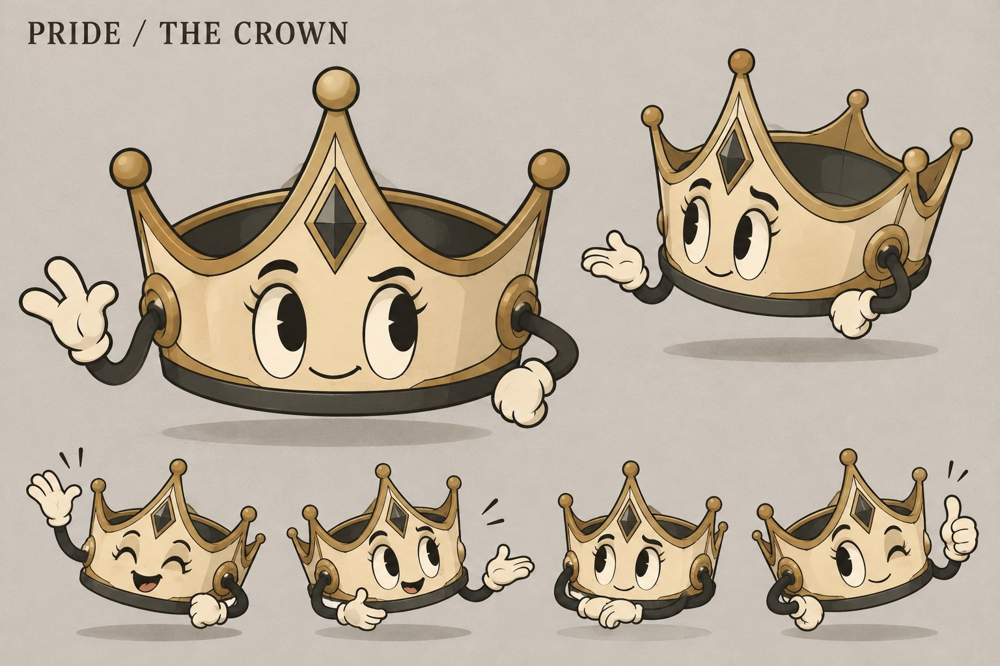
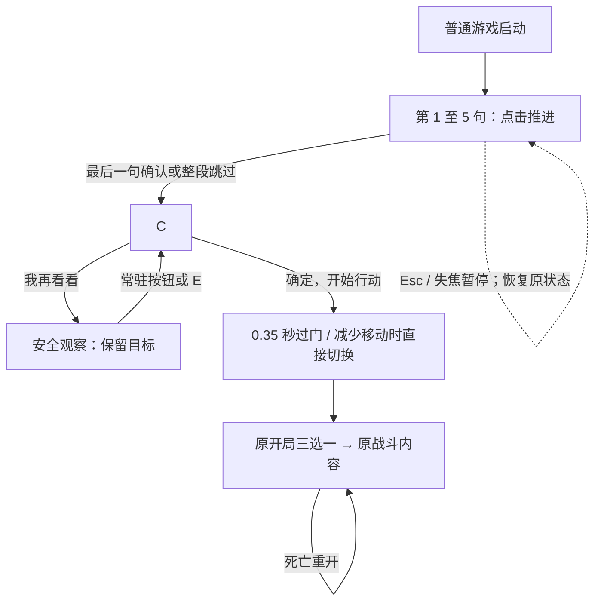

# 静滞之门：Pride 首次引导与玩家确认（历史归档）

> 对应 [Issue #45](https://github.com/kyrie21z/Battlefield-Rouge/issues/45)；设计与交互预演交付 v0.2 · 2026-11-01。
> 依据：[Sloth LDD](../SLOTH_LEVEL_DESIGN.md) §1、§2.1、§3、§6.2。
> 这是保留原稿的历史方案，已由 #147 一镜到底开场替代。用户最新纠偏明确取消眼睛、手与拟人表情，当前普通六尖皇冠见 `actors/crown/crown_model.gd` 和 [叙事基准](../../NARRATIVE_FOUNDATION.md)。下文的卡通眼/手套/逐句点击仅记录旧设计，不再作为实施要求。

## 1. 本段要让玩家知道什么

1. 这里陷入停滞；凝固建筑、断在半途的楼梯和停摆巨环构成同一种视觉语言。
2. Pride 是自己的皇冠与同伴。他真诚地帮助玩家，鼓励前进，允许玩家自行决定出发时间。
3. 本层目标是**消灭 Sloth**。第一步是穿过巨环下的入口，进入停滞广场。

开场不解释 Rest Fragment，不展示战后过度运转，也不提前揭露与 Pride 的终局冲突。

## 2. 演出方式与节奏

在现有游戏启动前采用 **Godot 实时灰模场景 + 场内卡通皇冠 + 逐句点击**。实时方案便于与 #46 对齐地标构图；无需先制作不可修改的长视频。

用户试玩认为初版固定 40 秒过长，因此本版取消强制播放时长。共五句，**每句立即完整显示，点击“下一句”、点击场景空白处、Enter 或空格即可推进**，不等待移动或表情结束。最后一句仍需一次确认，之后显示出发选择。右上角可跳过整段。连续快速推进不产生额外奖励或剧情变化。

参考阅读节奏约 12–20 秒，仅是设计估计，尚无独立计时盲测。玩家可更快点击，也可停留任意长时间。镜头与皇冠约 0.3–0.7 秒柔和到位，动画不是输入锁。

## 3. 分镜与正式预演对白

| 镜号 / 推进 | 画面与焦点 | Pride 台词 | 皇冠表演 | 音画提示 |
| --- | --- | --- | --- | --- |
| S01 / 第 1 句 | 冷白灰回廊，远处静止巨环；视角先与皇冠建立关系 | 我是 Pride，你头顶的皇冠。准备好向前了吗？ | 从头顶方向降入镜头中央，笑着挥手 | 一次轻短提示音；对白无正式配音 |
| S02 / 第 2 句 | 缓慢偏向悬停楼梯、错位块体和束缚线，巨环仍可辨认 | 看，连巨环都停住了。这里被 Sloth 困住了。 | 飞往左侧，摊掌示意建筑；视线仍回看玩家 | 不播放规律滴答，世界仍然停摆 |
| S03 / 第 3 句 | 镜头重新指向巨环及其下的入口 | 消灭 Sloth，让这里重新前进。 | 飞向右侧，带自信的鼓励表情、拇指手势 | 显示任务提示；目标内容与跳过路径一致 |
| S04 / 第 4 句 | 镜头降低到连续地面和门洞，明确下一步方向 | 入口就在巨环下面。我们马上就到。 | 飞到右上方，交替两个手绘挥手姿势 | 皇冠避开右上角控制按钮和字幕 |
| S05 / 第 5 句 | 保留入口构图，准备交还选择权 | 我会陪着你。什么时候出发，由你决定。 | 飞回左侧，手搭冠沿，安静等待 | 点“准备出发”后进入门前确认画面 |

本页是 #45/#48 历史预演记录。旧对白保存在 [dialogue-legacy.json](dialogue-legacy.json)，图集原件保存在 `assets/pride-atlas.png`；#147 已将运行开场替换为 `ui/cinematics/opening_sequence.tscn`，不再使用点击推进弹窗。

## 4. Pride 的形象与表演规范

**用户参考**：《洛基》分钟小姐的复古卡通表现力。借鉴眼神、眉毛、手套、弹性手臂与亲切的引导姿态；角色本体保持可佩戴皇冠，不引入钟面、刻度、鞋腿或原剧标识。

- **轮廓**：空心弧形冠环，正面三枚可见圆球冠尖，中央略高；中央深色菱形、深色下沿构成稳定识别点。
- **质感**：象牙白弧面、暖金包边、柔和块面阴影与手绘描边。新版采用手绘透明动作图集，替代早期扁平三角形占位头像。
- **表情**：欢迎、讲解、鼓励、等待。明亮、可靠、有一点自信；不做阴险笑、强迫玩家出发或嘲笑观察选择。
- **视线**：按用户最新反馈，所有主要表情的黑色瞳孔居中、直视玩家；鼓励眨眼时，睁开的眼睛仍看镜头。保留细长的复古瞳孔与原手绘质感，不改成发亮的现代 emoji 眼睛。
- **身体关系**：设定仍是头顶佩戴的皇冠。开场短暂飞入视野作拟人演示，确认出发后上升收回；不是场内人形 NPC。若团队不采用实际离头飞行，可把相同演出解释为皇冠的精神投影。
- **色彩语义**：皇冠的金色是哑光表面，不使用恢复光圈；不能与 Rest Zone 的琥珀色安全区域混淆。
- **动画资产**：六格透明 PNG；欢迎两帧构成挥手，另有讲解、鼓励、等待与思考姿态。当前为表情切换与飞行预演，不宣称已有逐音素口型或完整骨骼动画。
- **边界修复**：图集各格有透明边缘，绘制面另留 14% 余量；六格源图及 20 个实际绘制姿态均检查边界透明，避免用户指出的手掌、描边被截断。

生成方式和最终提示词见 [PROMPT.md](assets/PROMPT.md)。仅提交产物，不提交用户的剧集截图。

## 5. 场景与入口衔接

回廊由连续地面、深灰侧边和中线通向巨环门洞。白灰渐变根据高度与远近变化，辅以轻雾、方向阴影、不同高度的柱列、分层基座、未完成门架和浮空楼梯。近景轮廓较深，远景对比逐渐减弱；不加入写实废墟、军事道具或密集机械细节。

远景用于交代空间，不要求玩家在动画后再走一遍。结束或跳过均把镜头放到**门前约 3.5 米**；选择“确定，开始行动”后，默认 **0.35 秒**直接交接到现有游戏。开启减少移动则立即交接。

实际入口为 `ui/game_start.tscn`。演出发出单次 `combat_entry_requested`，GameStart 读取 `RunState.zone_scene()` 进入原 `maps/zone_1.tscn` 的开局三选一；之后继续原两小关和 Boss。不是进入独立预演的首关白模。#46 / #47 继续负责未来 Sloth 场景和敌人，本次不提前重做原战斗内容。

## 6. 玩家选择、跳过、暂停与重玩

| 情况 | 行为与结果 |
| --- | --- |
| 首次打开 | 普通启动自动播放第一句；无额外观看菜单 |
| 每句对白 | 下一句 / 空白处左键 / Enter / 空格立即推进；不设最短等待 |
| 最后一句确认 | 显示门前任务卡，不自动出发 |
| 确定，开始行动 | 单次交接到原开局三选一，选卡后进入原战斗 |
| 我再看看 | 在安全回廊自由观察，目标保留；不生成敌人或时间惩罚 |
| 观察后继续 | 常驻“准备好了，查看选择 [E]”，或按 E 返回确认；不会卡住 |
| 跳过 / 直接查看目标 | 直接到同一门前任务卡；仍显示目标与方向，等待玩家确认 |
| Esc / 窗口失焦 | 暂停对白、飞行、镜头、过门、音效及移动；恢复后延续原状态 |
| 暂停菜单 | 继续、静音、减少移动、从头重播 |
| 再次打开 | 每次应用启动都播放开场，仍可整段跳过 |
| 死亡重开 / fixture | 沿用原战区流程，直接开始，不重播开场 |

观察与出发仅决定启动时间，不改变属性、难度、结局或奖励。字幕默认开启，当前无需配音也可读懂。键盘可用 Tab 选择按钮、Enter 确认；触控和手柄未验证。

## 7. 验收证据与未完成项

已交付分镜、对白、交互流程、皇冠形象和可运行预演。流程与画面记录见 [证明材料](../../proof/pride-opening/README.md)。

发布前已对照此前 PR 的状态切换、素材登记、main 同步和证明体积问题复核，并修复重播镜头及过门残留；真实输入、信号和资源释放回归见 [审查记录](../../proof/pride-opening/REVIEW.md)。

- 已实测：逐句快速推进、整段跳过、门前目标、观察返回、暂停、重播、进入事件单次触发、手部边界及原游戏衔接。
- 待团队评审：台词与美术最终批准、真实离头飞行还是精神投影、正式配音与更多动画帧。
- 待真人盲测：请未读设计稿的人先体验，再问“要做什么？”“该往哪里走？”“Pride 给你什么印象？”先记录原话，不解释主题。未获得记录前，不把“首次观看者理解任务”勾为已验证。
- 已接入原 Battlefield-Rouge 游戏；新的 Sloth 关卡和敌人仍由 #46 / #47 制作。旧玩家、武器、HUD 与战斗保持现状。

## 8. 修订记录

- 2026-11-01 初版验证使用固定 40 秒、静态低保真头像和长回廊；用户试玩要求缩短、逐句点击、场内飞动、白灰渐变、修复手部边界并还原概念图。
- 本版按反馈改为五句点击、手绘动作图集、飞行挥手、门前选择与直接过门。历史仅记录设计变化；最终证明均为新版实测。

- 2026-11-01 仓库更正：本轮任务和代码归 Battlefield-Rouge；开场已在普通启动时自动播放，并接到原有游戏。
