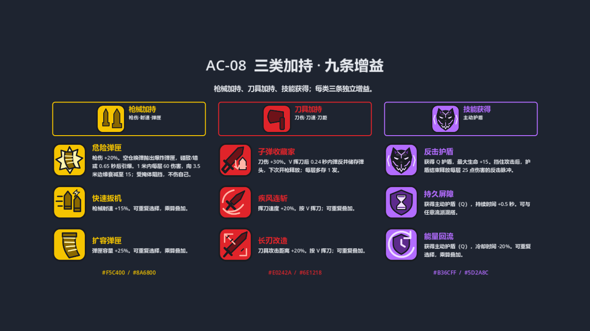
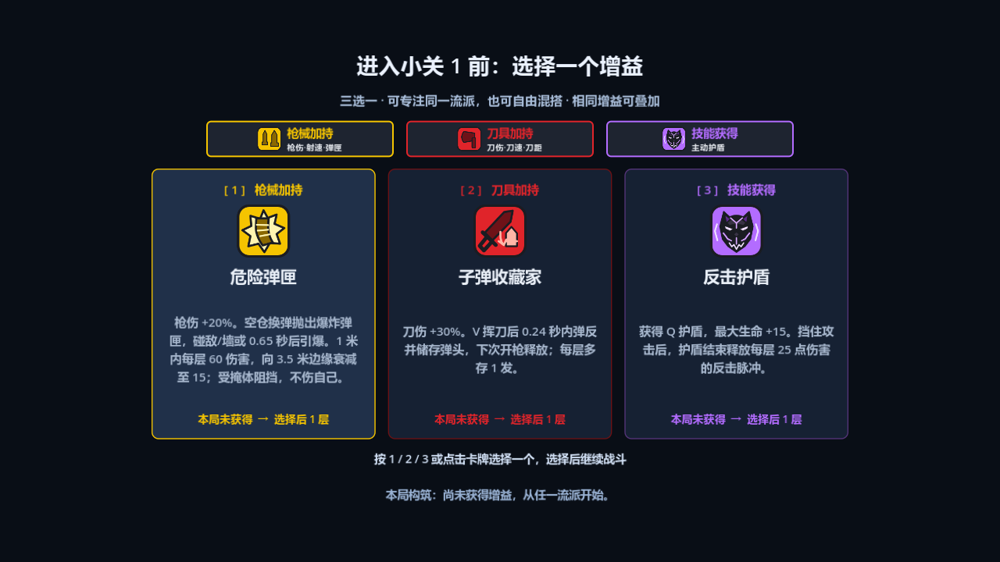
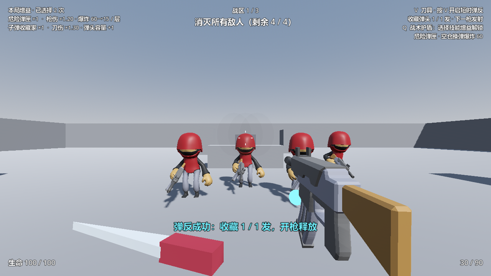
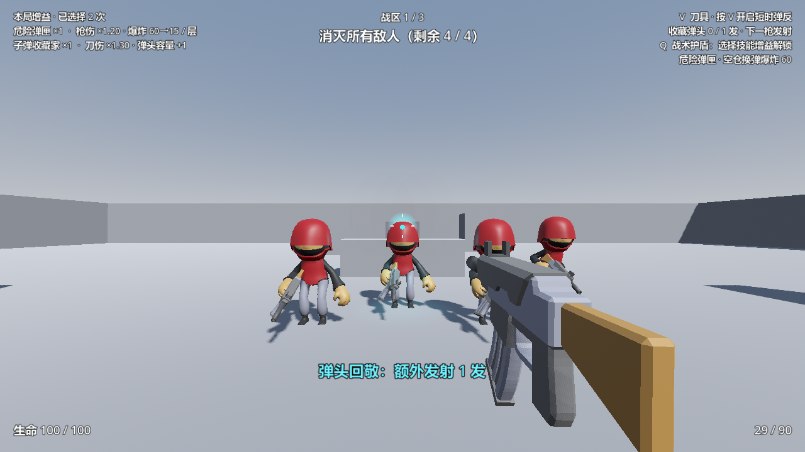
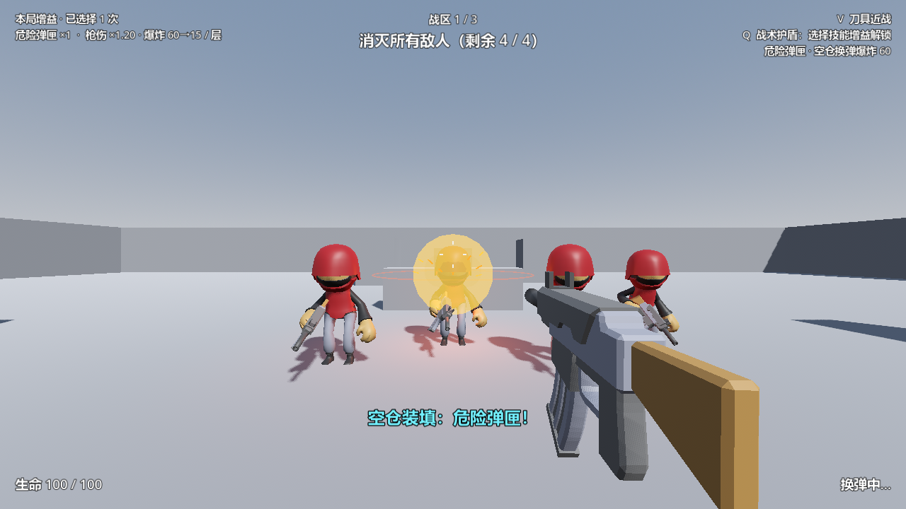
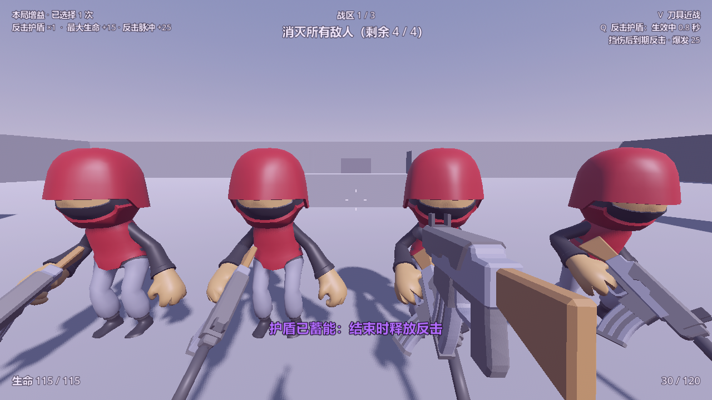
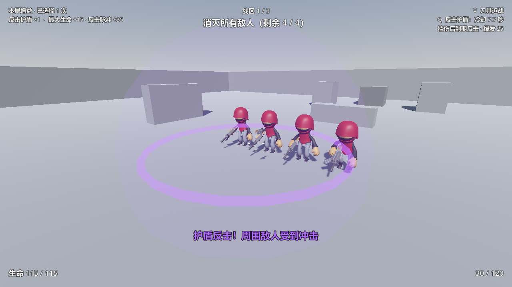

# AC-04 / AC-08：九增益集成证明

日期：2026-10-27。对应 [Issue #11](https://github.com/kyrie21z/Battlefield-Rouge/issues/11) 与 [Issue #15](https://github.com/kyrie21z/Battlefield-Rouge/issues/15)。

最初基线为团队 `main` 的 `70aa9d6`。解决与 #20 的冲突时，分支已变基到包含三枪三近战的 `main`。引擎为 Godot **4.7.2**。资源导入及原生画面使用原工程 **Forward+ / Jolt**，设备 NVIDIA RTX 4060 Laptop GPU。保留两张小关与原 `maps/boss.tscn`，没有用独立两关副本覆盖团队地图或 fixture。紫色护盾按键从 Q 改到 G，Q 继续切换近战。下面表格里的原生截图日志是改键之前保存的，其中「真实 Q」指当时的绑定；改键之后以 `input_map_setup.gd` 和 `buff_run_test` 的按键检查为准。

## AC-04：次数与时机

`tests/buff_run_test.tscn` 用真实按键/按钮选择、伤害、占点和场景切换验证混搭与枪械专精两局，均得到：

```text
["0:enter", "0:clear", "1:enter", "1:clear", "2:enter"]
```

两局都验证入场先暂停、选卡后增益即时生效、换关保留叠层、重复输入只选一次。Boss 入场有自己的选择，选完保留核心直接开放；Boss 与守卫仍活着时也能攻占核心获胜，胜利后没有第六次奖励。另测阵亡清空增益与选择历史、重开只出现一次入场选择。

| 时机 | 混搭流程截图 |
| --- | --- |
| 小关 1 前 | [mixed_01_entry.png](mixed_01_entry.png) |
| 小关 1 后 | [mixed_01_clear.png](mixed_01_clear.png) |
| 小关 2 前 | [mixed_02_entry.png](mixed_02_entry.png) |
| 小关 2 后 | [mixed_02_clear.png](mixed_02_clear.png) |
| Boss 前 | [mixed_03_entry.png](mixed_03_entry.png) |
| Boss 结束直接胜利 | [mixed_victory.png](mixed_victory.png) |

枪械专精对应 `firearm_*.png`。这些截图由验证脚本安排状态并使用真实 Godot 渲染保存，不冒充真人完整难度试玩或录屏。

## AC-08：每派三张与独特图标

九张 `.tres` 分属枪械、刀具、技能，每派三张。测试实际载入九张纹理并比较渲染像素哈希，全部不同；前三次发牌覆盖全部九张，卡片可继续重新出现并叠加。真实选择界面显示流派、图标、效果和当前/选择后层数。





## 本次原生引擎验证

以下各套覆盖可能重叠，不相加宣称更多独立玩法：

| 场景 | 结果 | 日志 |
| --- | --- | --- |
| `buff_run_test` | 258 项通过，0 失败 | [buff_run.log](buff_run.log) |
| 同一场景原生截图流程 | 272 项通过（含 12 次截图保存），0 失败 | [buff_native.log](buff_native.log) |
| `combat_traits_test` | 22 项通过，0 失败；含死亡清理 | [combat_traits.log](combat_traits.log) |
| `reload_blast_test` | 27 项通过，0 失败 | [reload_blast.log](reload_blast.log) |
| `reflected_round_test` | 6 项通过，0 失败；贴墙阻挡/无遮挡伤害/自身无伤 | [reflected_round.log](reflected_round.log) |
| `capture_hammer_test` | 39 项通过，0 失败 | [capture_hammer.log](capture_hammer.log) |
| `boss_test` | 50 项通过，0 失败 | [boss.log](boss.log) |
| `school_icons_test` | 34 项通过，0 失败 | [school_icons.log](school_icons.log) |
| `fixture_test --fixed-fps 60` | 23 项通过，0 失败 | [fixture.log](fixture.log) |
| `shield_purple_proof` | 11 项通过，0 失败；真实 Q、敌弹挡伤、一次 25 点反击 | [shield_native.log](shield_native.log) |
| `reload_blast_proof` | 7 项通过，0 失败；实际命中 4 个敌人并回收 | [blast_native.log](blast_native.log) |
| `school_icons_proof` | 原生九图标板与选择界面保存成功，0 失败 | [icons_native.log](icons_native.log) |
| `combat_traits_proof` | 11 项通过，0 失败；真实收藏弹/发射回敬弹画面 | [combat_native.log](combat_native.log) |

同起点回归：FX-001 两遍都胜利、3875 ticks、哈希 `faf979e483061388`；FX-002 两遍都胜利、1375 ticks、哈希 `9afe0ddb9ac0b983`。换种子后哈希均改变。哈希只用于同机器/引擎/固定步长比较，不作为跨机器常量。

最终导入没有脚本或资源导入错误。`capture_hammer_test`、`fixture_test` 在退出阶段仍有 ObjectDB 清理提示，保留原始诊断，不把它们写成零警告运行；其余本次新能力测试和原生截图日志没有错误或警告。

## 核心能力画面











## 复查命令

在项目根目录使用安装好的 Godot 4.7.2：

```text
godot --headless --path . --editor --import --quit
godot --headless --path . res://tests/buff_run_test.tscn
godot --headless --path . res://tests/combat_traits_test.tscn
godot --headless --path . res://tests/reload_blast_test.tscn
godot --headless --path . res://tests/reflected_round_test.tscn
godot --headless --path . res://tests/capture_hammer_test.tscn
godot --headless --path . res://tests/boss_test.tscn
godot --headless --path . res://tests/school_icons_test.tscn
godot --headless --fixed-fps 60 --path . res://tests/fixture_test.tscn
godot --path . res://tests/buff_run_test.tscn -- --proof=res://docs/proof/ac-04-ac-08
godot --path . res://tests/school_icons_proof.tscn
godot --path . res://tests/shield_purple_proof.tscn
godot --path . res://tests/reload_blast_proof.tscn
godot --path . res://tests/combat_traits_proof.tscn
```

效果数值仍是用户已有可调默认，详见 [当前九增益](../../Buff当前实现.md)。三把枪和三把近战已在本分支。未宣称完成手柄、低帧率手感、真人平衡试玩或未来候选卡。
