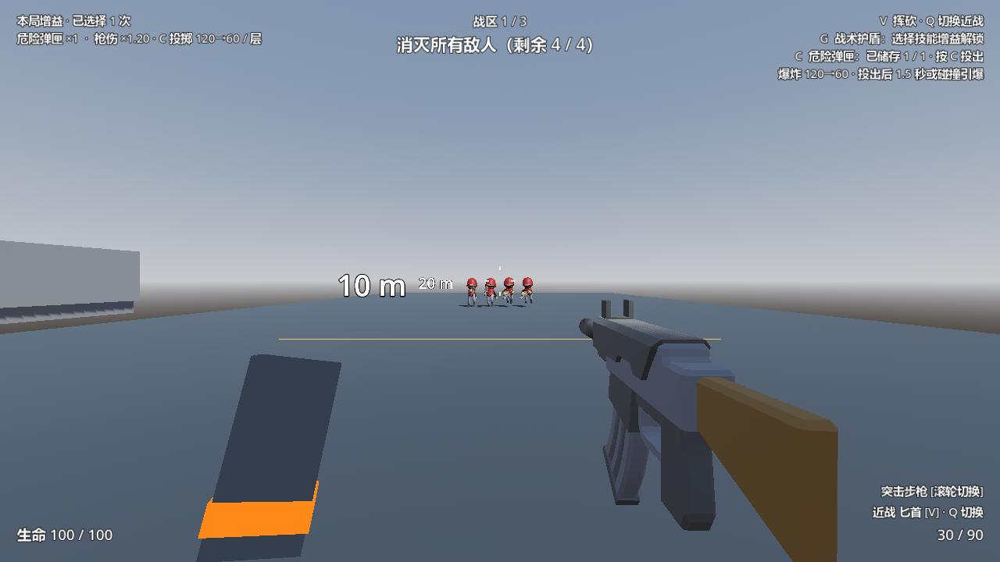
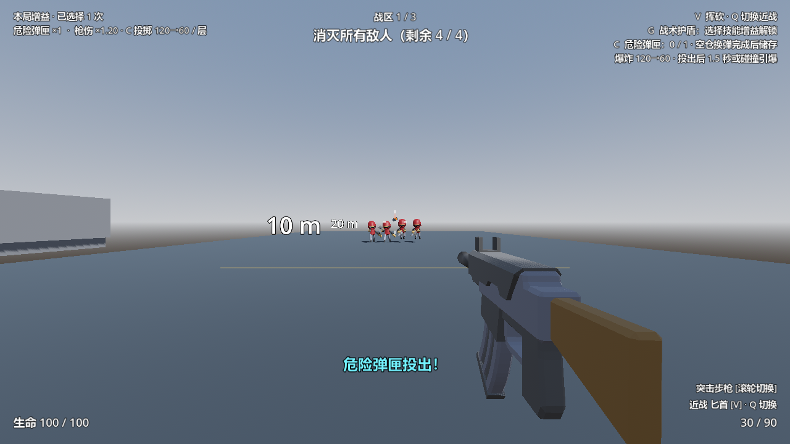
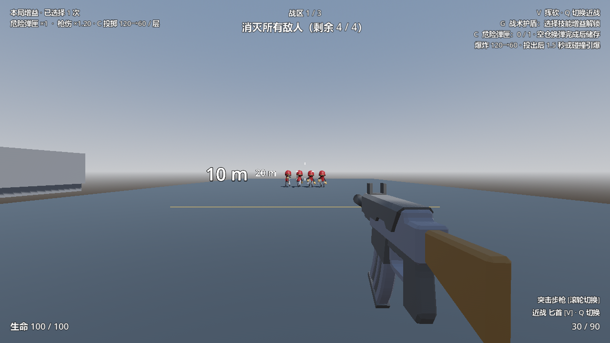
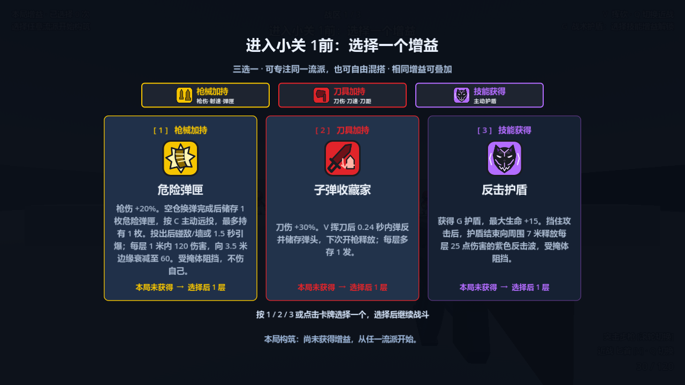
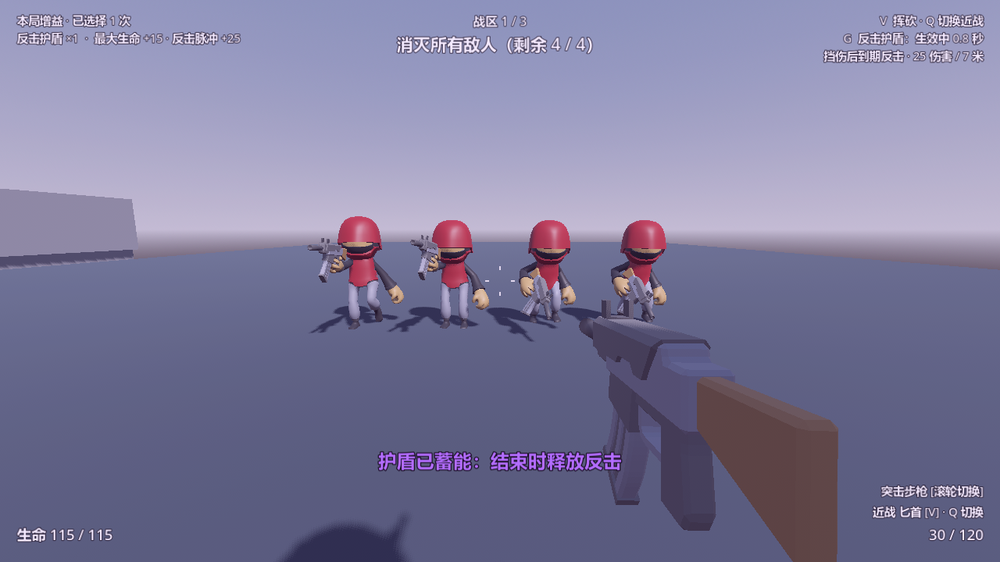
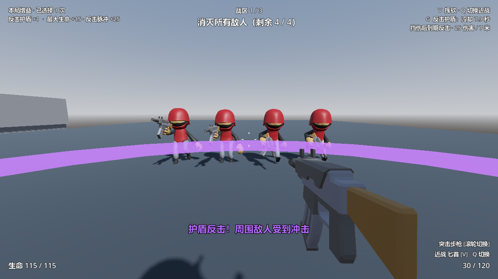
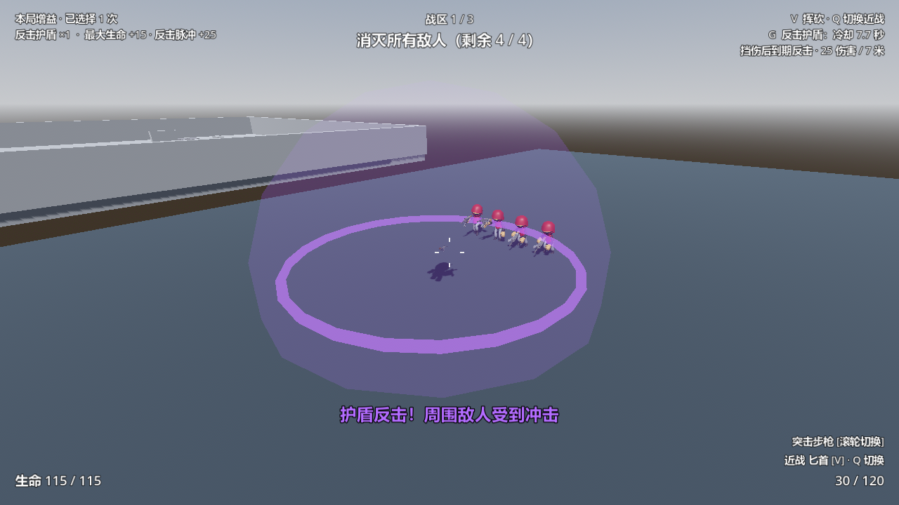

# 主动弹匣与扩大紫盾：2026-10-28 验证

基于 main `8462d108a2c851cea25fcab9beb4709b5cc4d25e`，Godot **4.7.2**。原生画面使用 Forward+ / Vulkan / RTX 4060 Laptop GPU。测试夹具使用真实 Player、Weapon、CombatTraits、Health 和投射物；为展示距离，把真实敌人移到地图外的平地并停住 AI，10/20 米标线只存在于证明脚本，没有修改正式地图。

## 当前结果

- 12 个 headless 测试场景全部通过、退出码 0：active_magazine、combat_traits、reload_blast、buff_run、capture_hammer、boss、reinforcement、reflected_round、school_icons、melee、weapons、fixture。
- `active_magazine_test`：36 项通过；原生同场景额外验证物理 C 键和释放鼠标边界，共 39 项。持有超过引信时长没有自爆；取消换弹不能得到弹匣；切枪保留已储存库存；暂停拒绝消耗；死亡清理；投出取当前叠层伤害。平地平视碰地距离 **24.15 米**。
- `reload_blast_test`：29 项通过，包括 120/90/60 距离衰减、墙体、同队、去重、近墙出生与碰撞/引信一次性爆炸。
- `reload_blast_proof`：12 项通过。真实完成空仓换弹，持有超过 1.5 秒后注入物理 C，实际落点 **24.50 米**，命中约 23 米处 **4 个真实敌人**，至少一个损失 ≥60 生命。
- `shield_purple_proof`：11 项通过。G 激活、真实敌方弹丸被吸收，6 米处敌人只受到一次 25 BODY 伤害。另有自动检查覆盖 7 米边界、7 米外和墙后不受伤。
- `buff_run_test` 保留完整两小关到 Boss、三次选卡、死亡重开的实际场景流程。一局选卡仍为 `0:enter / 0:clear / 1:clear`。
- `fixture` 固定 60 步：FX-001 两次胜利均 2643 ticks，哈希 `80db1126b6bac259`；FX-002 两次阵亡均 355 ticks，哈希 `5e1a5a995f643d72`。更换 seed 的哈希分别为 `a90f8ea04f6ca586` / `b3c5bae9db59952a`。FX-001 与基线不同，因为不再自动丢爆炸弹匣，机器人没有操作 C；同版本重复结果一致。

## 画面










## 运行

在项目根目录运行（路径含空格时加引号）：

```text
Godot_v4.7.2-stable_win64_console.exe --headless --path . res://tests/active_magazine_test.tscn
Godot_v4.7.2-stable_win64_console.exe --headless --path . res://tests/reload_blast_test.tscn
Godot_v4.7.2-stable_win64_console.exe --headless --fixed-fps 60 --max-fps 240 --path . res://tests/fixture_test.tscn
Godot_v4.7.2-stable_win64_console.exe --max-fps 60 --path . res://tests/active_magazine_test.tscn
Godot_v4.7.2-stable_win64_console.exe --max-fps 60 --path . res://tests/reload_blast_proof.tscn
Godot_v4.7.2-stable_win64_console.exe --max-fps 60 --path . res://tests/shield_purple_proof.tscn
```

## 审查与限制

独立静态审查已覆盖真实换弹/切枪信号时序、候选状态、信号重入、暂停、死亡、镜内显示及遮挡，未发现未解决的 P1/P2。审查期间已采用“完成换弹才发放”防止取消换弹刷爆炸物；原生证明脚本的按键注入改在 process_frame 后，避免在 frame_post_draw 后注入丢失单帧输入。

本次三个能力行为/爆炸 headless 测试、三个原生检查及最终导入没有脚本错误或退出诊断。部分原有 headless 测试在退出时仍有 ObjectDB/resource 清理诊断；同一 main 原始源码在相同引擎上可复现，原始对照日志一并保留，不能把这些日志说成完全无警告。无上限固定步 fixture 压力运行曾出现 Jolt 作业队列警告；补查命令添加 `--max-fps 240` 后未再出现且哈希一致，采用该补查日志。

数值是用户反馈后的试玩默认，未完成人工难度平衡、手柄、低帧率及导出平台检查。手持库存是场景临时状态，换关销毁；不写入 RunState。旧 AC-04/AC-08 证明保留原版本事实，不据此覆盖历史记录。
