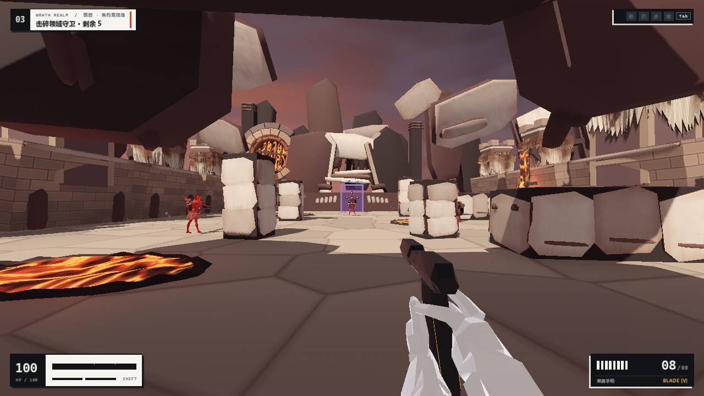
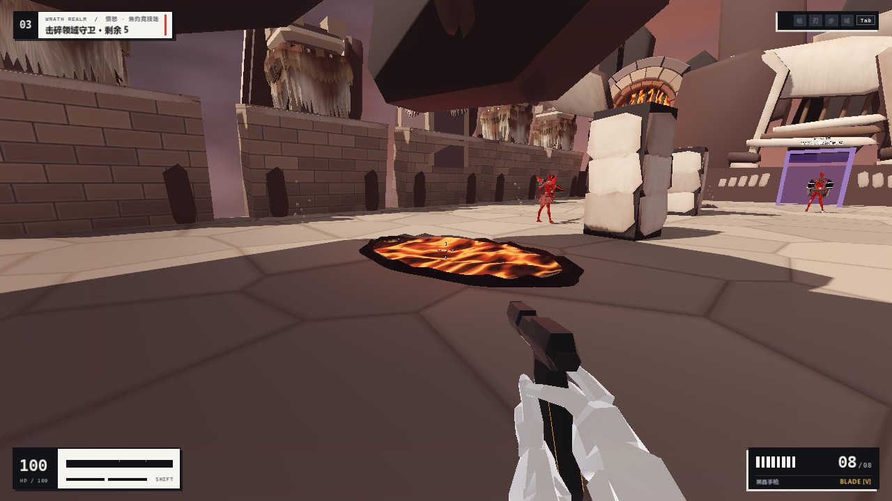
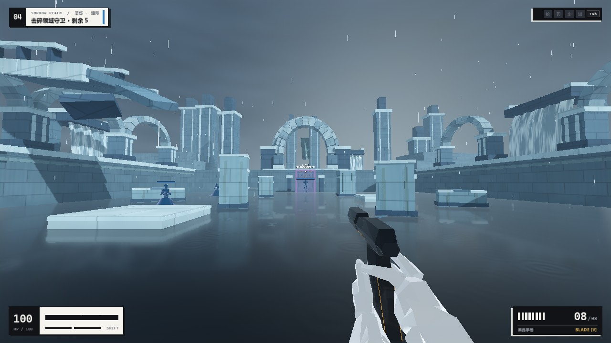

# 愤怒与悲伤前两关 · 战场地形细节

在主线 `b123541` 上，为愤怒「裂瓷熔窑」和悲伤「沉没回廊」的第一、第二关增加地表细节。两边都保留中央直路、可绕行的外侧与原有 40×48 米战斗区。

愤怒每关有三处发亮的熔岩坑，以及四根错落的裂瓷石柱。玩家触地踩入亮面即受 12 点伤害，持续停留每 0.65 秒再受一次。常规护盾和无敌判定有效，暗色坑缘安全，熔岩冷却后可通过。石柱加入了实际遮挡和寻路障碍。

悲伤每关有四根半沉湿石柱和两段低矮残墙。掩体能挡射线，水面能反射新的石材与轮廓，中央和侧路仍可通到出口。

| 愤怒战场 | 熔岩坑近景 | 悲伤战场 |
| --- | --- | --- |
|  |  |  |

Godot 4.7.2 Forward+ 原生检查覆盖两关的中央和外侧路线、掩体射线、岩浆伤害与冷却、悲伤水面反射、清场领卡和按 F 过门。另跑完整战役、愤怒守卫和悲伤涉水回归。截图使用游戏相机，守卫位置固定以便看清地形。低规格显卡上的帧率及活动敌人同时交战时的体感留待实际游玩。

[愤怒实机日志](wrath-native.log) · [悲伤实机日志](sorrow-native.log) · [回归日志](regression.log)
