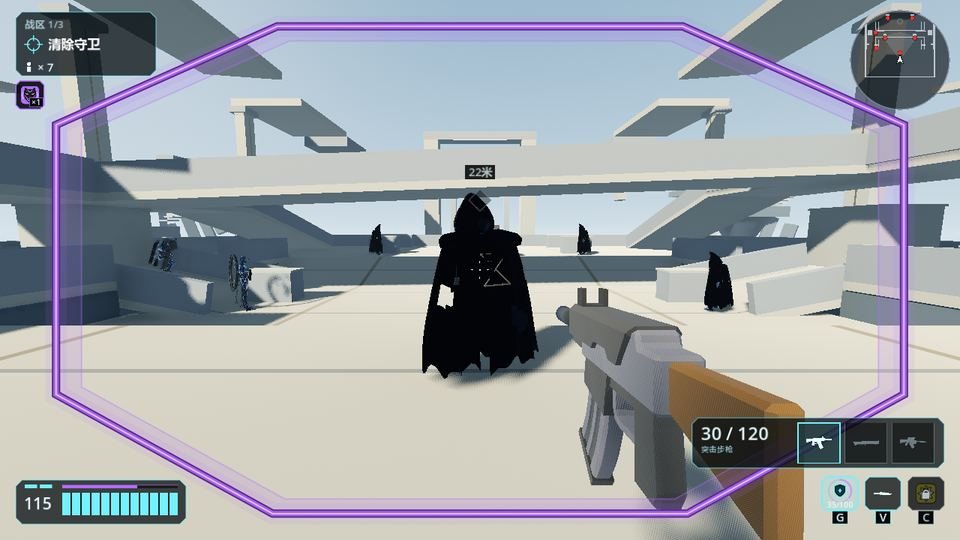
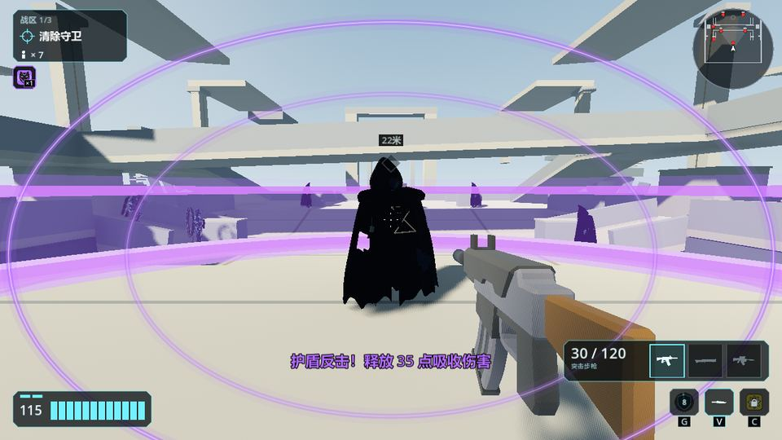
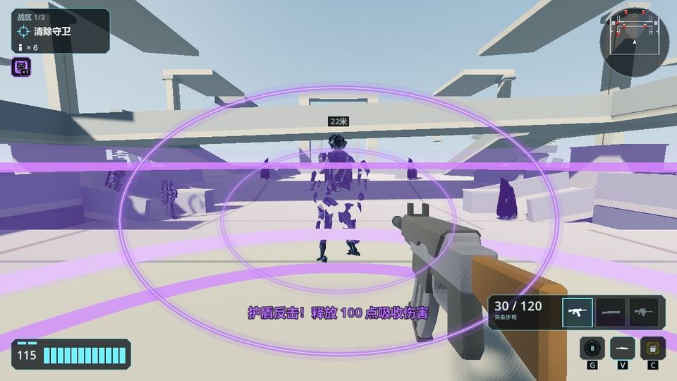
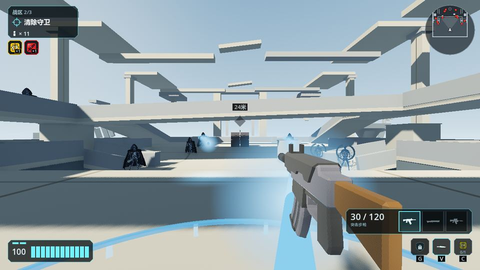

# 持续反击盾与主动敌群 · 2026-11-08

> 历史波次口径：本目录记录`8a6fa90`时的7/11/11开场小怪、每批2/最多5增援及对应哈希。用户后续微调为5/9/9、每批4/最多8，盾与主动性机制保持；当前数量/流程证据见[波次微调](../wave-tuning/README.md)。本目录原生盾证明与旧波次数值分别保留。

按用户试玩反馈继续更新草稿PR #98：反击盾从限时消失改为持续蓄伤，开场敌人数约乘1.8，敌人主动接近与进攻。紧凑战场和宏大外围保留，main尚未合并。历史缩图取证见[旧目录](../sloth-compact/README.md)。

## 怎么玩

选到“反击护盾”后，**G开盾**，盾会一直保留，默认能吸收**100点**伤害；蓄满自动向周围7米反击。未满时**再按G**可提前释放，反击伤害=实际吸收量×反击卡层数。空盾可收起但不造成伤害；释放后冷却8秒，冷却结束再G开启。

例如一层卡吸收35点后手动反击35，满100反击100。破盾一击超过剩余容量的部分正常扣血；致命溢出不死后反击。冲刺、弹反、外部无敌和友伤不充能；墙体挡反击，无自伤/友伤。反击卡仍+15最大生命。持久屏障保留普通盾+0.5秒，并给反击盾容量+25；能量回流仍降低冷却。未选反击卡的普通技能盾仍是基础2秒/8秒模式。

紫色盾缘一直显示到释放，G槽读数为**已吸收/容量**，进度弧表示蓄能；生命上方紫条表示剩余容量，释放后切到冷却显示。

三关开场小怪 **7 / 11 / 11**（原4/6/6乘1.8后四舍五入），Boss本体仍1，增援仍10秒2只/最多5只。敌人在正式开战后主动找玩家，锚定者会绕掩体追近；具备实际视线/射程即可及时施法，保留3.5米射位间距。跑速迟滞/锚定/退缩2.8/2.1/2.4m/s，开场0.25–0.70秒错峰；锚定/退缩施法周期4.4/3.6秒。四连弹2秒预警、最后0.45秒锁向、1秒恢复及伤害不改。

## 本轮验证

- 全部**38个测试场景组**通过，逐组摘要与最新日志SHA-256见[validation-results.json](validation-results.json)。包括反击盾28、HUD295、Sloth四组128、布局55、Boss63、增援63、射击位18、追击12，以及武器/近战/弹反/冲刺/受击/选卡/开场/设置/音效等回归。
- [盾机制28项](counter-shield.log)：持续5分钟、35手动/100自动、130来袭只扣溢出30、容量/层数、暂停、友伤/其他保护、空盾/取消、重入与嵌套伤害。110伤/5HP并在吸收回调嵌套1伤时，无死后反击；非致命嵌套恰1次反击。
- [原生真实G盾证明26项](shield-native.log)：真实选反击卡、物理G输入与实际敌弹；35点吸收超过旧2秒仍有盾和HUD，G手动实际反击35；经过正常8秒冷却后40+60蓄满100自动反击并击杀近敌。[报告](shield-report.json)包含实际值与渲染器。
- 整局[headless142项](integration-headless.log)、[Forward+原生155项](integration-native.log)通过：正常入口、三次选卡、据点/增援/插旗/增益台、Boss核心、胜负与重开，目标路程仍22/24米。
- [主动性观察](pressure-report.json)：每关观察3.5秒，不强制alert/begin_hunt/cast、不替换目标；7/7、11/11、11/11均实际移动或施法，施法演员6/6/7名。字段first_observed_cast_seconds是进入观察后首次发现warning，后两关进入观察时已在战斗，不能当作从战斗开始到首次出手的延迟。
- [追击实证](pursuit.log)：锚定者面对满高掩体先不施法，走4.56米绕开，2.47秒取得真实视线后才施法；保留墙体遮挡和射位间距断言。[布局](layout.log)检查真实胶囊无重叠、同层导航和掩体；[增援](reinforcement.log)7/8达到有效可视射位，jitter=0。

固定种子6次均胜利，同seed两遍一致、换seed不同；未改机器人或fixture来降低难度。[日志](fixture.log)：

| 起点 | seed | 结果/ticks | 哈希 |
| --- | --- | --- | --- |
| FX-001（两遍） | 1001 | 胜利/2221 | `cc0c03a32a05ea36` |
| FX-001 | 1002 | 胜利/2160 | `7c76ef8211581c3a` |
| FX-002（两遍） | 2002 | 胜利/810 | `035128f84c356ca9` |
| FX-002 | 2003 | 胜利/800 | `dbeb49a761341ce0` |

测试隔离调整：界面横幅走查保护测试角色，避免新敌群真实击杀中止界面观察；武器/近战/锤击/冲刺测试在释放场景后排空音频队列，避免快速退出时worker引用未释放；短寿命弹道几何在已知模拟时刻采样，生命周期仍通过真实帧检查。游戏速度、AI、盾阈值与反击时序没有为测试而放宽。

## 原生画面









前3张为真实zone_1、真实选卡/G/敌弹的定点证明：冻结其它AI、将一名实际Sloth敌人放在前方4米，盾计时/伤害不改。第4张为真实开场敌群观察，测试角色受保护以记录进攻。均为Godot4.7.2 Windows Forward+原生PNG，仅缩放/JPEG重编码；源码/地图/图像[SHA256SUMS](SHA256SUMS.txt)按Git LF/二进制字节校验。

复现：

```text
godot --headless --path . res://tests/counter_shield_test.tscn
godot --headless --path . res://tests/sloth_pursuit_test.tscn
godot --headless --path . res://tests/sloth_integration_test.tscn
godot --path . res://tests/counter_pressure_proof.tscn -- --out=res://artifacts/counter-pressure-native
godot --headless --fixed-fps 60 --path . res://tests/fixture_test.tscn
```

本机仅保留既有root certificate store宿主启动诊断（空工程亦复现）；最终无游戏脚本、导航、多边形或ObjectDB退出泄漏。未重新测帧时或跨平台，不使用旧低密度样本保证当前性能；更高密度和持续盾仍待真人平衡。完整巨像、休憩和战后叙事后续制作。
