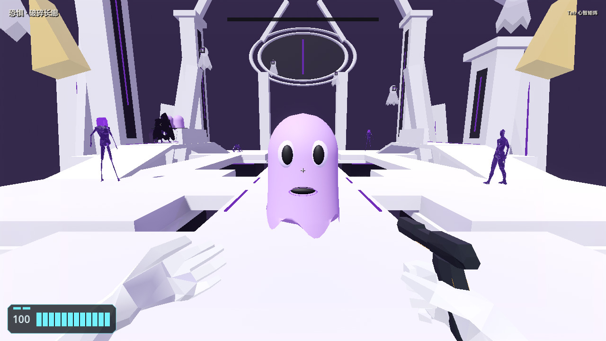
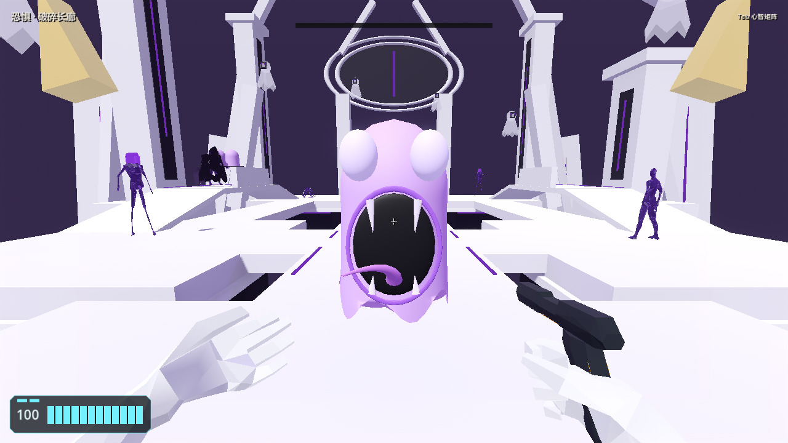
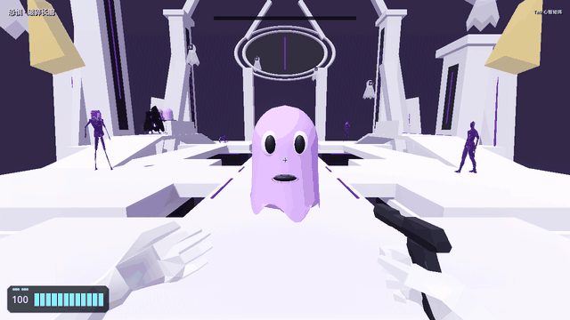
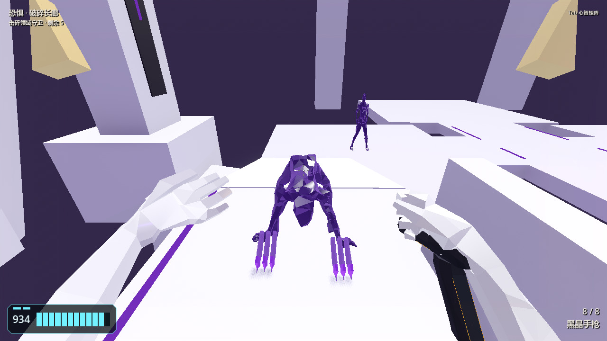

# 幽魂变形与爬行怪坡道：原生取证

2026-11-16，Issue #216。基线main `5ac99af`，包含已合并的引魂者、圣殿和轻柔水声。[当前设计与数值](../../enemies/FEAR_MORPH_CRAWLER.md)。

## 同视角模型与动画

Godot4.7.2 / Vulkan Forward+ / RTX4060 Laptop GPU / 1280×720，真实玩家相机和正式第二恐惧房间。测试将同一只追魂放到镜头前，并逐步推进原生变形参数，清楚对照嘴、牙根、眼球和舌头。

| 平时 | 张嘴扑击形态 |
| --- | --- |
|  |  |



GIF来自以55ms动画步进采集的11张同视角原生帧，缩至640×360并往返播放以便观察；实际游戏在前摇中张嘴，扑击后消散。JPEG仅由原生PNG编码，无重绘、生成式替换或参考图纹理。



## 验证结果

- 专用原生33项通过，含15次取图（11帧及4个场景）：连续变形、牙根固定与牙尖朝内、上半张脸实际射线命中、暂停/冻结停止动画；左右两台前后4个坡口均实际爬上并伤害玩家，能反向下坡，并多次连续进攻。
- 13组相关无界面445项通过：本轮18、引魂者27、恐惧场景37、恐惧领域32、审判之瞳29、恐惧音频24、恐惧通关30、Stage27、Boss Stage20、全战役98、编排54、反馈37、悲伤音频集成12。最终日志无脚本、导航或退出诊断。
- `crawler-before.log` 为修复前正式第二房的复现：480帧期间停在坡口，玩家1000HP保持；当前真实坡道与攻击结果见专用日志。`crawler-probe.gd.txt` 保存该复现代码（配一个挂载此脚本的Node场景运行）。
- 固定60Hz两侧fixture均通过，FX-001/FX-002仍为 `18f02a294f3e538a` / `ad3703cd93d3073e`。基线工作区 `cde6734` 与main `5ac99af` 完整源码树同为 `7d372e63c875483c65238d1986f5097e21ea6736`。
- 地图生成器重建无地图差异。本轮没有扩大场地或修改斜坡几何。

编辑器导入退出0，保留本机既有 `Safe save failed` 宿主诊断，不将导入声称为无报错；未改系统安全保存设置。跨设备性能和真人观感仍待反馈，不据本机测试承诺帧率。

```sh
godot --path . res://tests/fear_morph_crawler_test.tscn -- --out=morph-proof
godot --headless --path . res://tests/fear_morph_crawler_test.tscn
godot --headless --fixed-fps 60 --path . res://tests/fixture_test.tscn
```

源码、图片、动图和最终日志按Git LF/二进制字节的SHA-256记录于 `validation.json`。原始PNG保留本地忽略目录。新增3D模型与材质为项目原创，用户参考图没有入库。
