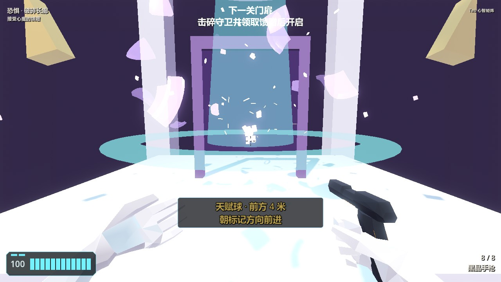
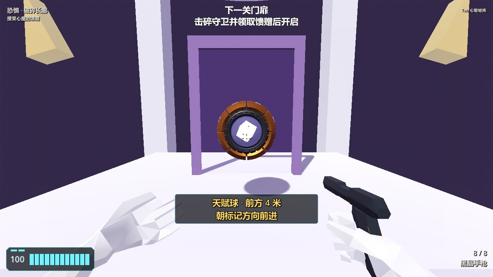

# 最新天赋球基础上的恐惧优化（2026-11-16，#222）

用户要求先更新天赋球PR再继续恐惧优化，并展示本地main落后远端的状态。本次从最新main `0a1a6ffe1c39215656d36705853206a4be265e9e`开发：它已经包含#218恐惧优化，以及#221在撤回#215后完整重新接入的天赋球与回归修订。

用户实际使用的`Battlefield-Rouge`主工作区已安全快进到该版本；更新前后的5个未跟踪文档导入设置哈希完全相同。实现继续走新分支和正式待审PR，不向main直接写提交。

## 修复内容

- 恐惧两普通房进房时实例化同一颗备用球，准备完整散片与独立发光材质；关闭逻辑和WORLD命中层，不暴露为`talent_orb`、不显示领取提示。用4帧1%大小绘制准备透明/不透明管线后隐藏，实际清场才恢复正常大小、碰撞与完整拼合演出。其他领域和旧BuffPedestal沿用原路径。
- #221接回整份RealmStage时遗漏了#219的馈赠预读取。基准延伸到实际领取后发现第一次按F仍会花约四分之一秒读取定义。补回恐惧进房预读取，抽卡资格、所有权、重抽和RNG仍在原时机计算。
- 基准现在把最后击杀/出球、完整拼合、领取后选卡分开记录，避免把世界拾取误称为自动弹卡。

没有改球体模型、碰撞半径0.52米、领取距离2.8米、门前定位、幽魂/爬行怪数值、随机领域、30HP坠落或轻柔水声。球在清场时按当时玩家/门位置定位；提前清场可安全结束预热，未领球退出也会释放全部节点。

实机加载的原GLB壳体为**102个MeshInstance**，原公式的演出时长为**4.34秒**；上游说明中的113/4.56与当前实际资源不符。两份原GLB的Git对象和SHA256保持不变，测试核对全部102块仍回到原始姿态，没有通过减少碎片加速。

## 帧时与限制

Godot4.7.2 / Vulkan Forward+ / RTX4060 Laptop GPU / 1280×720，无限帧率、关闭VSync，固定玩家/敌人AI，真实生产房间和效果。普通事件24渲染帧、击杀40帧；完整拼合额外采样`assembly_seconds()+1.3`秒。采样中没有截图或GPU图像回读。

| 场景 | 最长帧ms | 说明 |
| --- | ---: | --- |
| 最新main第一次出球 | 916.290 | 首次接触这些新模型/材质；未作成对驱动冷缓存对照 |
| 最新main后续进程出球探针 | 32.119 | 同步创建16.765ms，其中出场特效9.117ms |
| 优化后同一探针 | 11.508 | 同步出球9.126ms，特效8.742ms；临时建模部分移至加载 |
| 最终两次独立进程出球 | 10.819 / 10.646 | 完整新领球基准 |
| 最终两次首次召唤 | 1.922 / 1.830 | 继续保留上一轮召唤准备 |
| 最终两次完整拼合窗口 | 4.793 / 20.782 | p95为3.888 / 4.391ms，第二次存在单帧尖峰，不隐去 |
| 仅预建球、尚未补回目录时的首次领取 | 264.053 / 275.136 | CPU243.450 / 256.159ms，暴露目录读取回归 |
| 补回目录后的首次领取 | 45.723 / 44.283 | CPU25.796 / 25.509ms，仍有UI构建开销 |

不能将916→约11ms当成所有设备的驱动冷缓存收益：第一次运行也会准备持久缓存，此次没有清空驱动缓存重做前后对照。能稳定对照的后续进程出球由约32→约11ms；冷资源准备前移到加载，以增加备用节点/材质常驻为代价。选卡UI仍有约44–46ms开销，拼合采样也记录到20.782ms单帧尖峰，不能承诺彻底无卡顿。

`before-first`、`before-probe`、`after-probe`为出球隔离测量；`without-catalog-1/2`与`final-1/2`包含完整动画和领取。隔离探针只在`.runtime`覆写两个方法添加壁钟计时，代码以文本保存，不进入产品逻辑。

## 验证

- 15组相关回归通过：领球流程、四领域天赋球68项、幽魂/碎片、引魂者、变形/爬坡、恐惧三房通关、普通房/Boss、全战役、选卡、愤怒音频40项、HUD282项、增援77项、旧流程与占点。恢复目录预读取后，领球/幽魂/选卡/全战役4组再次通过；最终领球26项。
- 最终原生领球28项通过（含2张截图）：备用隔离、暂停、真实最后击杀、完整102片姿态、核心点亮、实际F事件、重复F防重、碰撞关闭、真实选卡开门、一次过门请求、提前清场与中途离场清理。
- 固定60Hz两个fixture通过，FX-001/FX-002保持`18f02a294f3e538a` / `ad3703cd93d3073e`，见`fixture.log`。导入退出0但仍有本机既存`Safe save failed`宿主诊断，原日志保留；最终功能/帧时日志无新增脚本、导航或退出诊断。





复现：

```powershell
godot --headless --path . res://tests/fear_orb_flow_test.tscn
godot --path . --resolution 1280x720 res://tests/fear_orb_flow_test.tscn -- --out=res://.runtime/orb-proof
godot --path . --resolution 1280x720 res://tests/fear_hitches_bench.tscn -- --out=res://.runtime/orb-frames.json
```
