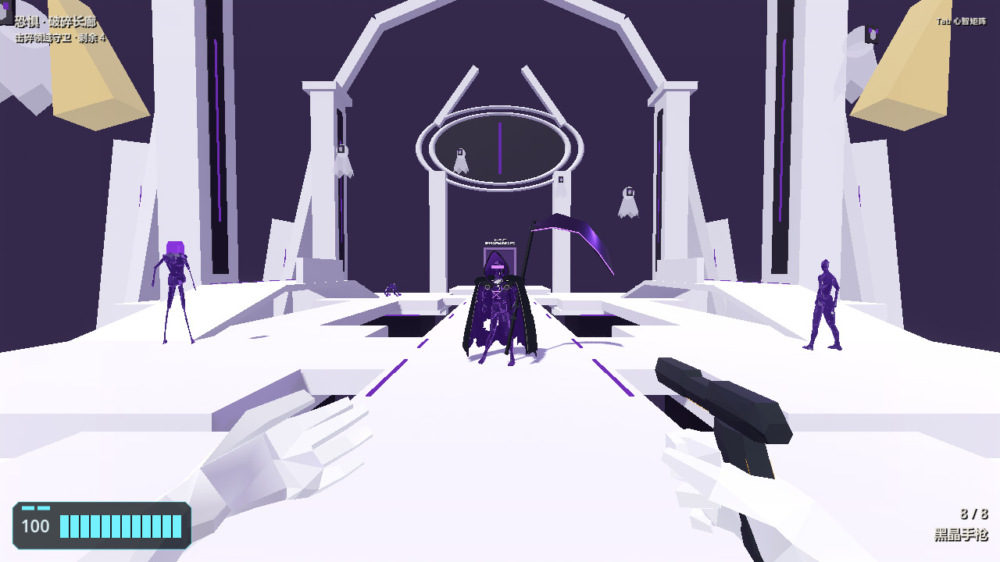
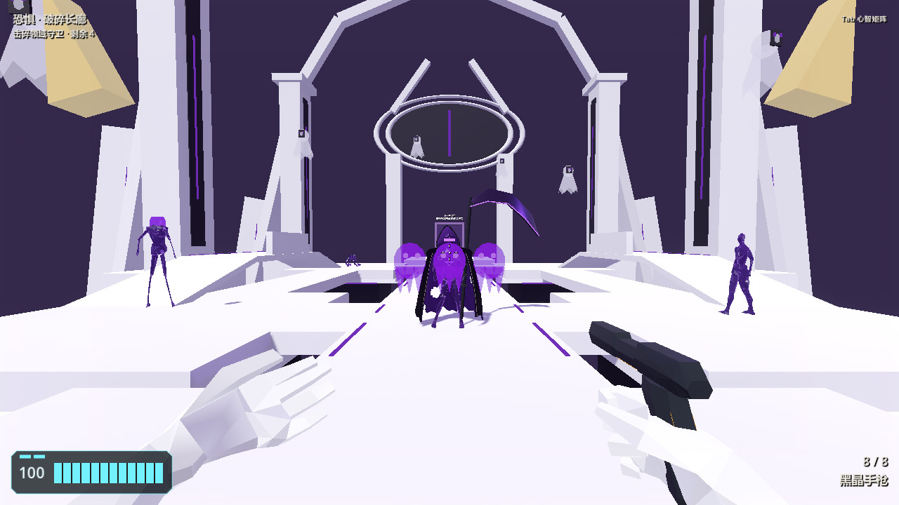
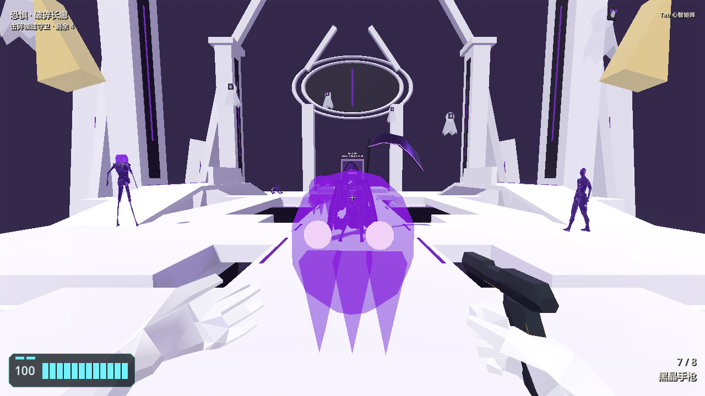

# 引魂者与紫色追魂：原生验证

2026-11-15，Issue #213，基于最新main `a5cb545`（已包含白色圣殿、高空幽魂及轻柔水声）。具体行为和试玩数值见 [敌人说明](../../enemies/FEAR_REAPER.md)。

## 实机

Godot 4.7.2 / Vulkan Forward+ / RTX 4060 Laptop GPU / 1280×720。使用正式恐惧房间、真实玩家相机和实际敌人，测试将引魂者移到中央以展示技能。三张原生PNG仅编码为JPEG，无重绘。

| 镰刀斗篷与召唤前摇 | 三只紫色追魂 |
| --- | --- |
|  |  |



## 已验证

- 专用原生测试30项通过：正式两房4/5名敌人、实际召唤前摇、3只存活上限、真枪击杀、飞越深渊、近身预警、单次8HP伤害、真实横向行走躲避、WORLD掩体挡伤、0.9秒挥镰前摇与16HP近击、主人死亡/换房/超时清理、难度和预警剥夺。含3张截图。
- 正式恐惧流程原生37项通过：三房清敌、选卡/拾Boss碎片、沿桥行走、按F过门并进入下一领域；30HP坠落恢复与死亡重开。
- 13组无界面检查450项通过：引魂者27、场景37、恐惧领域32、审判之瞳29、恐惧音频24、恐惧流程30、Stage27、Boss Stage20、完整战役98、编排54、反馈37、悲伤音频集成12、局外战役23。完整输出保留在 `regression/`。
- AC-07两侧均以固定60Hz完成，FX-001 / FX-002哈希均为 `18f02a294f3e538a` / `ad3703cd93d3073e`。基线使用已发布的 `fa7187a` 工作区，其完整源码树与main `a5cb545` 都为 `1b28a41265d07525cb9b70a0f18a4c23d0302602`，见两份fixture日志。
- 重新运行地图生成器后无地图改动。已有侧台通行检查保留，第二房引魂者站在外侧，坡道中间可直接走通。

最终原生和13组相关回归日志没有脚本、导航或退出诊断。编辑器导入退出0，仍出现本机已有的 `Safe save failed` 宿主诊断，未将导入声称为无报错。未修改系统安全保存设置。

自动化行走与画面测试屏蔽真实桌面鼠标对测试玩家的视角干扰；仍使用真实Player移动与实际F交互，生产输入保持。临时追魂不计入清场和普通击杀收益；主人的死亡负责立即清除它们，避免出口或收益依赖残留召唤物。

```sh
godot --headless --path . --editor --import
godot --path . res://tests/fear_reaper_test.tscn -- --out=reaper-proof
godot --path . res://tests/fear_playtest_test.tscn -- --out=flow-proof
godot --headless --fixed-fps 60 --path . res://tests/fixture_test.tscn
```

源码、图片和日志的SHA-256及字节数见 `validation.json`；文本使用Git LF，日志仅移除终端色码及行末空白。没有新增第三方模型或音频。当前为可调试玩平衡；其他平台、低端设备和真人难度反馈待收集，未据本机原生检查承诺跨设备帧率。
