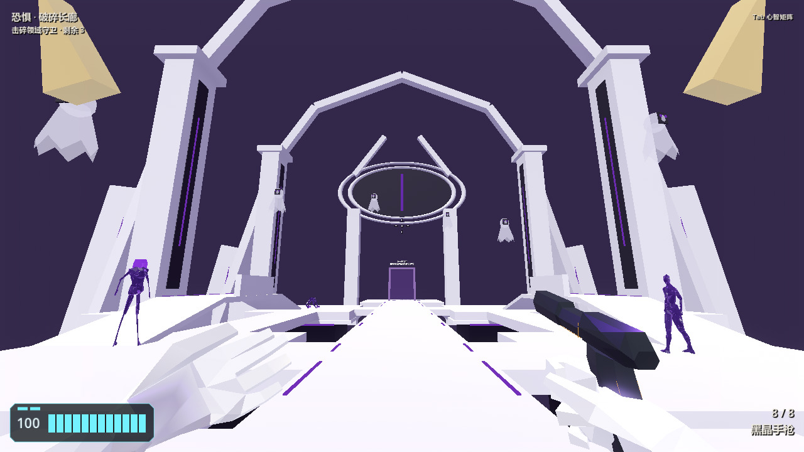
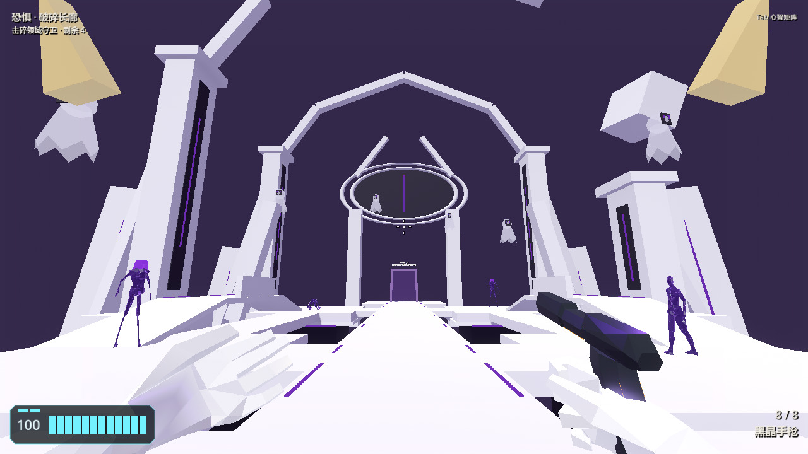
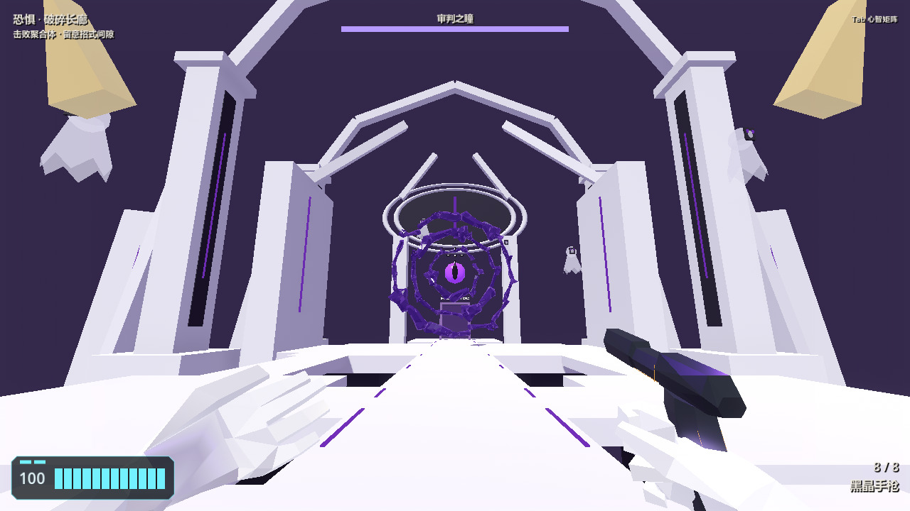
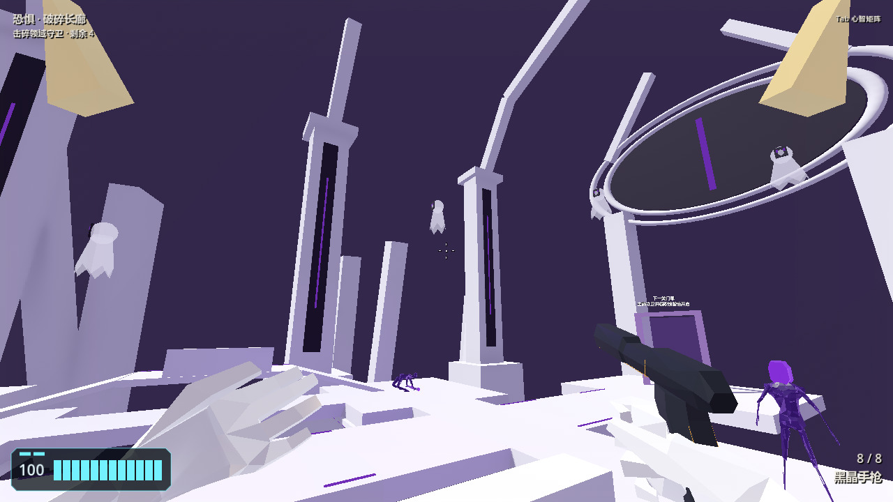
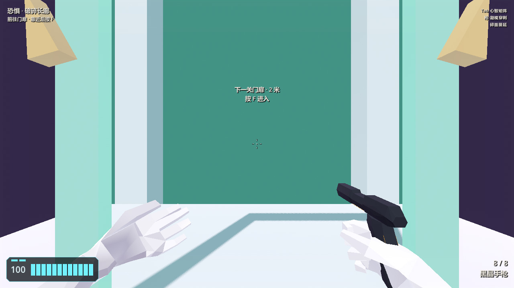

# 恐惧白色圣殿：实机与验证

2026-11-15，Issue #211，基于最新 main `8d3db20`。实现及具体尺寸见 [场景设计](../../levels/FEAR_LEVEL_DESIGN.md)。本次不包含尚未合并的涉水音色 PR #210。

## 原生画面

由本机 Godot 4.7.2、Vulkan Forward+、RTX 4060 Laptop GPU 在1280×720窗口运行正式 `fear_1`、`fear_2`、`fear_boss` 房间，使用真实玩家相机、原模型及HUD取图。仅PNG转JPEG，没有重绘。每房六只幽魂为无碰撞景观，在高空缓慢漂移。

| 第一小关：柱廊 | 第二小关：断柱 |
| --- | --- |
|  |  |

| Boss房 | 两侧高台 |
| --- | --- |
|  |  |



## 验证结果

- `tests/fear_sanctum_test.tscn`：原生41项通过。检查正式三房、每房6只幽魂漂浮及暂停冻结、无景观物理体、装饰数量上限、36米距离及3块翻板。实际Player在两个普通房左右两条坡道各自走上1.2米侧台并走下，未使用跳跃；AI导航可抵达台顶。包含4张原生截图。
- `tests/fear_playtest_test.tscn`：原生37项通过。真实正式三房清场、领卡/拾Boss碎片、沿桥行走、HUD出口提示、按F过门至下一领域；坠落扣30HP恢复，生命不足时死亡并重开。用于聚焦恐惧的测试入口显式固定顺序，正式游戏仍随机。
- 10组相关无界面检查，共388项通过：场景37、恐惧领域32、审判之瞳29、恐惧音频24、恐惧通关30、领域Stage27、Boss Stage20、四领域98、编排54、反馈37。完整输出保留在 `regression/`，没有脚本、导航或退出诊断。
- 导入退出0，但基线及最终导入都出现相同的宿主 `Safe save failed` 诊断，见 `import-base.log` 与 `import-final.log`。未修改系统安全保存设置，不将本机导入声称为无报错；最终原生两份日志和上述回归没有此诊断。
- 地图配置同步到 `tools/gen_realms.py`；运行 `tools/gen_zones.py` 后所有地图与暂存内容一致，第二房的断裂样式可重复生成。

复现（使用仓库要求的 Godot 4.7.2）：

```sh
godot --headless --path . --editor --import
godot --path . res://tests/fear_sanctum_test.tscn -- --out=proof-output
godot --path . res://tests/fear_playtest_test.tscn -- --out=flow-output
godot --headless --path . res://tests/fear_sanctum_test.tscn
```

截图文件、文本日志和相关源码的SHA-256及字节数见 `validation.json`；文本按Git LF行尾保存，日志移除终端色码与行末空白。测试用APPDATA重定向到忽略目录，未改用户存档。源码保留稳定编号、共享网格/材质，新增景观不生成碰撞或导航、不新增动态光、粒子或音频声部。幽魂仅更新固定6个变换。

本次验证不是跨设备性能基准，不据此承诺帧率。低端显卡、其他平台和真人对压迫感的反馈仍待收集。建筑与幽魂采用已有低多边形风格，敌人/Boss数值和当前随机编排未调整。
