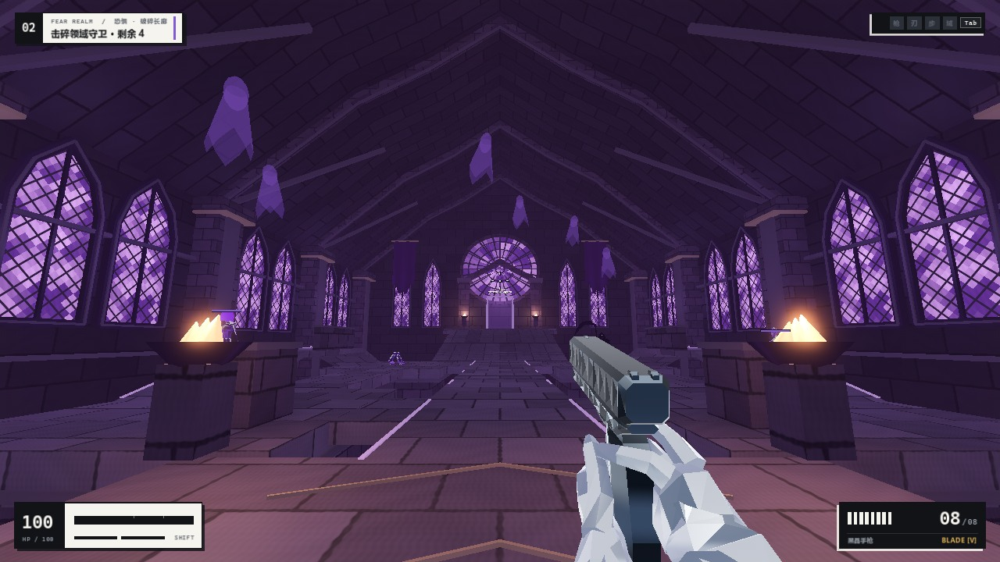
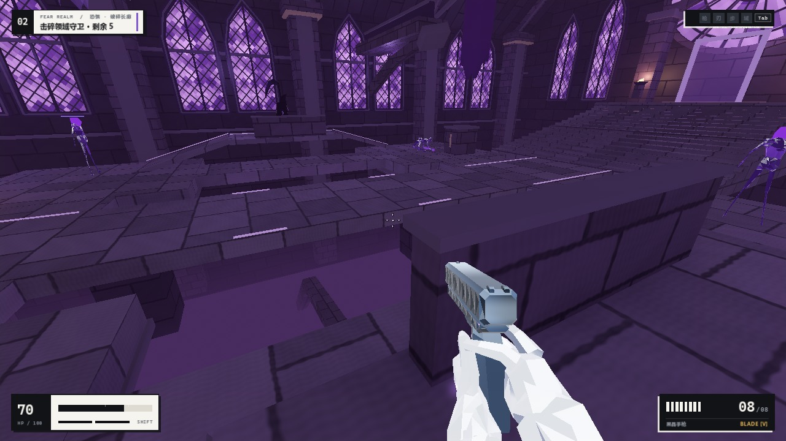
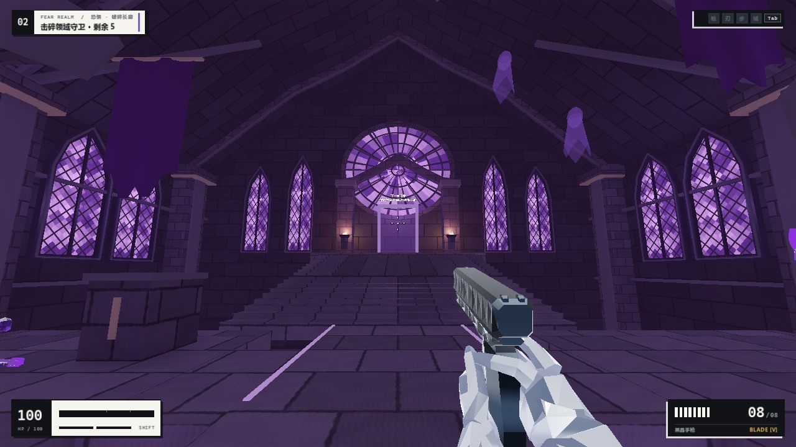
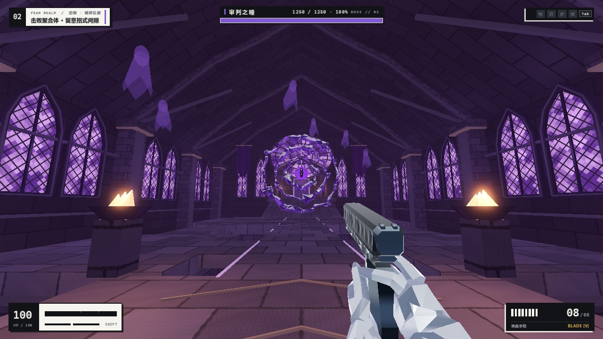

# 恐惧 · 紫色城堡内殿

恐惧两间战斗房与「审判之瞳」Boss 房共用高拱顶、紫色铅条彩窗和深色砌石。第二关加入断裂的上层廊道，Boss 房用更宽的玫瑰窗框住审判之瞳。少量暖色火盆照出近处轮廓，桥缘有细条标出落脚边界。入口平台加长到 11 米，六只幽灵在拱顶和侧窗间巡飞，不参与攻击和受击。

后厅的 18 级石阶居中布置，沿行进方向长 12.2 米、宽 10.8 米，两侧保留虚空。宽 12.8 米、高 2.9 米的出口平台一直铺到城堡后墙，正对墙上的玫瑰窗和紫色尖拱窗。石阶外观与连续斜坡碰撞分开，寻路从原有战斗桥接到抬高的门扉。中央路径仍有翻板，侧台仍能绕行，桥与平台之间保留真实虚空。玩家跌落扣 30 点血并回到稳定落脚点。

| 第一关入口 | 第二关侧廊 |
| --- | --- |
|  |  |
| **中央长石阶与后墙彩窗** | **审判之瞳大厅** |
|  |  |

Godot 4.7.2 Forward+ 原生验证 65 项通过，包括幽灵巡飞、入口平台、步行上台阶、AI 导航连通、台阶两侧真实虚空、双侧路线、实体遮挡和实际坠落。六组回归共 302 项通过，覆盖正式过门、全战役、翻板、追魂、斜坡追击与 Boss。截图使用正式场景中实际玩家相机。低配显卡帧率和自由交战的体感留待试玩。

[原生验证日志](native.log) · [回归汇总](regression.log)
