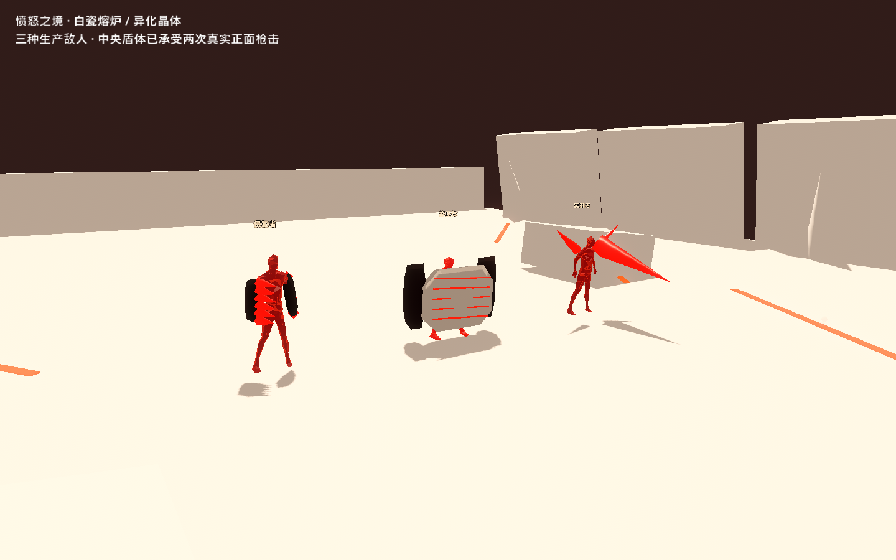

# #142 愤怒领域与三种晶体敌人

白瓷熔炉由 `environments/wrath/realm.gd` 构造：40×48 m 的连续战斗地面、十段倾斜断壁、锯齿倒刺、八条熔岩裂缝与八个蒸汽口。地面与实体墙使用 WORLD 并加入 navigation_geometry；装饰不生成额外阻挡。玩家入口 (0,0,16)、出口 (0,0,-20)，与统一地图生成器的约定一致。环境音为源码合成的循环蒸汽与金属音，没有引入第三方素材或音频。

三变体都复用仓库原有 24 骨晶体人形及 56 片预切碎屑，材质逐实例独立，原 GLB 不变。附加晶面随原骨骼动作；原生检查发现并修正过未播放 idle 的 T-pose，截图为修正后的真实引擎画面。

| 变体 | 默认参数与行为 |
| --- | --- |
| 突刺者（variant 0） | 110 HP，3.6 m/s；0.75 秒锁向先兆，23 m/s 冲刺。真实 WORLD 竖墙接触触发死亡与八枚可弹一次的实体晶弹；地面不冒充墙。 |
| 蓄压体（variant 1） | 220 HP，1.6 m/s；前方 ±60° 拦截真实枪击，侧背/近战有效。压力达 100 后先兆 0.75 秒，释放可跳过或被实体墙遮挡的扩张震波。 |
| 侵犯者（variant 2） | 160 HP，5 m/s；0.4 秒锁向，14 m/s 短扑，近距伤害与真实玩家冲击。普通受击硬直和推挤不改变其动作，仍正常掉血。 |

共用 Enemy setup/Health/Hitbox/死亡、局部时停、独立攻速、导航追击与普通击退契约；没有读取 RunState。层级伤害通过注入 `realm_damage_scale` 缩放，警告通过 `warnings_enabled` 门控。玩家冲击使用共享 `apply_external_impulse` 的 CharacterBody 碰撞移动，不瞬移穿墙。死亡碎片为真正 RigidBody3D，凸包缓存、WORLD 碰撞、两秒回收；外形和接缝不会改动主角材质。

## 验证

Godot 4.7.2 / Jolt。运行 `tests/wrath_realm_test.tscn`：28 项通过，日志 `wrath-realm.log` 无错误、警告或退出泄漏。覆盖实际手枪射线四种方向/近战、压力边界、近墙高速弹体优先命中玩家、真实冲击波 HP 和位移、施法者移除、霸体与掉血、局部时停、物理墙碰撞、跳弹反射、56 刚体及完整回收、熔炉生成和熄灭。

`tests/wrath_realm_bench.tscn` 是可操控独立战斗入口。WASD / 鼠标、左键枪、V 刃、Shift 冲刺。实际层级生成与持久化由统一 RealmStage 接线，保留旧 Sloth fixture 的运行内容。

`tests/wrath_realm_proof.tscn` 的原生 Forward+ 截图展示三种生产演员；中央盾体受了两次真实正面射线，压力 70、拦截两次。它是机制布景，不是人工游玩录像。

## 边界

当前数值为可调起点，没有宣称人工手感或全硬件性能验收。蒸汽为环境表达，不额外添加未规定的持续伤害。单 issue 同时涉及地形、三敌、物理碎片与验证，按一 issue 一 PR 保留这组相互依赖的交付。
