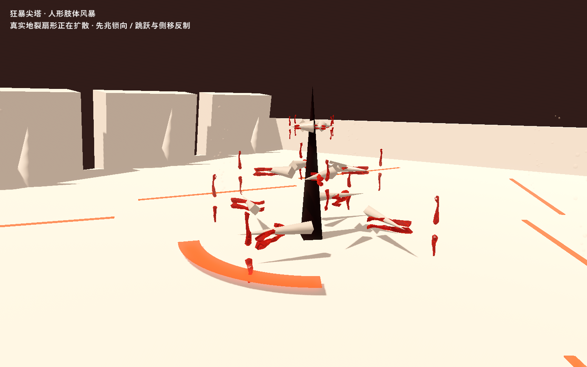

# #143 狂暴尖塔

`actors/boss/wrath_spire/wrath_spire.tscn` 是实际 Enemy 派生 Boss：1050 HP，三层旋转的原始人形四肢与三角利刃组成约五米高的风暴棱锥；三层轨道半径为 2.0 / 1.0 / 0.24 m，人形肢体与刃片同样逐层收窄。它保留 Health/Hitbox、真实枪伤、局部时停、攻速与死亡契约；不读取全局对局状态。

招式按风暴旋斩 → 扇形地裂 → 双轮破片轮换。每招有 1.1 秒锁向先兆和 1.5 秒收招窗口：

- 风暴旋斩以 6.5 m/s 沿已锁方向推进，3.3 m 近身范围每 0.45 秒可造成一次伤害与物理推挤，WORLD 障碍实际阻挡身体。
- 地裂释放三条有明确空隙的扇形波，20 m/s 扩张；跳跃和实体掩体可以规避，实际受击只结算一次。
- 破片分两轮各十二枚，第二轮偏转 15°；复用有真实 WORLD 反射的晶弹，并可由短刃弹反。

死亡只发出一次 `realm_defeated(2)`，关闭本地熔岩与蒸汽、停止工业音，并生成 56 个真正的原始晶体刚体。独立 bench 在真实死亡后设置“失去愤怒”并生成实体锋芒碎片；走近拾取后生成侵犯者演示独立反震。正式 RealmStage 接入相同事件实现跨关继承。用户已明确：拾取碎片启用独立反震，普通武器击退仍被剥夺；本 Boss 不自行恢复普通击退，也不把全局状态写入模型。

## 验证

`tests/wrath_spire_test.tscn` 23 项通过，原始日志 `wrath-spire.log`。包含实际死亡后普通击退禁用、实体拾取、独立反震可推霸体而普通击退仍禁用。包含实际扇波伤害、两轮24个真实弹体、锁向不追踪、真实大体型位移、暂停/时停、真实手枪命中、单次死亡事件、环境熄灭、未命中弹体清理与56刚体回收；导入和运行均无脚本错误、警告或退出泄漏。

独立可玩入口 `tests/wrath_spire_bench.tscn`。原生 `tests/wrath_spire_proof.tscn` 驱动实际 Boss 释放三条地裂，截图与 `wrath-spire-native.log` 对应，已打开检查。

## 集成边界

普通击退剥夺、独立碎片拾取与跨关继承由共享对局组件统一实现，避免在 Boss 内直接查找 Player 或 RunState。HP 与伤害默认值仍需人工平衡；脚本和截图不等于人工手感验收。同一 issue 的 Boss 状态机、场景、演出与验证一并交付。
