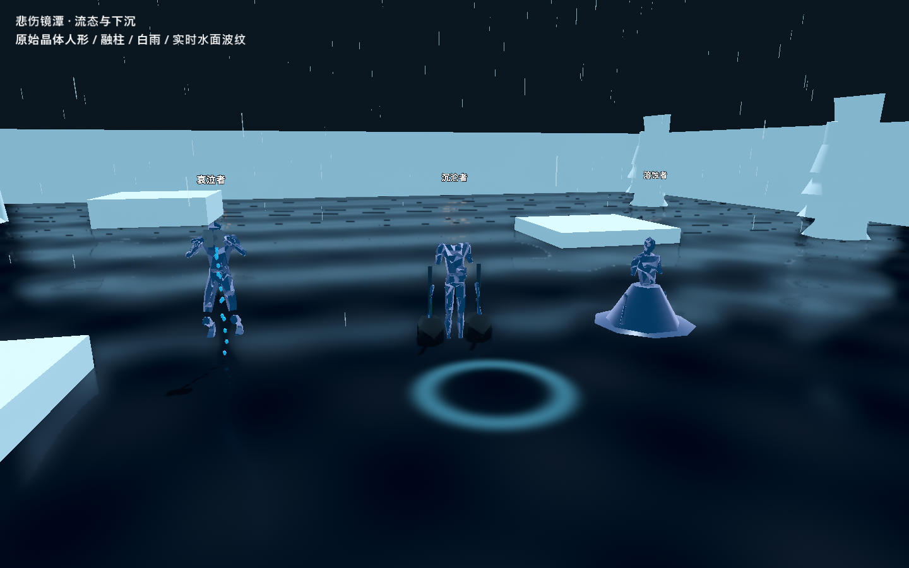

# #144 悲伤镜潭与三种异化晶体

`environments/sorrow/realm.gd` 构建 40×48 m 浅水镜潭、八座融化立柱、四处 0.6 / 1.2 m 高台及白色无声雨丝。入口 (0,0,16)、门 (0,0,-20) 沿用领域坐标约定。实体地面、边界与高台使用 WORLD，并加入 navigation_geometry；镜面水体是自写 Shader，时间由物理帧注入，踏水波纹由真实玩家位移触发，短促溅水音由源码合成。没有引入第三方素材，也没有修改源 GLB。

三种 Enemy 派生演员复用原有 24 骨晶体人形，独立苍蓝材质与 56 片物理碎屑。掩面者采用保留原骨架的对称跪姿和随头部骨骼的晶体双掌；普通敌人的 Head / Torso / Core Hitbox 跟随初始异化姿态对齐。独立入口为 `tests/sorrow_realm_bench.tscn`，WASD / 鼠标 / 左键 / V / Shift。

| 变体 | 实际机制 |
| --- | --- |
| 溶蚀者（variant 0） | 110 HP、2.7 m/s。潜水 1.1 s 时取消可射击 Hitbox；在玩家身后约 3 m 浮起，WORLD 射线和胶囊形状查询限制重现位置。0.65 s 浮出先兆后发射真实黏液弹，命中伤害 10、移动倍率 0.45，持续 2.5 s。 |
| 沉沦者（variant 1） | 230 HP、1.6 m/s。6.5 m 内、实体墙无遮挡时施加跳跃 0.28、冲刺距离 0.35、移动 0.72 倍率；离开范围或来源死亡立即清除。 |
| 哀泣者（variant 2） | 130 HP、0.7 m/s。0.9 s 先兆后发出实际扩张声波，实体墙可挡。触及玩家使画面黑白、换弹速度 0.4、技能冷却 2 倍，持续 3 s；施法者死亡或移除清除对应效果。 |

所有效果使用独立 source key，交给共享 RealmPlayerEffects 聚合，避免重复叠乘；死亡清理在飞黏液、声波与残留效果。演员保留 Enemy setup / 注册 / 死亡 / 普通和独立碎片冲击 / 局部时间与攻速接口，不查找全局状态。

## 验证

Godot 4.7.2 / Jolt：`tests/sorrow_realm_test.tscn` 22 项通过，见 `sorrow-realm.log`。验证真实水步与音效、24 骨、玩家跳跃/冲刺倍率、离场和死亡清理、潜水 Hitbox、真实 WORLD 边界内重现、实体黏液命中、实际 Stats 和黑白效果、暂停、56 刚体及完整回收、涨水与干涸。

原生 Forward+ 截图由 `tests/sorrow_realm_proof.tscn` 生成并打开查看；这是生产演员和真实 Shader 波纹的布景，不是人工手感录像。首次检查发现溶蚀者下身不连贯和泪滴位置偏离，已修正为流态锥裙与基于实际 Head pose 的泪滴发射位置。

## 接入与边界

Stage 应调用 `Geometry.set_player(player)`，将 `actor.arena` 指向本地 SorrowRealm；Boss 可用 `set_water_level`，战后使用 `set_deprivation(true)` 完全隐藏水面并停止雨与水步。层级伤害通过 `realm_damage_scale` 注入，先兆由 `warnings_enabled` 门控。

镜潭是可涉足场景，未增加未规定的游泳或窒息系统。当前数值仍需人工平衡，测试及截图不等于人工手感验收。此 issue 同时要求水体、三敌、来源约束和验证，作为相互依赖的单 issue 交付，没有拆成多个 PR。
