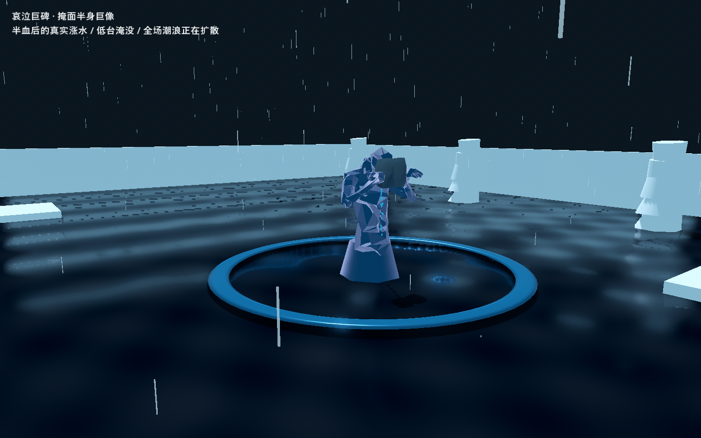

# #145 哀泣巨碑与温润碎片

`actors/boss/sorrow_monolith/sorrow_monolith.tscn` 是 1300 HP 的真实 Enemy 派生 Boss，以原始晶体人形、掩面蜷跪姿态和晶滴组成半身巨像。三招循环，各有 1.1 s 锁位先兆、0.8 s 生效表现与 1.6 s 收招：

- 泪滴暴雨：以先兆开始时的玩家位置为中心，5×5 网格释放 25 枚真实向下扫掠弹体；离开标记区域即可避开。
- 全场潮浪：14 m/s 扩张至 50 m，命中水位以下的玩家造成伤害与真实 CharacterBody 推挤；仍高于水面的平台与实体掩体可规避。
- 巨碑拍击：锁定地面 2.4 m 范围，留在区域内受伤并被推出；不会在最后一帧偷偷追踪玩家。

随着失血和战斗推进，实际水面从 0.14 m 上涨至最高 1.7 m，依次淹没 0.6 m 与 1.2 m 高台。时停冻结涨水与攻击计时。Boss 死亡只发送一次 `realm_defeated(3)`，清理标记、在飞泪滴与水浪，环境完全蒸干，散出 56 块实际 RigidBody3D 晶体。

独立 `tests/sorrow_monolith_bench.tscn` 在真实死亡后配置普通缓冲剥夺并生成实体温润碎片，玩家走近即可拾取。共享碎片组件提供独立 60 点屏障；其溢出损伤仍直接粉碎生命并发出脆响。拾取不会恢复普通伤害缓冲，与用户已确认的裁决一致。跨关继承由正式 Stage 负责，Boss 不读取 RunState。

## 验证

`tests/sorrow_monolith_test.tscn` 22 项通过，见 `sorrow-monolith.log`：实际暴雨弹伤、潮浪 HP/位移、锁位拍击命中与躲开、时停、真实枪伤、实际水面位置与高台淹没、死亡清理、物理碎片、真实拾取、60 点独立吸收与 20 点实际溢出伤害、普通缓冲仍禁用与玻璃脆响。

第一次运行仅水面 Node3D 的 float32 位置与 GDScript 浮点精确相等断言失败，改为近似比较后通过；生产涨水逻辑没有因测试改动。共享组件的独立测试见本目录 `fragment-contract.md` 与相应日志。

原生 Forward+ 图由 `tests/sorrow_monolith_proof.tscn` 驱动半血 Boss 释放实际潮浪，真实水位约 0.87 m、低台已淹没，生成后打开查看。没有用图像生成替代游戏证据。

## 边界

默认 HP、伤害和水位速度仍需人工平衡；截图和自动检查不宣称人工手感或全面性能验收。半身姿态与晶滴保留原素材，不依赖新增第三方模型。Boss/领域、共享永久剥夺与碎片分别通过注入引用和死亡信号接线。
