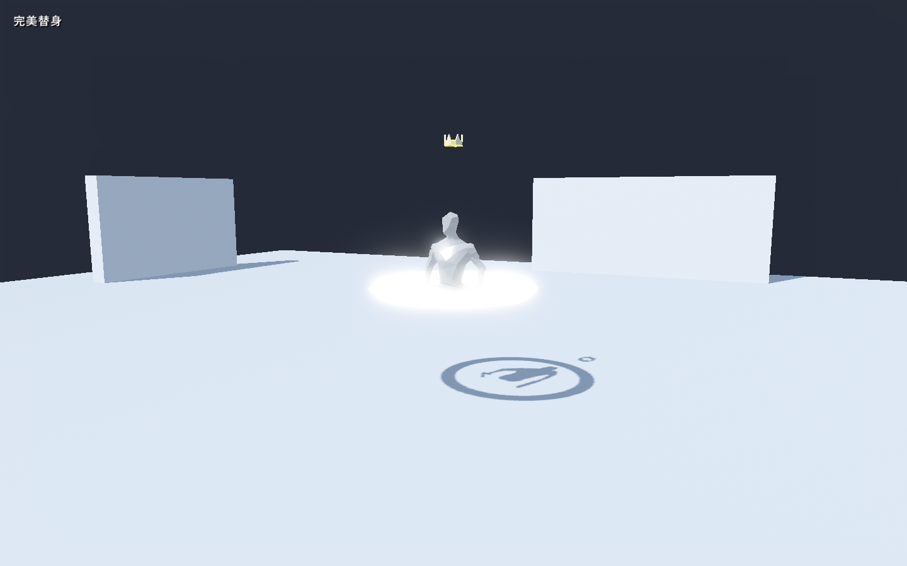
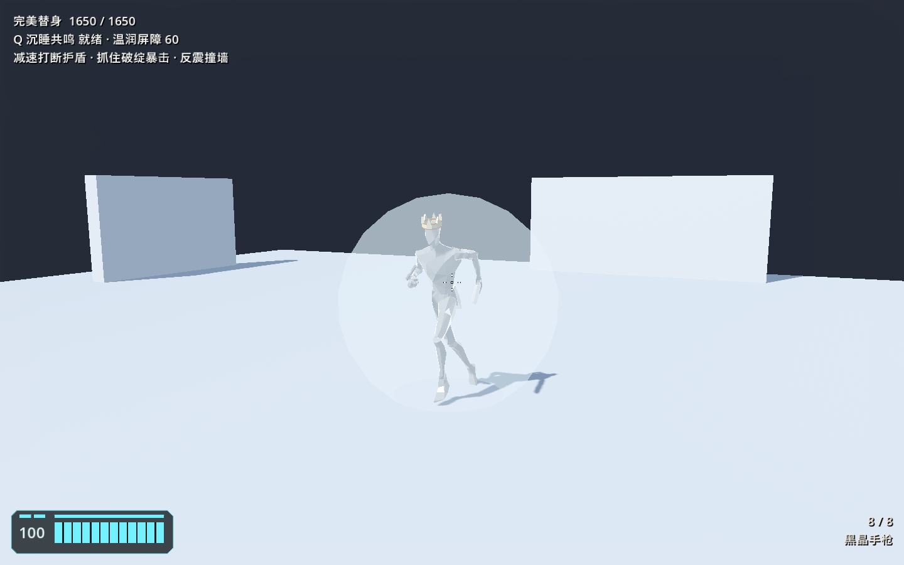
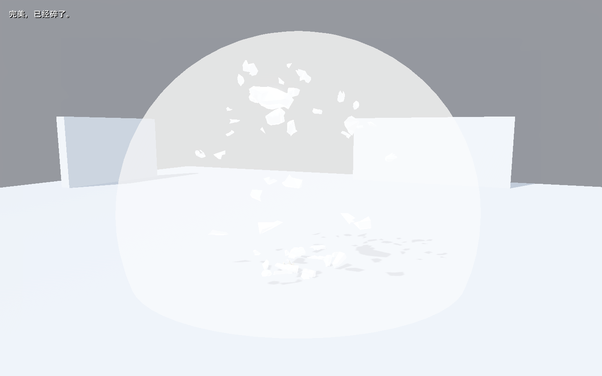
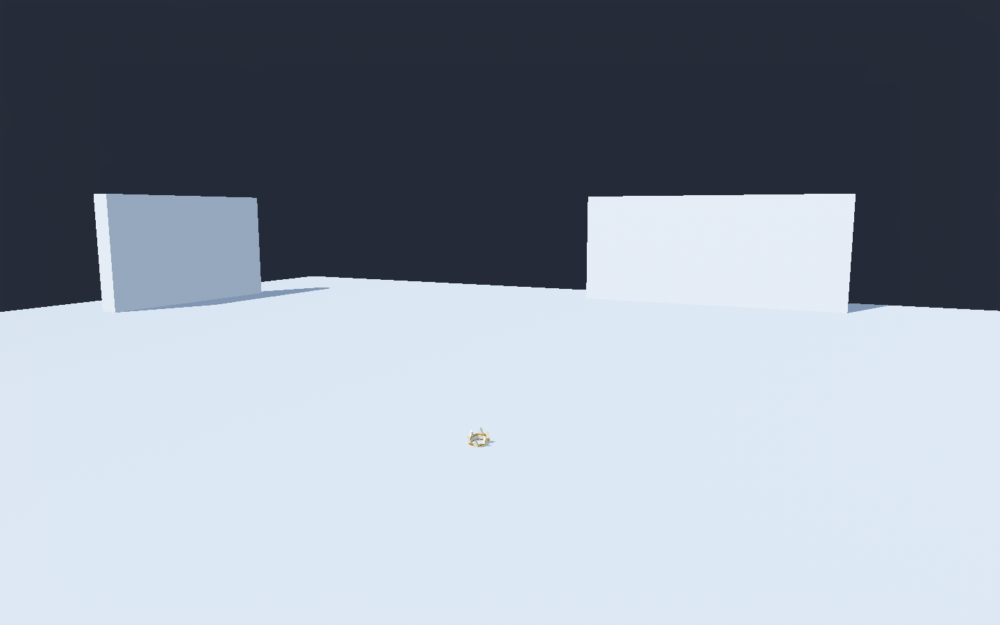
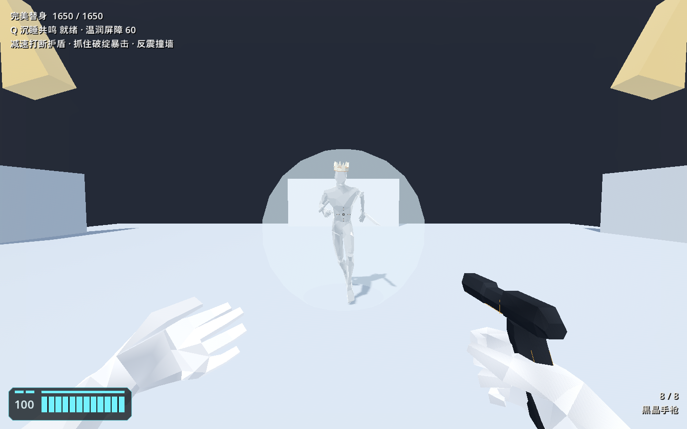
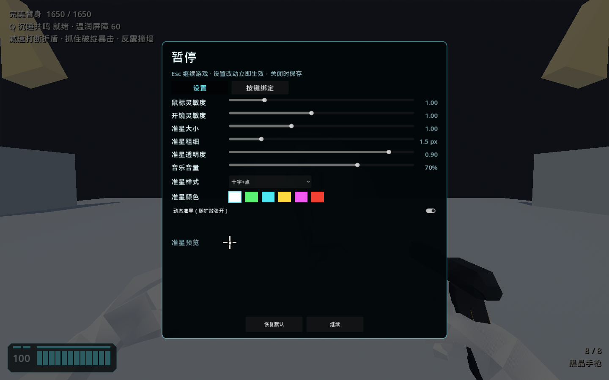
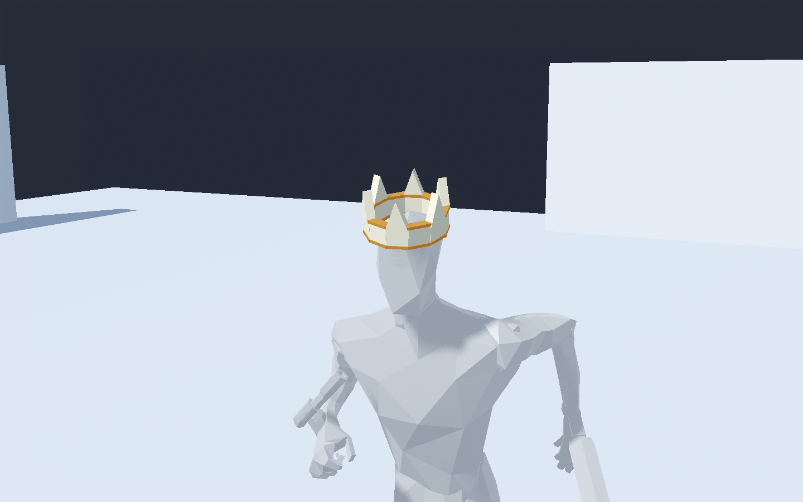

# #150 完美替身

`levels/climax/doppelganger_spawn.gd` 是可注入的终局演出入口。调用 `setup(player)` 后再 `add_child`；正式流程把它放在世界 (0,0,-50)，共享场地 32×30 m、入口 z=-38。它不创建主地面，也不读取 RunState / RunDirector。六段本地 WORLD 晶墙用于真实反震撞墙破裂。

皇冠先作为 RigidBody3D 从 4.4 m 高处落下，实际地面接触后播放中文人声“你简直无药可救了！！”。随后悬起释放白光，Shader 从头到脚逐层显示原始 24 骨白晶人形；打印完成前无 Hitbox 和攻击。皇冠挂接到动画头部锚点、保留普通无眼手冠形并缩合后才开始战斗。玩家控制在演出和湮灭期间暂停，完成或中途移除均恢复。

替身使用原有黑晶手枪和意志短刃 GLB 的独立镜白材质；白晶身体采用高金属度、低粗糙度和菲涅尔反光，源 GLB 不变。1650 HP；四发快枪为实际 42 m/s 扫掠弹体；锁向滑步为 23 m/s、0.28 s 的 CharacterBody 运动，随后的刀斩实际结算伤害；完美盾拦截真实子弹，收招和外壳受损都有反击窗口。

| 独立碎片 | 最终战中的真实作用 |
| --- | --- |
| 沉睡 | 共享 Q 共鸣在 18 m 和 WORLD 视线内打断完美盾，并将 Boss 与其发出的弹体减为 0.25 倍速，持续 3 s；独立 10 s 冷却，暂停不会消耗。 |
| 警醒 | 保留拾取所得暴击率；真实暴击击中收招或暴露期，额外造成 1.5 倍伤害。验证使用固定暴击率测试夹具驱动实际武器射线，不把随机触发率当成确定命中。 |
| 锋芒 | 普通击退仍无效。独立碎片反震推动 Boss，真正撞上 WORLD 墙板后产生 12 个刚体破片、移除墙碰撞并暴露外壳。 |
| 温润 | 独立 60 点屏障能承受快枪爆发；普通缓冲仍剥夺，屏障耗尽后的实际溢出直接损伤 HP。 |

死亡先散出 56 块真实白晶刚体，伴随扩张白球与渐变全屏白光。2.2 s 湮灭完毕后，只发出一次 `defeated(crown: Node3D)`，交出仍存活的皇冠供 #151 接管；Boss、攻击弹体和碎屑全部清理。皇冠 `CrownModel` 来自 #147；共享 Q API 来自本 issue 的 `1e5f02c`。

## 验证

Godot 4.7.2 / Jolt，最终导入无脚本错误或警告：

- `tests/flawless_combat_test.tscn`：21 项通过。含四发实际弹体与屏障吸收、滑步位移、刀伤与躲避、真正枪击护盾、Q 破盾/时钟/冷却/暂停、实际暴击窗口、真实 WORLD 撞墙破裂、普通击退仍禁用、56 刚体与攻击回收。
- `tests/doppelganger_spawn_test.tscn`：28 项通过。含实际刚体落地、真实语音流、打印进度/无提前受击、暂停、头部戴冠、一次开战、控制恢复、超新星、一次皇冠交接和早退清理。
- `tests/doppelganger_proof.tscn`：四张原生 Forward+ 图均已生成并逐张打开查看；见 `native.log` 及 `SHA256SUMS`。白晶全身、打印截面、戴冠、白光/碎屑和只剩皇冠均为实际游戏节点。
- `tests/climax_hud_proof.tscn`：另三张原生图检查生产第一人称 HUD、真实暂停设置菜单和正常头围；见 `hud-native.log`。第 07 张使用外部审阅相机靠近同一 Boss 头部，模型和皇冠尺寸不变，其余画面均采用生产玩家相机。七张均来自 Godot 4.7.2 / Forward+ / RTX 4060 原生渲染。

## 入口与边界

`tests/flawless_bench.tscn` 可玩完整生成与战斗，WASD / 鼠标 / 左键 / V / Shift / Q。独立 bench 提供地面、四枚碎片与四项普通剥夺；正式流程沿用玩家已有状态。HUD 展示 Q 冷却与独立屏障。

中文台词已替换为官方 Apache-2.0 Kokoro-82M-v1.1-zh 离线合成的真实 WAV（2.825 s），生成脚本和摘要见 `assets.md`；没有用蜂鸣代替台词，也没有分发语音引擎。已检查波形、时长和引擎播放，没有声称人工听感或专业配音验收。

默认 HP、速度、攻击伤害和窗口仍需人工平衡；自动检查与原生截图不等于人工手感或完整游戏通关验收。该 issue 同时包含打印演出、完整 Boss、四系反制、音频和独立证明，按用户一 issue 一 PR 保留相互依赖的交付。

皇冠视觉按用户最新要求统一为普通简洁六尖冠，无眼睛、手、面部或珠宝装饰。本目录原生图已用修订后的生产 CrownModel 重新生成并逐张检查。

最终战补齐生产Crosshair、Vitals与实时弹药/重组提示；仅COMBAT显示，独立layer90的PauseMenu在落冠/打印/战斗均可Esc暂停，并即时应用准星、灵敏度和绑定设置。COMPLETE前移除暂停输入及战斗覆盖层，结局自行接管。真实Esc注入、换弹暂停、ADS、退出时释放暂停及28项流程检查见 doppelganger-spawn-test.log。

皇冠改为#147真实尺寸模型。Boss从原Head网格的实际蒙皮绑定计算头围，沿Head骨姿态放置，内圈适配上部头围，Y不缩放：实际头部包围盒0.1915×0.2954×0.2320m；冠约0.2351×0.1351×0.2645m，佩戴scale约(1.083,1,1.013)。头网格正常可见并投影，不是SHADOWS_ONLY；原GLB未改。

挂到头骨时保留悬浮世界姿态，随后 0.6 s 内同时平滑归位位置和局部旋转，最终 Quaternion.IDENTITY 对齐真实 Head 方向；避免 `reparent(..., true)` 的遗留旋转使椭圆冠偏转。实际流程断言同时验证局部身份旋转和世界基底与头锚一致。

最终七张原生图均在头骨旋转归位修正后重新生成并逐张查看；第 07 张可直接检查椭圆内圈、头部可见性与正常佩戴比例。
