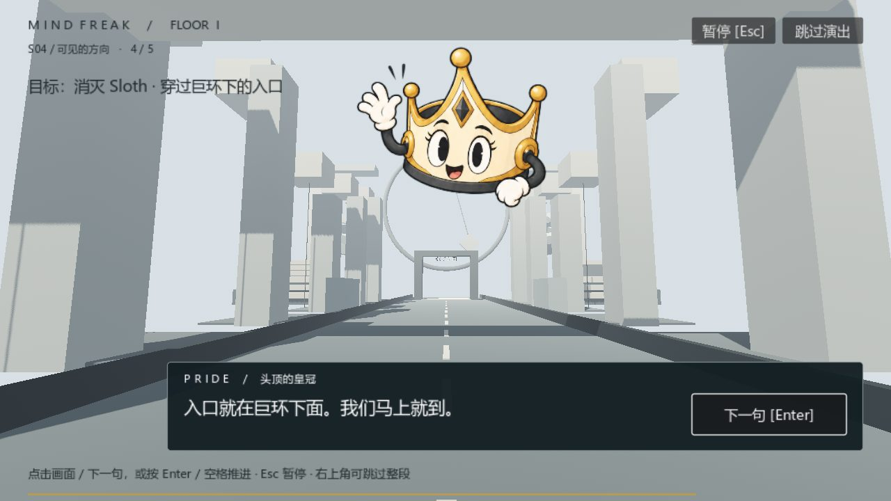
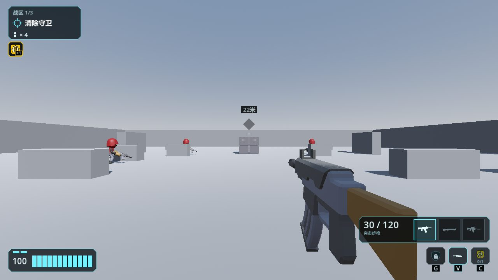

# Pride 开场接入原游戏

2026-11-01，Godot 4.7.2，实际游戏的 Forward+ / Vulkan 渲染。正常启动自动播放 Pride 开场，确认后切入原来的开局三选一和 `maps/zone_1.tscn`，后续继续两小关与 Boss；这里不再使用独立预演的首关白模。

## 验证结果

- 全部 18 个 `tests/*_test.tscn` 通过，退出码均为 0；含新开场接入检查 30 项。
- 新接入的原生画面检查 32 项通过（含两张截图输出）：逐句、观察后返回、跳过、单次地图加载、开局选卡、原有枪械 / 近战 / 盾、死亡重开、两个 fixture 绕过均通过。见 [原生日志](native-integration.log)。
- 迁入本仓库的对白流程 43 项、源图 / 渲染边界 26 项均通过，见 [flow.log](flow.log)、[avatar-bounds.log](avatar-bounds.log)。分镜、台词和形象见 [开场设计](../../levels/sloth-opening/README.md)，既往审查对应的规避说明见 [REVIEW](REVIEW.md)。
- 全套 fixture 各三遍，再独立 FX-001、FX-002 各三遍，原种子和种子 +1 结果仍与接入前一致：

| Fixture | 主种子 | 结果 / tick | 哈希 | 种子 +1 |
| --- | --- | --- | --- | --- |
| FX-001 | 1001 | 胜利 / 2554 | `95d4b590ae882378` | 1002：2537 tick / `c3c3084d44c20133` |
| FX-002 | 2002 | 胜利 / 912 | `4494ad3460ca6ab9` | 2003：912 tick / `07161059705b7ef8` |

独立日志：[FX-001](FX-001.log)、[FX-002](FX-002.log)。固定 60 tick 验证，额外逐帧间隔 1ms 仅用于诊断，不改变游戏数值。首轮 FX-001 独立过程出现过一次已知的 Jolt 任务队列提示；部分旧无界面测试仍有 ObjectDB / 资源退出诊断，断言和哈希均通过。本次未宣称引擎诊断已修复，原生接入检查无报错。

另外直接从正式入口以 FX-001 / FX-002 启动检查，修复了 Boss fixture 的延迟回调在旧启动节点已离树后仍调用 get_tree 的问题；入口先确认自身仍在树中且仍是当前场景。新接入测试同时复现并覆盖这一先后顺序。全套与独立进程的主种子三遍、种子 +1 轨迹逐字节一致。

执行汇总见 [validation.json](validation.json)。仅保留新接入及相关 fixture 日志，其他测试原始日志在本地 `D:\CS Games\tmp\pride-opening-integration-checks`，未重复提交基线材料。

## 实际画面

两张原生 JPEG 共 135,705 字节，单张 <100 KB。

源码入口为 `ui/game_start.tscn`。正常运行项目或双击原本地“启动游戏.cmd”就能看到；直接运行地图 / fixture 或传 `--skip-opening` 会跳过。按每次启动播放一次处理，死亡重开不重复。
