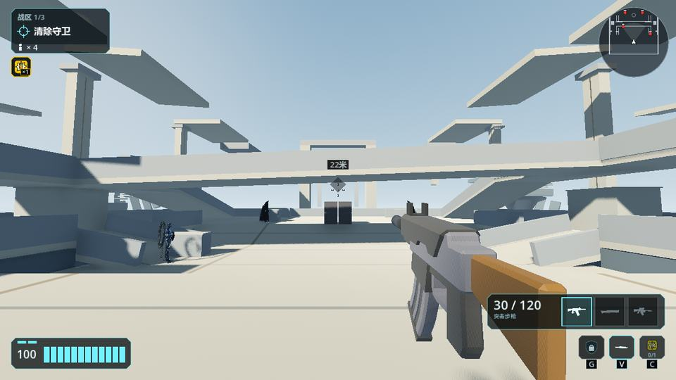
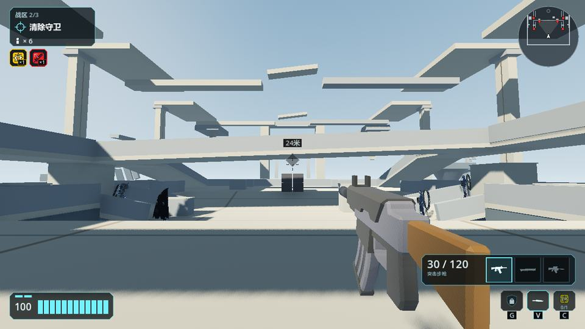
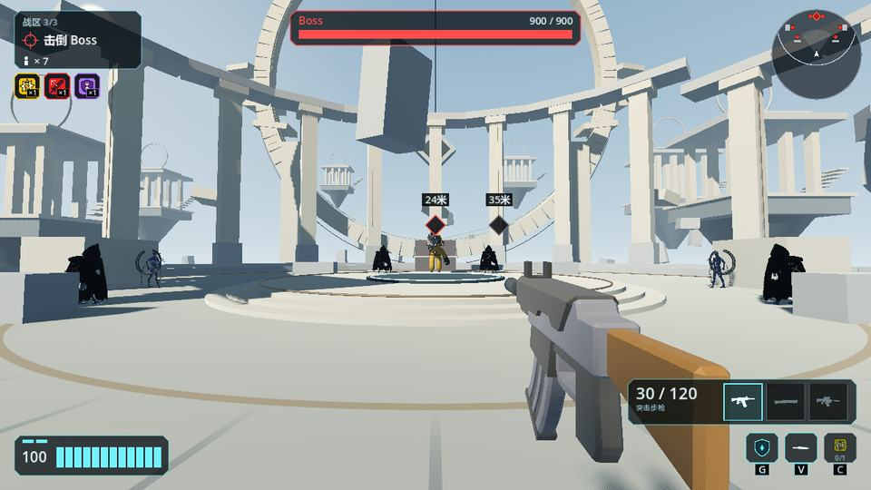
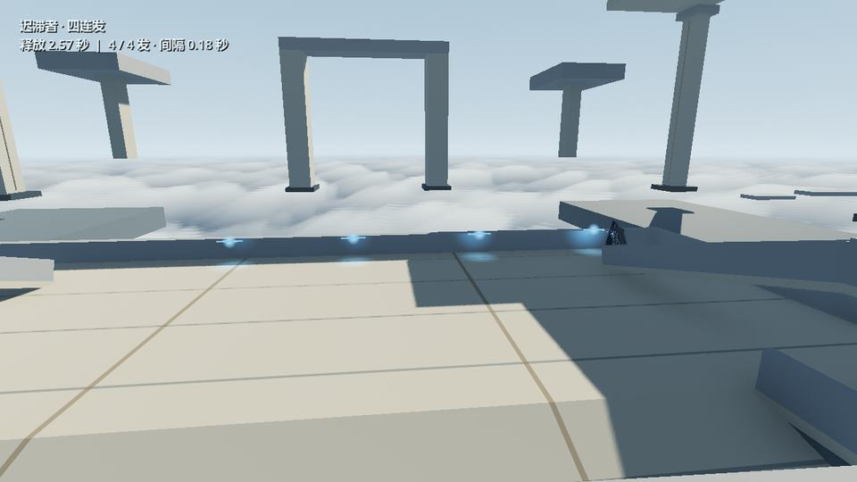

# Sloth 紧凑战场修订 · 2026-11-08

用户试玩指出宽场跑到据点耗时过长，本轮把实际战斗核心缩小，外围景观保留宏大尺度。继续修订草稿 PR #98，不合并 main。历史宽场截图/轨迹/性能见 [首次整合证明](../sloth-integration/README.md)，不作为本版结果。

## 当前尺寸与目标距离

| 布局 | 旧灰盒 | 首次宽场 | 本次紧凑版 |
| --- | --- | --- | --- |
| 两小关地板/核心 | 60×60 米 | 96×128 米 | 可走核心40×48米 |
| 第一关出生→据点中心 | 22 米 | 103 米 | 22 米 |
| 第二关出生→据点中心 | 24 米 | 103 米 | 24 米 |
| 普通步行理论时间（4.4m/s，忽略地形/操作半径） | 5.0 / 5.45秒 | 23.4秒 | 5.0 / 5.45秒 |
| Boss实际战斗台 | 原灰盒 | 直径92米 | 直径50米 |

实际操作需要进入据点范围，不能走进核心实体；最终步行验证用真实 Player/正常移动输入到操作位置，不通过改速度或传送测时间。外围原尺度柱廊、巨环、浮岛、钟摆与云海保留，外围不作为可走地板或增援绕行区域。

当前三关仍沿用新敌人、4/6名守卫、Boss6名小怪、据点锤击、增援、插旗冲击波、增益台、三次选卡、胜负和重开。四连弹伤害/蓄力/锁向/反击窗口未调整。完整巨像、休憩和战后叙事后续制作。

## 验证与复现

| 检查 | 本轮结果 |
| --- | --- |
| 正常玩家步行到锤程 | 第一关4.30秒/18.813米，第二关4.72秒/20.780米；真实移动输入，jog=4.4、Stats=1、无冲刺，见[步行数据](approach-report.json) |
| 同一锤程socket的导航路程 | 100.379→19.407米、101.358→21.291米，缩短约81%/79%；Boss57.5→32米 |
| 完整三关与胜负/重开 | headless130项、原生140项通过；见[无界面日志](integration-headless.log)与[原生日志](integration-native.log) |
| 站位/导航 | [55项通过](layout.log)，真实胶囊无重叠、同层掩体、出生安全、Boss近卫、导航只在核心内 |
| 增援 | [63项通过](reinforcement.log)，7个marker均无重叠且在正确导航楼层；7/8抵达可视有效射位、jitter=0 |
| 保留四连发 | [原生25项通过](burst-native.log)，仅观察镜位随新边界调整，伤害/时序不改；[发射报告](burst-report.json) |
| 依赖地图的既有回归 | Boss、射击位、刷新视线、HUD、整局选卡、小地图、锤击、阶段横幅8组通过；[摘要与日志哈希](validation-results.json) |
| 外围与边界独立复查 | 三图景观PhysicsBody=0，无外围导航岛；各图96方向高位玩家扫掠全被防坠边界阻挡，见[之前](review-before.log)/[之后](review-after.log) |

原生轮的步行4.27/4.72秒受初始落地帧差影响；上表统一采用headless轮，同一轮同时记录真实终点、移动距离、物理时间与导航socket，未把理论时间或未实测的旧步行时间混入对比。完整通关走查只保护测试角色并缩短测试锤冷却，不直接写phase推进。

本次适配保留了实际行为断言：刷新视线测试先显式建立可见/全近距前提，避免用旧地形固定观察点假定无遮挡；射击位测试读取真实Projectile位置，避免把Sloth胸口噪声事件再叠加一次眼高误判桥面遮挡。未改变玩家、AI或刷新规则来让测试通过。[视线日志](spawn-sight.log)、[射击位日志](firing-position.log)。

固定种子6次全部胜利（`--fixed-fps 60`），同seed两遍轨迹一致，换seed不同；[fixture日志](fixture.log)：

| 起点 | 种子 | 结果 / ticks | 哈希 |
| --- | --- | --- | --- |
| FX-001（两遍） | 1001 | 胜利/1861 | `704caea589dc573b` |
| FX-001 | 1002 | 胜利/1859 | `e5d0bb32a752feb7` |
| FX-002（两遍） | 2002 | 胜利/690 | `12e617f6e148f229` |
| FX-002 | 2003 | 胜利/740 | `dcc6687a539ce1cf` |

## 原生画面









以上为本轮Godot4.7.2 Windows Forward+实际PNG截图，仅缩放/JPEG重编码；当前几何、生成地图与JPEG的LF/二进制哈希见[SHA256SUMS](SHA256SUMS.txt)。

```text
godot --headless --path . res://tests/sloth_integration_test.tscn
godot --path . res://tests/sloth_integration_test.tscn -- --integration-proof=res://artifacts/sloth-compact-native
godot --headless --fixed-fps 60 --path . res://tests/fixture_test.tscn
```

本机 Godot 启动仍有根证书存储读取诊断，空工程也可复现；游戏错误与宿主诊断分别记录。先前宽场帧时与冷峰不代表本版性能，也不承诺其他机器表现。
