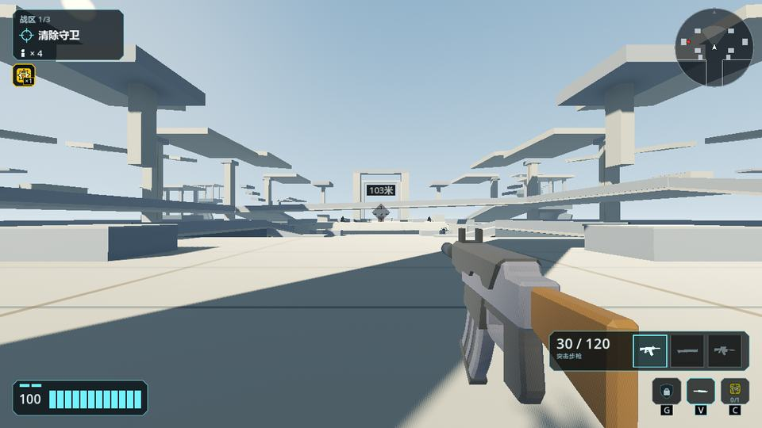
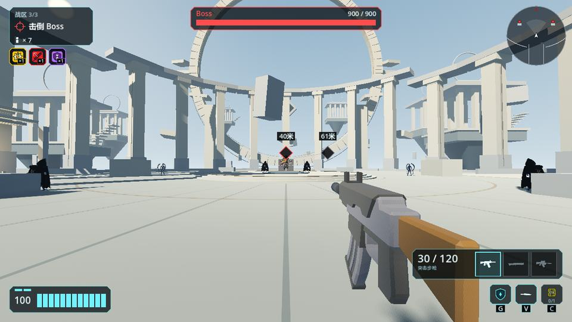
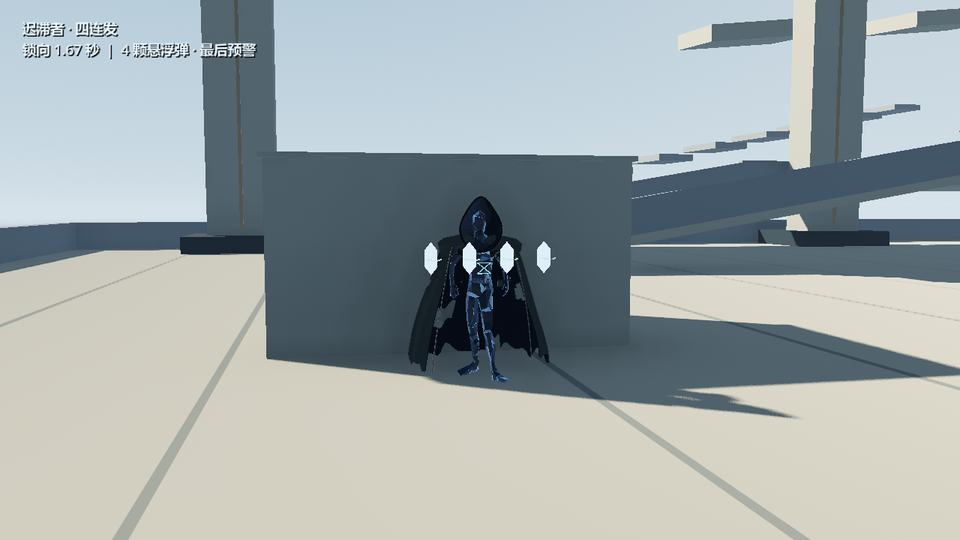
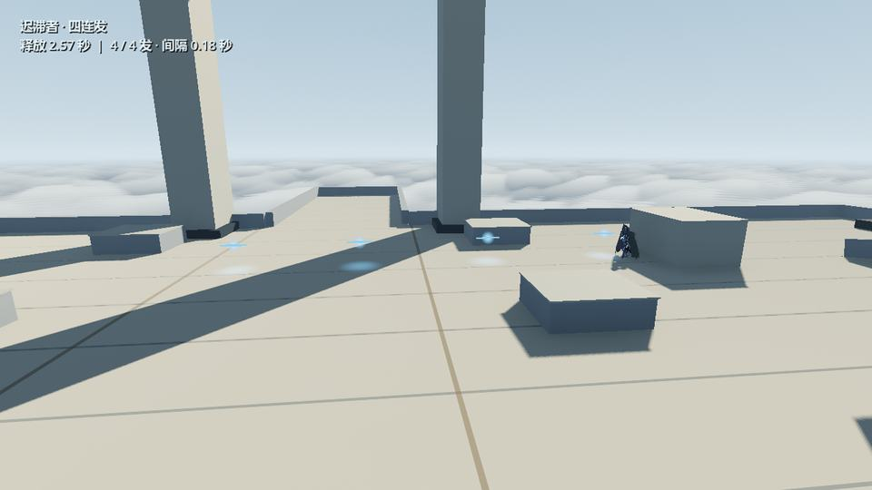

# Sloth 可玩整合草稿 · 2026-11-08

基于 main `fe0e1c9`（已合并 #96），任务 #97。普通项目入口使用新地图、新小怪与现有据点循环；历史备用包仍被 `.gdignore` 隔离。本次允许先提交草稿，尚未合并 main。

## 试玩

用 Godot 4.7.2 打开根 `project.godot`，导入完成后 F5。Pride 开场 → 开局选卡 → 两关清守卫/锤据点/插旗/增益台 F 选卡 → 云海圣殿 Boss → 核心 → 胜利。死亡后 R 重开不重播开场。快速进入 Boss：`godot --path . -- --fixture=FX-002`；跳过开场：`--skip-opening`。操作仍为 WASD、Shift 冲刺、空格跳、左键开火、右键开镜、滚轮换枪、R 换弹、V 近战、Q 换近战、E 锤据点、F 增益台、G 护盾、C 危险弹匣。

两关为 96×128 米，-2.5 米下沉庭、3/5 米高台、6 米桥及侧坡；Boss 直径 92 米。小关守卫 4/6，后庭有近据点守卫；Boss 900 HP、6 名小怪（含两名近卫）。据点开放后每 10 秒 2 名迟滞者增援、最多 5 名，清点不回退，插旗撤退。锤仍为普通 +10%、完美 ×2，窗口 ±150ms；开局和两关结尾共选 3 次。

| 敌人 | HP | 当前攻击与限制 |
| --- | --- | --- |
| 迟滞者（披风） | 90 | 2 秒凝聚、最后 0.45 秒锁向；4 发，间隔 0.18 秒，40 米/秒，9 伤/发。结束后 1 秒暴露；闭篷单弹 30% 闪避，成功冷却 2.5 秒。悬浮弹前移 0.45 米让四颗预警可见，近墙会回退。 |
| 锚定者 | 140 | 0.95 秒预警，半径 3.2 米减速场 2.6 秒；最多减速 25%，不叠加、不改冲刺，墙体阻挡。 |
| 退缩者 | 180 | 0.95 秒预警，半径 7 米低位环波、14 伤；留安全缺口，可跳跃、掩体或冲刺规避。 |

以上是可调试玩默认值。服饰仍藏青、三种轮廓；56 片碎裂从当前姿态与真实命中点生成。场景沿用单层地板、像素过滤/远处淡出的线缝，避免共面叠层与远处细线闪烁；没有增加全屏闪光。

## 原生画面









其余实机帧：[第二关](02-zone-two.jpg)、[插旗](03-capture.jpg)、[增益台选卡](04-reward.jpg)、[核心击碎](06-core.jpg)、[胜利](07-victory.jpg)。

## 证据口径

`tests/sloth_integration_test.tscn` 使用真实开场 Start 按钮、数字选卡、Health 死亡信号、玩家进入 Area、E 锤击和 F 交互完成三关；只给走查玩家无敌并缩短测试锤冷却，不写 director phase 或后续 zone_index。它检查主入口、路线、真实导航代理、HUD/小地图、增援种类、技能清理、三次选择、胜负与重开。原生轮次额外保存画面。

`tests/sloth_burst_proof.tscn` 从真实 zone_1 的 Enemy1 发起原版 SlothAttack，记录四枚实际 Projectile、锁向后目标移动、暂停与 1 秒恢复窗口。证明使用观察镜位/安全目标，不是普通玩家视角，也没有给攻击改时间或伤害。

`tests/enemy_layout_test.tscn` 检查分布、同层掩体、真实胶囊无重叠、入口可达、安全出生、Boss 两近卫；Boss 本体在开阔圣殿允许远处可见，小怪仍不可在出生处直接看见玩家。增援测试按真实最长导航路程/1.8 米每秒与寻位时间预算，仍要求 75% 到达有视线的有效射程、ENGAGE 且无往复抖动。

复现（除 fixture 外不用固定帧率，避免音频池测试受墙钟调度影响）：

```text
godot --headless --path . res://tests/sloth_integration_test.tscn
godot --path . res://tests/sloth_integration_test.tscn -- --integration-proof=res://artifacts/sloth-integration-native
godot --path . res://tests/sloth_burst_proof.tscn -- --out=res://artifacts/sloth-burst-proof
godot --headless --fixed-fps 60 --path . res://tests/fixture_test.tscn
```

最终日志摘要、原生截图及 SHA-256 与本文件同目录。完整临时 PNG、运行日志和本机启动器不入库。

### 最终结果

| 检查 | 结果 |
| --- | --- |
| 既有回归 | 30 组全部通过；最新逐组摘要与日志哈希见 [validation-results.json](validation-results.json) |
| Sloth 敌人 | 战斗 64、修订 27、披风防御 21、缓存 16，共 128 项通过 |
| 整局流程 | 无界面 120 项、原生 130 项通过 |
| 四连发原生取证 | 25 项通过，实际释放时刻 2.0167 / 2.1833 / 2.3667 / 2.55 秒，误差为物理 tick；见 [burst-report.json](burst-report.json) |
| 实体站位 / Boss | 44 / 63 项通过；包含圣殿入口桥与两侧外庭 4 条补充路径 |
| 增援 / 小地图 | 59 / 22 项通过；增援 8/8 到达可视射位，jitter=0 |
| 固定种子实战 | 6 次全部胜利；同种子两遍轨迹一致，换种子不同 |

最终 fixture（`--fixed-fps 60`）：

| 起点 | 种子 | 结果 / ticks | 轨迹哈希 |
| --- | --- | --- | --- |
| FX-001（两遍） | 1001 | 胜利 / 5737 | `58bd12f9140bec52` |
| FX-001 | 1002 | 胜利 / 7095 | `0e2a016947f02b1a` |
| FX-002（两遍） | 2002 | 胜利 / 991 | `136cea0ec4cb89c6` |
| FX-002 | 2003 | 胜利 / 991 | `d2ded6fc58dc3afa` |

代表日志：[整局无界面](integration-headless.log)、[原生整局](integration-native.log)、[四连弹](burst-native.log)、[布局](layout.log)、[增援](reinforcement.log)、[fixture](fixture.log)。敌人四组：[战斗](sloth-enemy.log)、[修订](sloth-revision.log)、[披风](cloak-defense.log)、[缓存](sloth-cache.log)。测试退出在释放场景后等待音频队列排空；最终增援 / fixture verbose 检查无 ObjectDB 泄漏或清理警告。

修复过的实际阻断：守卫胶囊与掩体重叠、后庭无人防守、Boss 浅台座导航往复，以及圣殿边缘 `queue_free` 的缺口实体尚未删除就被同步烘焙造成的幽灵墙。现在缺口创建前直接跳过，玩家防坠边界仍在；不通过增大机器人超时或改机器人寻路来掩盖。

### 本机实际战斗帧时

i7-14650HX / RTX 4060 Laptop，Windows、Forward+、1440×810，关闭 VSync 与帧率上限；第二关真实 6 名守卫、AI/导航/技能/HUD 全开，玩家在低庭静止，扩大生命池但仍受实际伤害，全程存活且未暂停。温机 5 秒后采样 20 秒、6179 帧：帧间隔 p95 **4.507ms**、最大 **15.554ms**；GPU p95 1.466ms，CPU 渲染准备 p95 1.016ms（不是游戏总 CPU），[原始数据和口径](performance.json)。

温机另有 **427.704ms** 孤立峰值，未清旧 shader cache，不能断言是全冷启动或归因于某个步骤；该峰不计入上述温机后样本，但保留原数据。这里只覆盖一处视角的真实战斗，不包含全图遍历或大量同时碎裂压力，不承诺所有帧锁 60 / 其他机器性能。

## 草稿边界

Boss 暂用旧大敌人模型和核心规则，尚未实现 Sleeping Colossus、Rest Zone、Rest Fragment、战后环境变化或完整叙事。两关共用环境主体，守卫与部分掩体不同；小地图当前为 XZ 俯视叠加，没有楼层区分。大地图的巡回时间、四连弹压力和难度尚需真人试玩。

本机 Godot 启动仍有 `Failed to read the root certificate store` 宿主诊断（空工程也能复现）；不把它算成游戏脚本通过或修改系统证书。测试证明仅覆盖本次 Windows / Godot 4.7.2 实际结果，其他机器和系统未实测。
