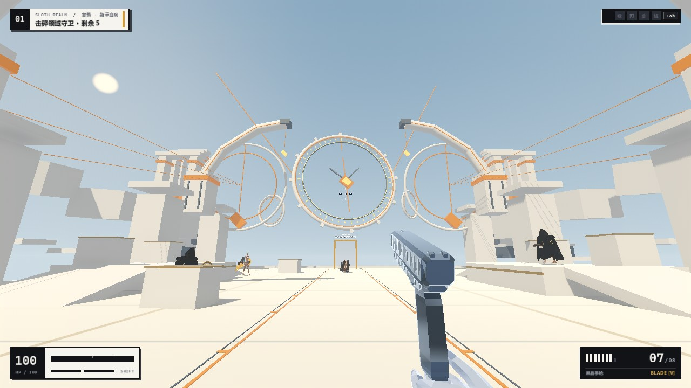
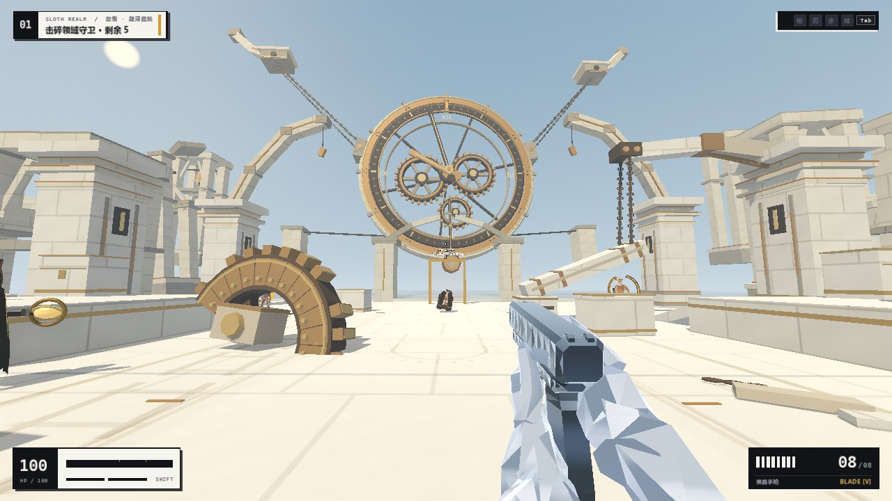
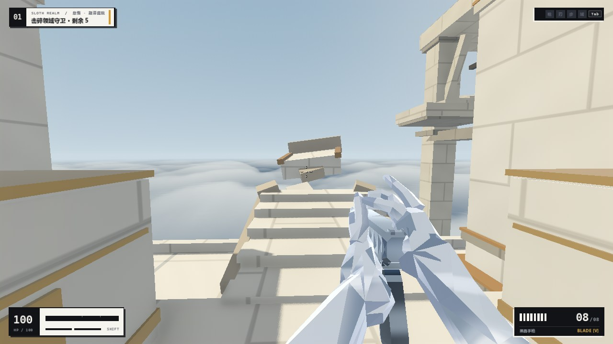
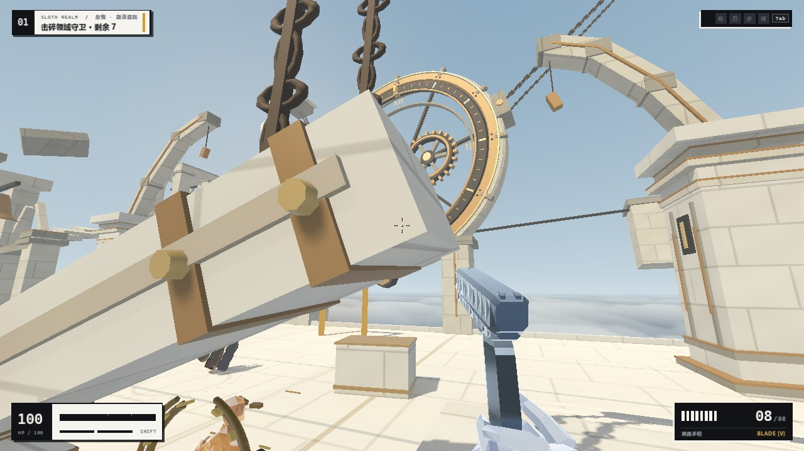
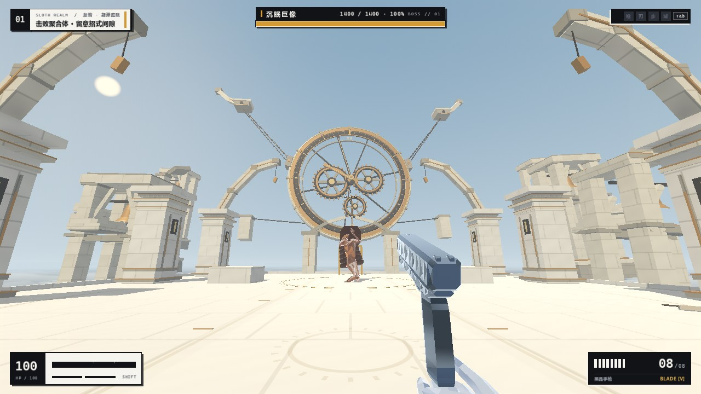

# 怠惰悬钟庭院 · 搁置的修钟场

三间正式怠惰房共用厚石钟壳、旧金刻度、外露齿轮、悬链、短摆锤和残拱。两侧六座浮空钟楼分成近、中、远三层。巨钟每 8.4 秒试着跨过最后一格，再滑回原处。摆锤最大摆角约 2.5°。暂停冻结动作，剥夺后齿圈和指针随原有快节拍转动。

前两关把修到一半的东西留在战区。左边斜插的旧金断齿轮能挡枪，裂口仍可穿射。右边石梁的一端压在实体垫座上，一端吊在石柱的悬臂上。玩家能从抬高的一端下方冲刺穿过。西侧平台有五级短阶连接断桥，最远碎片悬在战区之外。运输轨、断链、铁箍和斜放的石楔沿路可见。

战斗台为 40×48 米，两侧台高 1.25 米，出生点到门扉的水平距离为 36 米。中央长线通向出口，左右各有绕过新掩体的走线。沉眠巨像房在场边放维修碎件，使用更大的悬钟。

| 改造前入口 | 改造后入口 |
| --- | --- |
|  |  |
| **断齿轮和吊装石梁** | **西侧断桥** |
|  |  |
| **第二关侧台** | **沉眠巨像房** |
|  |  |

六张图来自 Godot 4.7.2 Forward+ 正式关卡的玩家相机。入口前后使用同机位。PNG 转为 JPEG。两间战斗房分别验证了入口到门扉的视线、实物挡枪、两侧实际冲刺、导航和出生点。Boss 房对照原有竞技区碰撞。低配置帧率和自由混战的体感留待试玩。

[改造前日志](baseline.log) · [原生验证日志](native.log) · [回归结果](regression.log)
