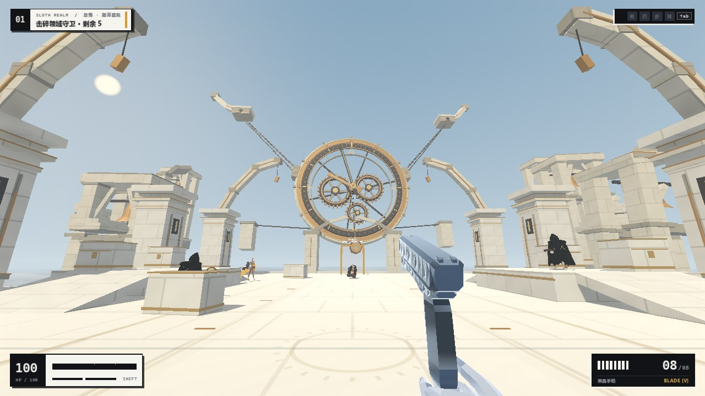

# 怠惰悬钟庭院 · 巨钟卡在最后一格

三间正式怠惰房共用厚石钟壳、旧金刻度、夹层齿轮、链节、悬臂、长杆短摆锤和山墙残拱。两侧六座浮空钟楼分成近、中、远三层，带开敞钟室和断裂的浮廊。第二关的残拱和外侧钟楼更不对称，沉眠巨像房用尺寸更大的钟。

巨钟每 8.4 秒尝试前进一次。指针接近最后一格时卡住，再滑回原位。摆锤平时最大摆角约 2.5°。暂停会冻结动作，怠惰剥夺后沿用原有快节拍，时钟的齿圈与指针随之转动。

近处用带灰缝的白灰石材、暗金铺地图案、柱身嵌件和掩体铜箍补足细节。场景沿用 40×48 米战斗台、1.25 米侧台与坡道，以及出生点到门扉 36 米的路线。新增高空建筑和机械件为景观。

| 改造前入口 | 改造后入口 |
| --- | --- |
|  |  |
| **第二关侧台** | **沉眠巨像房** |
|  |  |

四张图来自 Godot 4.7.2 Forward+ 正式关卡的玩家相机。入口前后保持同机位。PNG 转为 JPEG。原生 64 项与六组回归 441 项通过，涵盖时钟进退、暂停、剥夺、坡道与寻路、敌人技能和完整战役。自由交战时的阅读体验与低配置帧率留待试玩。

[改造前日志](baseline.log) · [原生验证](native.log) · [回归结果](regression.log)
