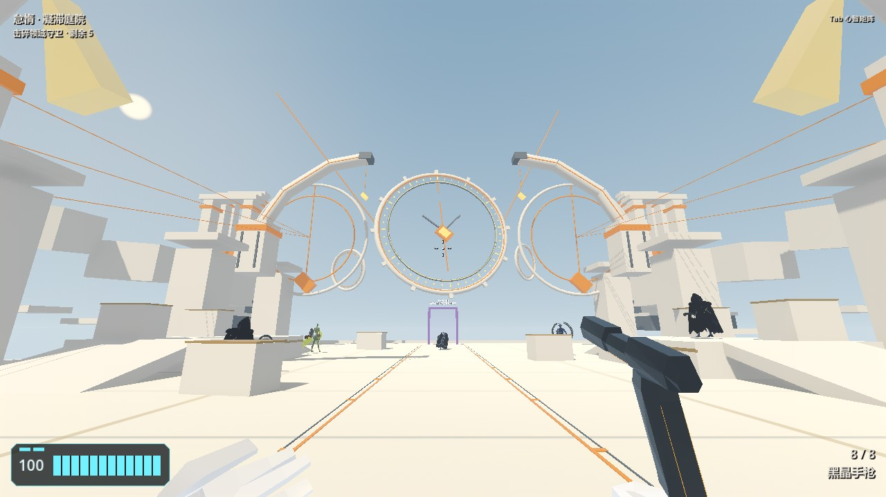
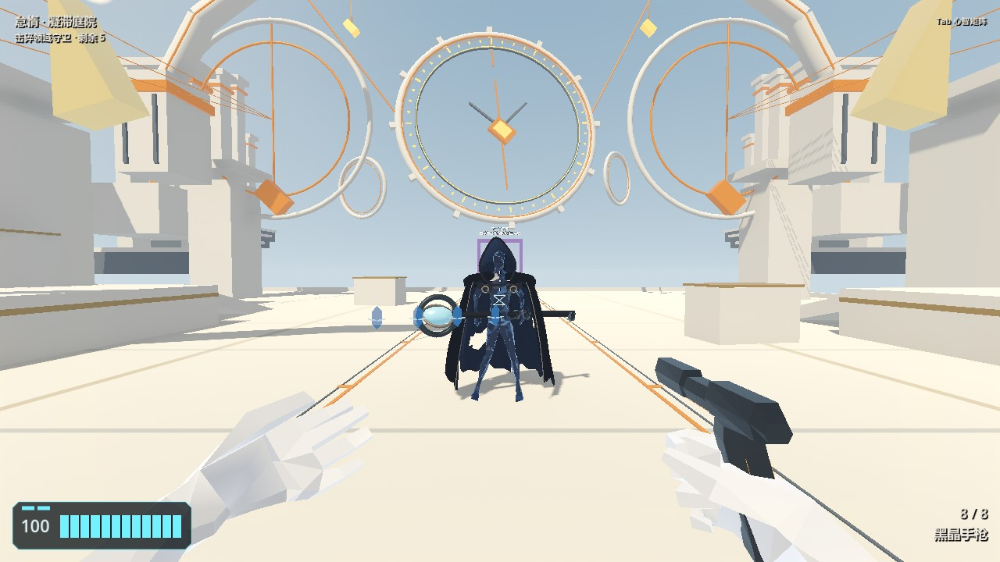
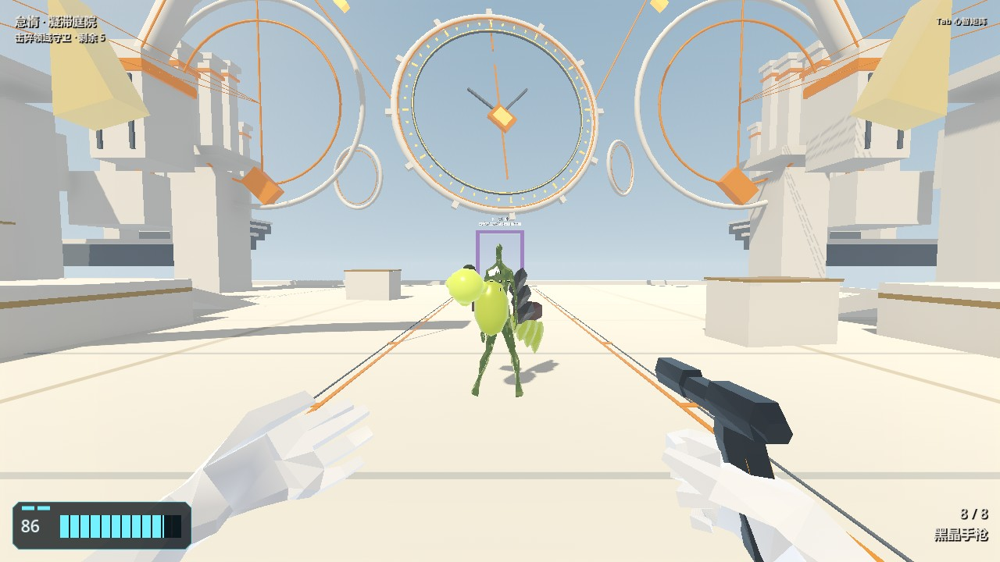
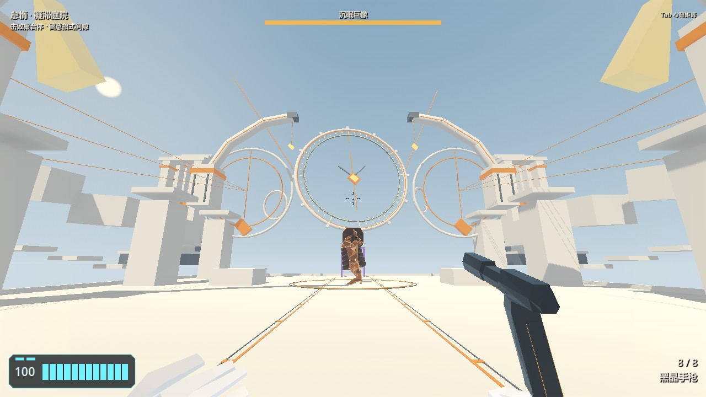

# 怠惰 · 悬钟庭院与守卫

基于已合并 PR #225 的主线 `91b0ce9`。用户希望在上方增加宏大的景物，地形比原庭院更细致，恢复 [PR #92](https://github.com/kyrie21z/Battlefield-Rouge/pull/92) 方向的三种敌人技能，并加入持杖四连发和新的黏液敌人。

## 场景

小关保留 40×48 米战斗平台与中央路线，出生到门扉的纵向距离为 36 米。两边各有 1.25 米高台，前后都有坡道，侧台掩体留出可以交战的通道。第二房错开高台和掩体，进入后有不同的射击角度。钟面、刻度、断拱、悬灯、远处浮空钟楼和云层延伸视野。Boss 房使用更大的悬钟，保留原战斗地面和单 Boss 编排。

建筑阴影与金属镶条给白石分层。地板分缝在原材质内绘制，上方刻度使用批量绘制。远景模型没有碰撞，不参加导航烘焙。

## 守卫

| 守卫 | 生命 | 玩法 |
| --- | ---: | --- |
| 迟滞者 | 90 | 藏青兜帽和破洞披风，右手持钟环法杖。四枚晶体在杖头附近凝聚 2 秒，最后 0.45 秒锁向，再以 0.18 秒间隔直射。速度 40 米/秒，每枚基础伤害 9。闭篷单弹闪避率 30%，成功冷却 2.5 秒。施法后段暴露双倍胸口弱点，结束或被打断后保留 1 秒。 |
| 锚定者 | 140 | 原地向玩家脚下放定点领域。0.95 秒前摇，半径 3.2 米，持续 2.6 秒，领域内步行减速 25%。掩体、离开范围和击倒施法者均可脱离，可冲刺。 |
| 退缩者 | 180 | 接近后开壳，0.95 秒前摇发低位扩散波。半径 7 米，波速 9 米/秒，命中一次 14 伤，朝起手方向留下 44° 缺口。可跳过、钻缺口或用实体掩体挡；释放后开壳弱点保留 1.6 秒。 |
| 凝胶异形 | 105 | 不对称的肩背、歪头和拉长的手臂。1.15 秒蓄力，最后 0.35 秒锁向，发射 12 米/秒的直线球。命中后步行减速 35%，每 0.25 秒结算 2.5 点，共四次。定向投射可绕开、被墙挡住或弹反。近战击退可打断前摇；同类持续效果刷新时长，不叠加并行伤害。 |

两小关各增加一名持杖迟滞者与一名凝胶异形。第一房的编排为 2 杖、1 锚、1 退缩、1 凝胶，共 5 名。第二房为 3 杖、2 锚、1 退缩、1 凝胶，共 7 名。伤害和生命沿用领域深度缩放。凝胶段伤害走正常防御结算，深渊、死亡、过门与选卡沿用正式关流程。旧的占点路线与旧独立测试房仍用原配置。

## 验证

Godot 4.7.2 原生 Forward+ / Vulkan / RTX 4060 Laptop GPU，1280×720。专门检查覆盖实际走上侧台、导航到达高台、AI 主动起手、四弹释放与锁向后横移、定点减速、低位波缺口与命中、黏液遮挡与四段伤害、暂停及近战打断。原生画面、无界面回归、主线与当前分支的 fixture 结果见本目录日志。

原生 33 项通过，含 4 张截图。14 组相关无界面测试通过，其中正式战役 98 项、天赋球 68 项、新怠惰战斗 29 项、领域坠落 24 项。与主线文件树一致的基线和本分支分别运行固定 60 Hz fixture，FX-001 保持 `edc3fc82c34f1bc0`，FX-002 保持 `ad3703cd93d3073e`。重新运行地图生成器仅产生第二房的 `chamber_style` 预期改动。原生与相关运行日志无脚本错误。源码、证据和截图的 SHA256 记在 `validation.json`。

Windows 导入仍记录了宿主已知的 `Safe save failed`。本次移除了上游选卡取图场景开头导致 Godot 解析失败的 UTF‑8 BOM。该文件的场景节点保持原样。敌人数与攻击强度为目前的试玩默认。

