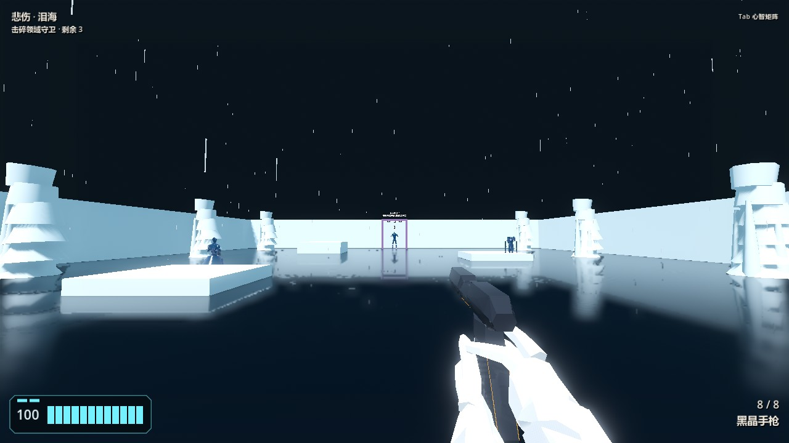
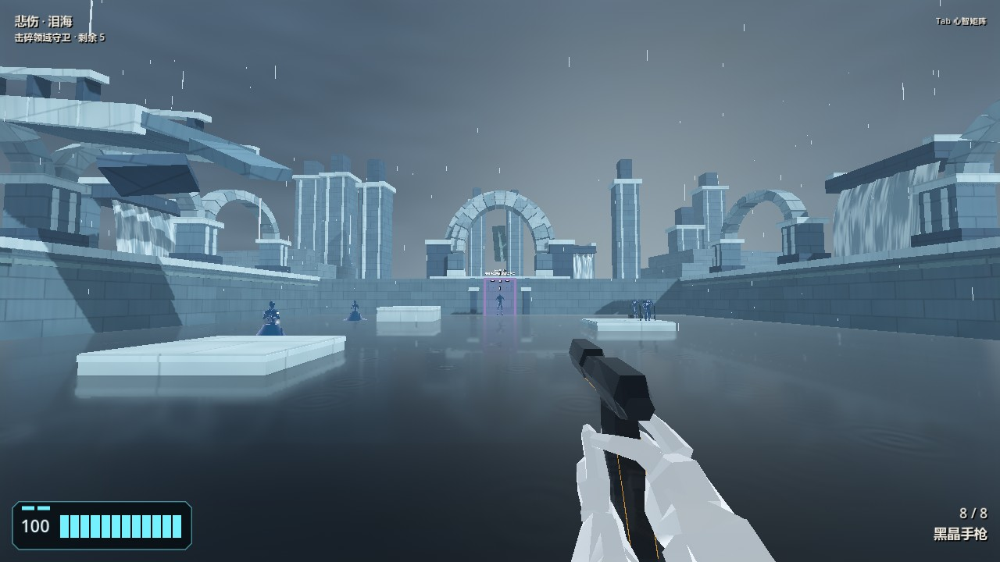
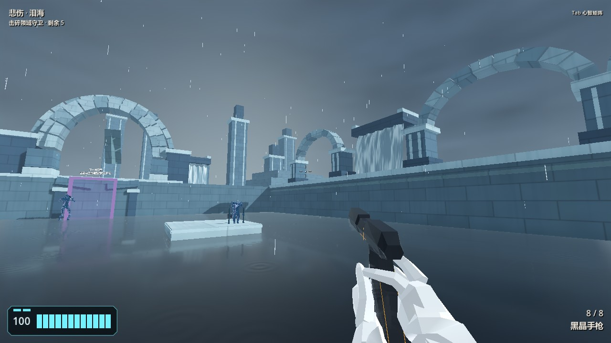
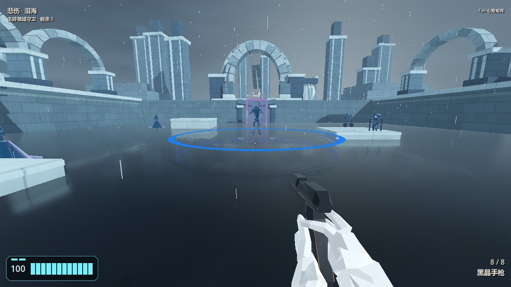

# 悲伤前两关 · 沉没回廊

正式战役的 `sorrow_1` 和 `sorrow_2` 共用新场景。进场后沿浅水看向出口，近处的石拱和西侧断桥逐层框出远塔。三道溢流从外侧堤坝落入低处蓄水区。冷灰石材有板缝、积水线和雨痕，远处塔群在雨雾中逐层淡去。

战斗区为 40×48 米，出生点距门扉 36 米。中央是一条直行路线，四块原有石台之间仍可绕行。新建筑与溢流由独立的视觉节点绘制。两关分别布置三名和五名守卫，沿用原位置及行为。主池水深 0.14 米。正式战役保留涉水声音、移动涟漪和屏幕空间反射。悲伤剥夺会一并停止雨水与外侧溢流，石材失去潮湿色泽。

## 实机

| 原场景入口 | 新版悲伤第一关 |
| --- | --- |
|  |  |

| 新版悲伤第二关 | 右侧溢流 |
| --- | --- |
|  |  |

## 验证

Godot 4.7.2 Forward+，1280×720，Windows / RTX 4060 Laptop GPU。29 项原生检查通过，覆盖两关的中央与侧面路线、浅水反射、涉水涟漪、雨水剥夺、清场领卡、按 F 过门及 Boss 场景。六组无界面回归共 199 项通过，覆盖悲伤敌人、水面、雨声、涉水音频、悲伤 Boss 和完整战役。[原生日志](native.log) · [回归日志](regression.log)

截图使用实际玩家视角，敌人机位固定，蓝色哭波由正式房间的哀泣者释放。测试使用 Dummy 音频驱动。低规格显卡的帧率和完整实战手感留待试玩。
