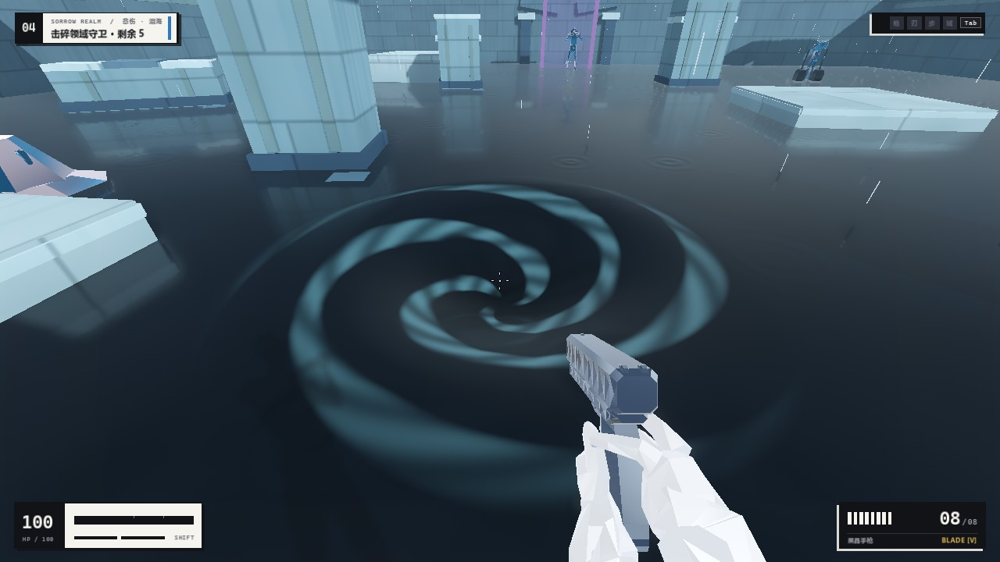
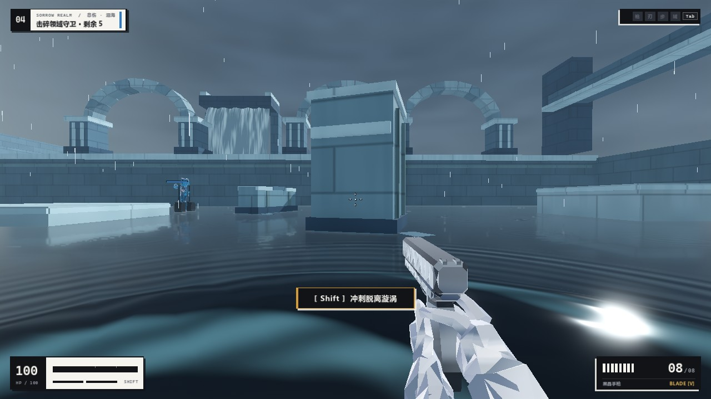

# 悲伤漩涡 · 下沉与冲刺脱困

正式悲伤前两关的漩涡将浅水中的玩家拉向中心，峰值 11 米/秒。基础步行速度为 4.4 米/秒。落入半径 0.8 米的核心后，步行和跳跃无法脱身。持枪姿态和第一人称视角会一同下沉，每秒 0.64 米，最多下沉 1.18 米。HUD 显示当前绑定的冲刺键。

冲刺期间脱离吸力。核心内的冲刺沿玩家朝向或当前方向键水平移动，低头也能冲出去，仍使用正常充能。漩涡到期时会解除吸附。吸附本身无伤害。

漩涡沿用 2.6 米范围和 0.60 米的水面漏斗。每 5 秒生成一个，各持续 15 秒。悲伤 Boss 房继续使用原有场景。

| 漩涡边缘 | 被吸进核心后的低视角 |
| --- | --- |
|  |  |

Godot 4.7.2 Forward+ 在两张正式战斗地图完成 72 项原生检查。验证了逆流仍会被吸入、走跳无法脱困、低头按 Shift 能冲出并恢复视角，以及到期释放和清场过门。实战难度体感留待试玩。

[原生日志](native.log) · [回归结果](regression.log)
