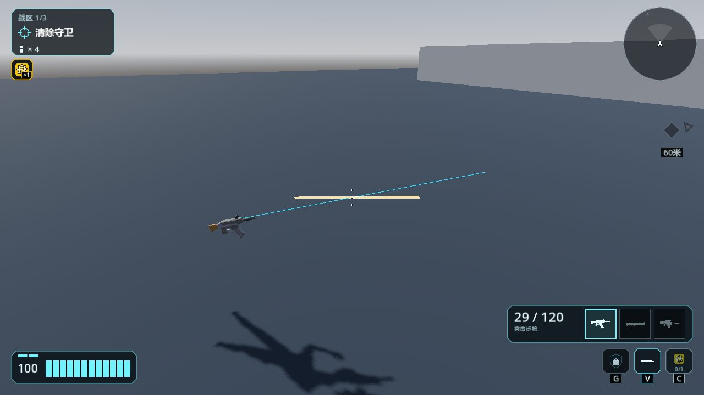

# 枪械子弹特效朝向修复

2026-11-04，Issue [#90](https://github.com/kyrie21z/Battlefield-Rouge/issues/90)，基于 main `5004e8c`。

## 问题与修复

枪械转身、抬枪或低头后，金色曳光会横着飞或变形。`Tracer._place()` 先朝向射击路径，再用 `Basis.scaled()` 沿世界坐标轴非均匀拉伸；旋转后的网格因此偏离枪口到命中位置的直线，宽度也随方向改变。原测试只覆盖世界 -Z 方向，恰好无法发现该问题。

修复仅将拉伸改为直接缩放旋转基底的本地 Z 轴。世界端点沿既定弹道，横截面保持 0.014 × 0.014 米。速度 320 米/秒、完整长度 5 米、最长路径 120 米与原有回收规则沿用；伤害、射线判定、散布、枪口火焰和敌人实体子弹均未修改。

## 原生画面对照

Godot 4.7.2 / Windows / Forward+ / Vulkan / RTX 4060 Laptop，1280×720。三把枪和开镜狙击均通过真实 `Weapon.try_fire()` 生成特效，使用相同随机种子、相机、环境、网格与材质。仅在截图中冻结特效于已行进 2 米的时刻，便于看清朝向。

`--baseline` 仅在证明脚本内把同一实际生成的网格变换重放为旧公式，用于可控对照；正常证明使用修复后的真实运行实现。青色细线是证明场景额外显示的射击路径参考线，不进入正式游戏。截图日志中的输出目录已省略。

| 观察 | 修复前 | 修复后 |
| --- | --- | --- |
| 第一人称、相同位姿 | [横条错位](before-01-first-person.jpg) | [沿枪口方向延伸](after-01-first-person.jpg) |
| 外部近景、相同位姿 | [金色网格横穿参考线](before-02-observer.jpg) | [金色网格与参考线重合](after-02-observer.jpg) |




四张 JPEG 共 194,750 字节，每张小于 53 KB，已逐张目视检查。

## 验证

- 旧运行公式配合新增回归：实际测得 48 项失败、135 项通过；改为本地 Z 拉伸后，同一测试 183 项全部通过。
- 新增 54 项实际网格世界端点和横截面检查：9 种方向（直射、45/90/135 度、俯仰、垂直、近垂直）×2 种父变换（普通、旋转和非均匀缩放）×3 个飞行阶段（首帧 0.01 米、完整 5 米、末尾短段）。不依赖“最长尺寸就是 Z 轴”的假设。
- 原生旧公式对照 [before.log](before.log)：59 项通过，确认复现错位。修复后的 [after.log](after.log)：83 项通过、0 失败，无脚本或引擎错误。覆盖步枪 yaw 60° / pitch +12°、霰弹 -65° / -15°、狙击 105° / +25°、开镜狙击 -75° / -10°；每枚真实曳光的增长、完整、尾段均对齐且横截面稳定。
- 旧公式的步枪完整段与弹道点积约 0.75495，端点偏差约 1.737 米，横截面宽约 0.0608 米；修复后所有原生样本点积显示为 1.000000，宽高均为 0.014000 米，端点浮点误差小于 0.00001 米。

| 回归场景 | 通过项 | 日志 |
| --- | ---: | --- |
| gun_feel_test | 183 | [开火表现与曳光几何](gun_feel_test.log) |
| weapons_test | 38 | [三枪、换弹与狙击镜](weapons_test.log) |
| enemy_bullet_test | 6 | [敌人子弹与薄墙碰撞](enemy_bullet_test.log) |
| reflected_round_test | 6 | [收藏弹、遮挡与伤害](reflected_round_test.log) |

四个最终回归均退出 0，断言无失败。`weapons_test` 退出时仍有 11 个 ObjectDB 实例和 2 个资源占用清理诊断；本次没有改对象生命周期，也未宣称修复该退出诊断。原生修复日志无该诊断。未执行长期性能或跨平台检查。

## 复查

在项目根目录用 Godot 4.7.2：

```powershell
godot --headless --path "." "res://tests/gun_feel_test.tscn"
godot --path "." "res://tests/tracer_direction_proof.tscn" -- --baseline
godot --path "." "res://tests/tracer_direction_proof.tscn"
```
