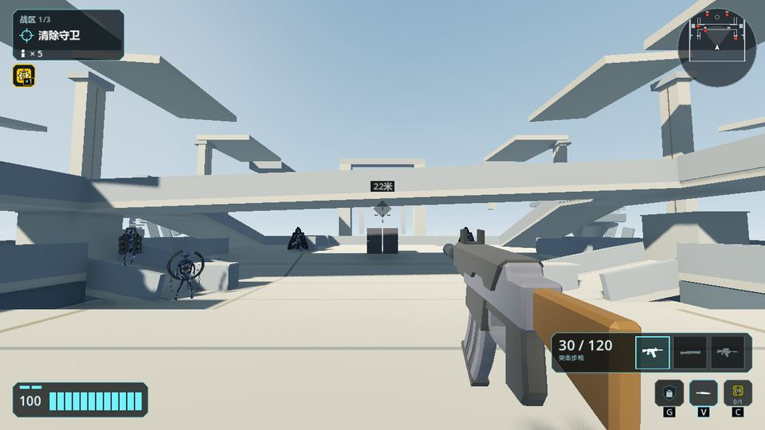
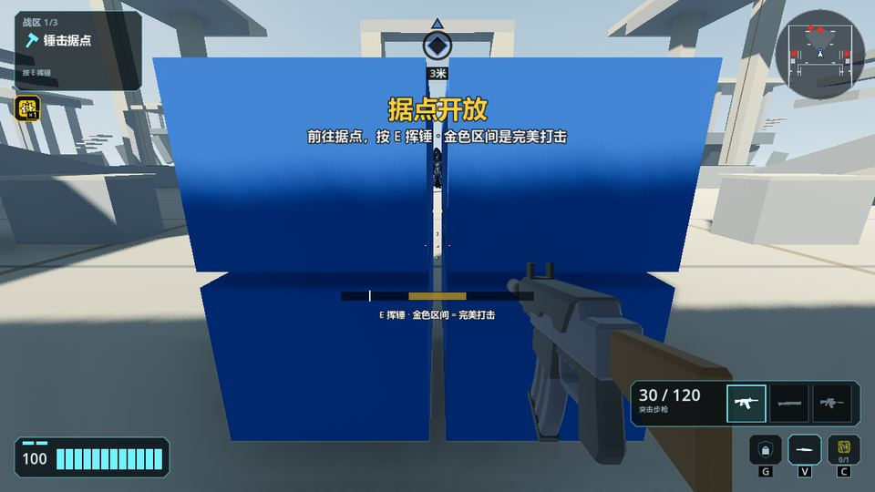

# 开场减员与增援翻倍 · 2026-11-08

用户要求“第一波下调1–2个，第二波在原数量基础上翻倍”。当前按每关开场守卫和据点开放后的增援调整，继续修订草稿PR #98，未合并main。

| 阶段 | 前轮 | 当前 |
| --- | --- | --- |
| 两小关开场Sloth守卫 | 7 / 11 | **5 / 9**，各减2 |
| Boss开场小怪 | 11 | **9**，减2；Boss本体仍1、两近卫保留 |
| 小关据点开放后每批增援 | 2 | **4** |
| 增援间隔 | 10秒 | **10秒** |
| 场上增援上限 | 5 | **8**，容纳两批完整4人；满场等待，有多少空位补多少 |

第一关保留三类敌人，第二关保留双高台和三类敌人。地形、目标距离、主动AI、四连弹、持续反击盾及通关流程不变。Boss仍无据点增援阶段。

## 安全刷新

生产10秒间隔实测发现：上一批可能留在刷新点射击，下一批复用该点会重叠。选择候选点和最远fallback现在都会用ENEMIES胶囊检查占位；全部占位时少刷/等待下一次，不强行堆叠。缓存形状为高2米/半径0.6米、中心上移1米，包含实际Sloth的1.94米高/0.34米半径身体并留余量，只在刷新时查询，不逐帧执行、不增加随机抽样。

两小关各9个刷新点，新增后庭(-6,0,-22)/(6,0,-22)，实际胶囊不碰WORLD、导航楼层正确，给两批各4人留足空位。同一波不重复选点，跨波也跳过仍被占用的点。

## 本轮验证

本轮11组相关检查通过，逐组摘要和日志哈希见[validation-results.json](validation-results.json)：布局55、Boss63、HUD295、增援77、刷新视线、射击位、小地图、整局选卡、阶段横幅、完整流程与fixture。完整流程headless146项、Forward+原生161项通过；前轮[持续反击盾证明](../counter-pressure/README.md)的38组、旧7/11/11与旧哈希保留其历史口径，本轮没有重复整套38组。

[增援77项](reinforcement.log)实测生产配置4→8、满场不再创建、杀2只补2、全部9点占位时0候选/0创建、解除阻塞后补4，实际10秒两批出生胶囊均无重叠；动态8/8进入有效可视射位、jitter=0。插旗退场、F增益台与关卡推进保持。[布局](layout.log)、[新增两点物理/导航](extra-markers.log)、[完整headless](integration-headless.log)、[原生](integration-native.log)。

固定种子6次全胜、同seed两遍一致、换seed不同；未改机器人或fixture，[日志](fixture.log)：

| 起点 | seed | 结果/ticks | 哈希 |
| --- | --- | --- | --- |
| FX-001（两遍） | 1001 | 胜利/2166 | `a1bb290e0dc25f8c` |
| FX-001 | 1002 | 胜利/2218 | `c7e573a3bfe2d38a` |
| FX-002（两遍） | 2002 | 胜利/810 | `6ae040f6fd0e10ae` |
| FX-002 | 2003 | 胜利/740 | `2ee02df836fa7b07` |

## 原生画面





第二图顶部按原HUD设计显示“锤击据点”，不显示×4；4名增援数量由真实director断言/日志验证，小地图红点作辅助。两图为本轮Godot4.7.2 Windows Forward+原生PNG的缩放/JPEG重编码；走查角色受保护以完成观察，生成数量/间隔/位置/AI不改。当前源码/地图/图片哈希见[SHA256SUMS](SHA256SUMS.txt)，文本按Git LF字节。

复现：

```text
godot --headless --path . res://tests/reinforcement_test.tscn
godot --headless --path . res://tests/enemy_layout_test.tscn
godot --headless --path . res://tests/sloth_integration_test.tscn
godot --headless --fixed-fps 60 --path . res://tests/fixture_test.tscn
```

本机Godot仅保留既有root certificate store启动诊断（空工程亦复现）。本次为波次数量调整，未重新测帧时或跨平台；真人难度反馈继续待收集。
