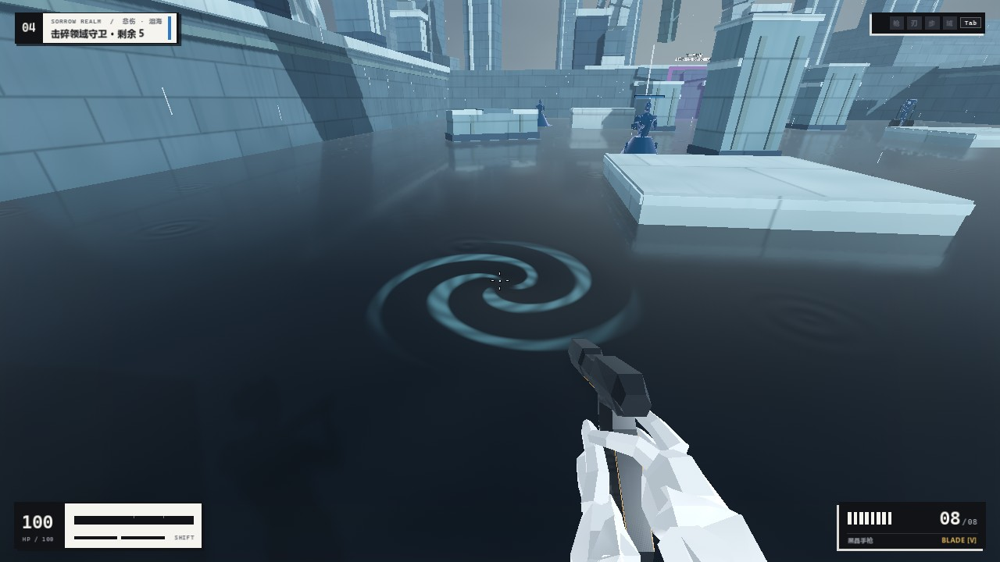

# 悲伤小漩涡与怠惰减速阵

基于 #254 合并后的主线 `ac41094`。

- 悲伤前两关开场各出现一个半径 1.35 米的水面漩涡。从 8 处避开掩体的浅水点中按本局种子与关号抽取，每轴偏移最多 0.35 米。漩涡为水面特效，行走不受影响。
- 怠惰锚定者的减速阵生效时，阵内移动速度为 75%，Shift 冲刺无法启动且保留充能。预警期和离开阵后可以冲刺。

| 悲伤第一关 | 悲伤第二关 |
| --- | --- |
|  |  |

Godot 4.7.2 Forward+ 实机检查通过。悲伤场景 39 项，包括落点、中央与侧路、实机领卡和按 F 过门。怠惰敌人 65 项，包括向实际玩家发送 Shift 动作、验证充能和出阵冲刺距离。回归覆盖战役 98 项、冲刺 49 项、怠惰战斗 48 项及悲伤水面 32 项。

[悲伤实机日志](sorrow-native.log) · [怠惰实机日志](sloth-native.log)
