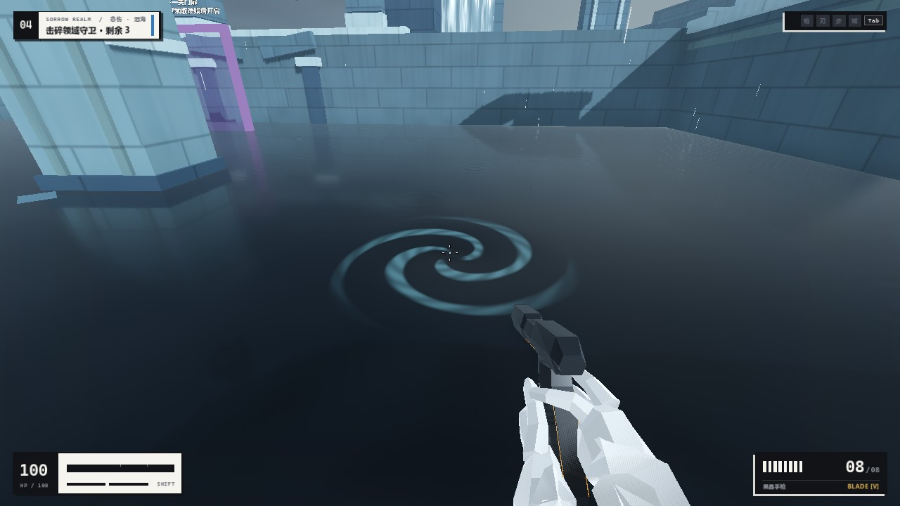

# 悲伤漩涡与怠惰减速阵

基于 #254 合并后的主线 `ac41094`。

> 此页保留初版漩涡的验证记录。更新后的吸附、下沉和冲刺脱困见[悲伤漩涡脱困](../sorrow-vortex-escape/README.md)。

- 悲伤前两关开场出现第一个漩涡，此后每 5 秒随机生成一个。每个持续 15 秒，因此最多三个同时存在。每个半径 2.6 米，位置从 13 处避开掩体的浅水区域抽取。
- 漩涡的水面网格可向下弯曲 0.60 米，带流向中心的涡纹和水脊。玩家站在水中时受到水平吸力，默认峰值 1.25 米/秒，并限制在当前步行速度的 48% 以内。实测逆着水流步行即可离开。
- 怠惰锚定者的减速阵生效时，阵内步行速度为 75%，Shift 冲刺无法启动且保留充能。预警期和离开阵后可以冲刺。

| 悲伤第一关 | 悲伤第二关 |
| --- | --- |
|  |  |

Godot 4.7.2 Forward+ 实机检查通过。悲伤场景 57 项，包括漩涡生成和到期、站定受到吸力与徒步出圈、中央与侧路、实机领卡和按 F 过门。怠惰敌人 65 项，包括阵内按 Shift 保留充能以及出阵恢复原冲刺距离。

[悲伤实机日志](sorrow-native.log) · [怠惰实机日志](sloth-native.log)
