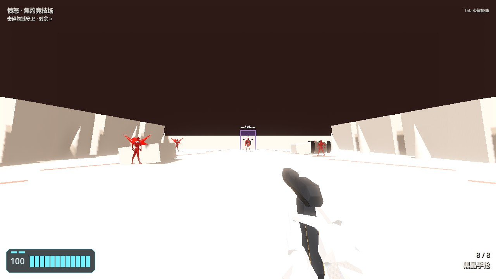
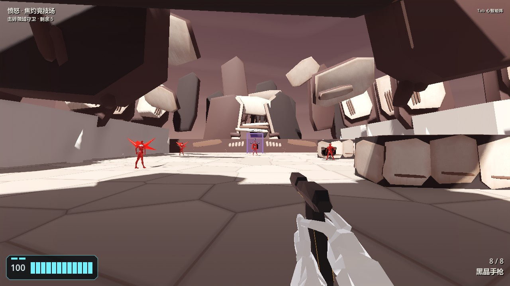
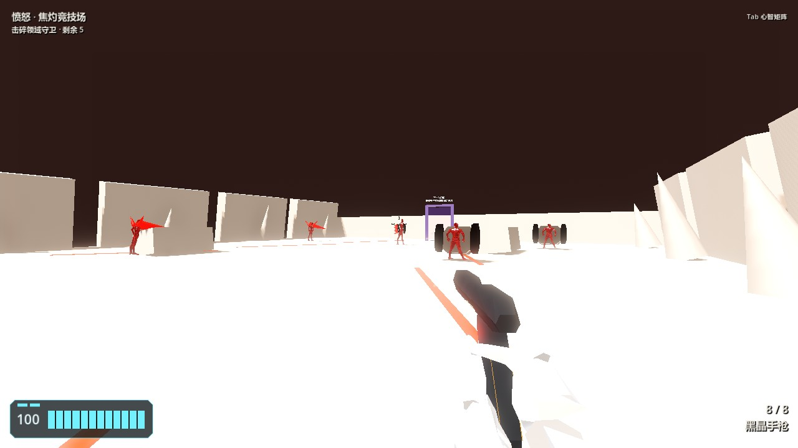
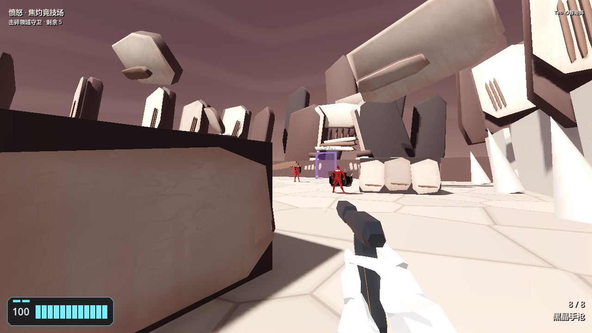
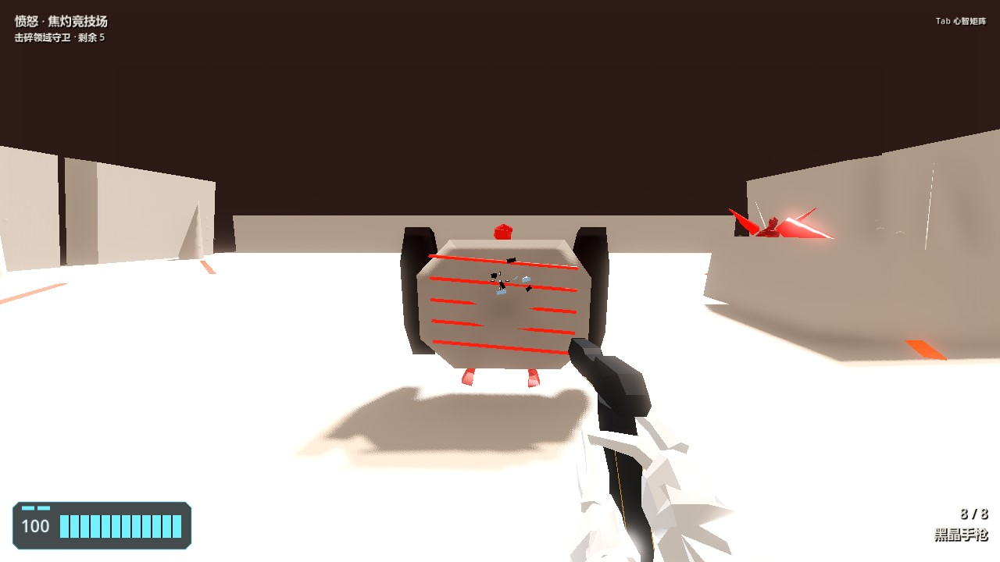
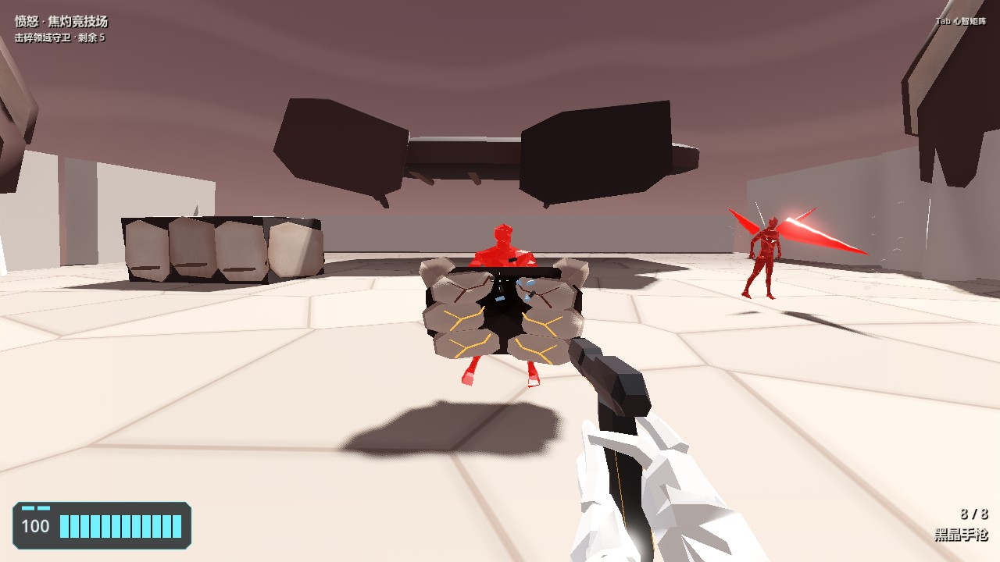
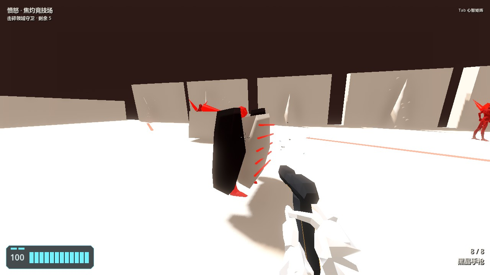
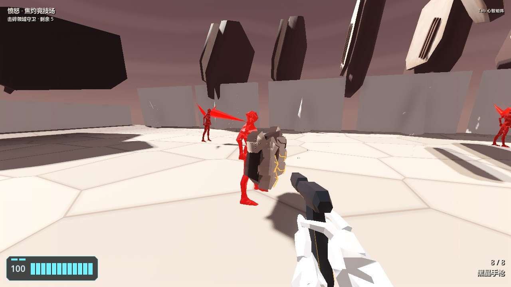

# 愤怒第二小关 · 裂瓷熔窑

2026-11-20 的后续版本新增了立体熔流、兽皮塔、三种守卫装备与读报者。当前试玩图、交战数值和复验记录见[本轮熔窑与守卫](foundry/README.md)。下文是 11 月 19 日存档的原始对照。

本轮基于主线 `8528ac1658a68d28ca026a4832f31eda60ab5312`。愤怒第二小关在暗入口上方悬置厚瓷板，视线越过顶棚后看到开阔战区和歪斜的窑门。地面的裂纹用哑光深色画在原地面材质里，亮橙色用于蓄压和攻击反馈。

最后一轮细化增加了版片烧痕、瓷釉细纹、入场斜撑、悬板的断裂夹层、窑门的多层横楣和远景烟尘色带。对照图使用这次细化后的版本。当前在本地存档，等待下一轮调整。

中央保留长射线。右侧用两块已有用途的实体掩体错开视线，第一块护住进入侧路的位置，外侧留出冲刺空间，从 `x≈14.7` 米处可切向蓄压者。两条路线在门扉前汇合。战斗平台为 40×48 米，出生点到门扉的纵向距离为 36 米。新窑壳、悬板和远景均为纯视觉节点。空间推敲参考灰盒和掩体设计资料、巨型建筑的明暗以及重复几何的纵深。[The Level Design Book](https://book.leveldesignbook.com/process/blockout) · [Cover](https://book.leveldesignbook.com/process/combat/cover) · [NaissanceE](https://store.steampowered.com/app/265690/NaissanceE/) · [Manifold Garden](https://manifold.garden/)

蓄压者的晶体骨架外新增六片带倒角的瓷质盾板，夹层和斜撑在侧面可见。正面挡枪给蓄压加值，盾板裂纹由下至上分三段亮起。护盾判定沿用原有正面扇区，范围内的头部射击也会被格挡。绕出正面后，枪弹可分别命中裸露的躯干和头部。两间愤怒小关的蓄压者共享新外观。

## 同机位原生对照

四对画面均由同一测试场景在 Godot 4.7.2 Forward+ 原生渲染，1280×720，RTX 4060 Laptop GPU。使用生产玩家相机。敌人近景将同一蓄压者摆到固定位置，并用两发实际正面射击为盾板蓄压，便于对照。图像只做 PNG 到 JPEG 编码。

| 机位 | 改造前 | 改造后 |
| --- | --- | --- |
| 出生点看向中央和门扉 |  |  |
| 右侧掩体看向战区 |  |  |
| 蓄压者正面 |  |  |
| 蓄压者侧面 |  |  |

## 验证

- 原生场景 28 项通过，涵盖两条路线的实际移动和冲刺、射线及五个敌人出生点、真实 AI 绕行、正面躯干和头部挡枪、分段蓄压、侧面两种命中、清场领卡和 F 门扉交接。路线验证时固定守卫的初始位置，另启一名实际 AI 测其绕行。首房与 Boss 房均进入核对，相关战役回归检查后续场景切换。[原生基线](baseline.log) · [原生验收](native.log)
- 美术初版无界面的愤怒敌人 28 项、正式房间 27 项、愤怒 Boss 23 项、完整战役 98 项通过。最后一轮材质与装饰细化后复跑上述 28 项原生检查。[回归日志](regression.log)
- 先调整两块灰盒掩体检查侧向遮挡与绕行。中央走线避开原来就在中央的守卫驻位。重新生成地图仅修改 `wrath_2.tscn` 的样式参数。[生成日志](generate.log)
- 画面在当前 Windows 和显卡上检查。最终原生执行用 Dummy 音频后端，音色和其他设备画质、帧率留待试玩。未进行所有守卫自由交战下的手动平衡评估。

## 修改文件

- `environments/wrath/realm.gd`、`environments/wrath/cracked_kiln.gd`、`assets/materials/wrath_kiln_*.gdshader` 控制新房间的样式、实体掩体、瓷釉与远景渲染。
- `tools/gen_realms.py` 和生成的 `maps/realms/wrath_2.tscn` 只为正式第二小关启用样式。
- `actors/enemy/wrath/wrath_visual.gd` 增加蓄压者盾板与蓄压材质。
- `tests/wrath_kiln_proof.gd` 与对应场景复用生产关卡生成实机对照、验证线路和交互。日志、图片和核心源码的 Git 字节数与 SHA256 见 [验证记录](validation.json)。
