# 裂瓷熔窑与愤怒守卫

正式战役的愤怒第一、第二小关都使用裂瓷熔窑，战斗台为 40×48 米，出生点距门扉 36 米。第一小关有三名守卫。第二小关有五名守卫，读报者占用原来第二名穿刺者的出生点。

## 可以主动激怒的读报者

| 静读 | 首次普通命中撕开报纸 | 近身出拳 |
| --- | --- | --- |
| 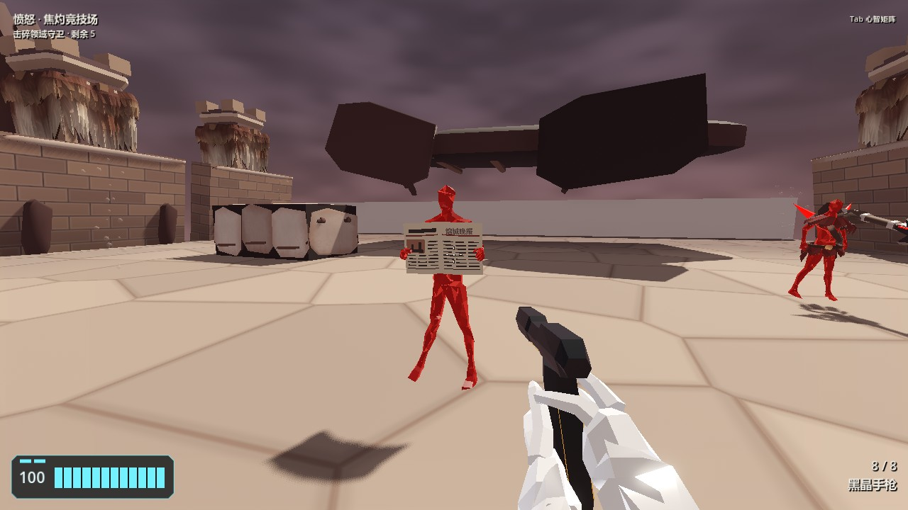 | 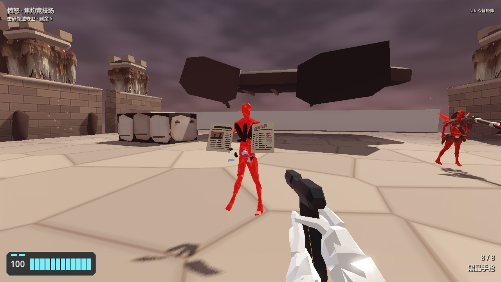 | 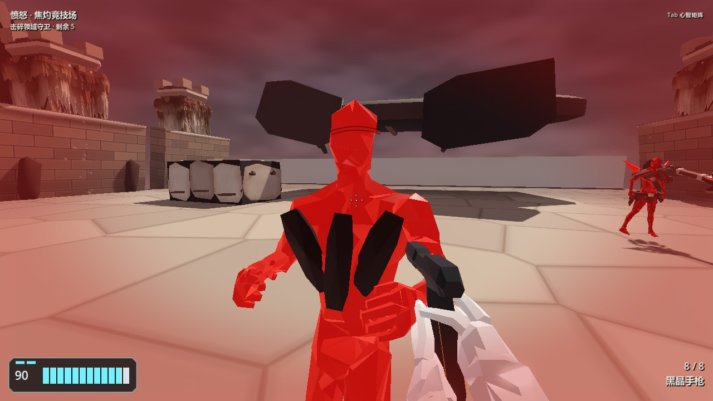 |

读报者有 90 点基础生命，静读时以 3 米/秒走动，在玩家身旁会停下来。首发枪击或刀击被报纸挡下，后续攻击立即扣血。真实伤害沿用穿透规则。撕报后立即以 9.2 米/秒追击，在 4 米内看见玩家就锁向出拳，以 20 米/秒冲出最多 0.17 秒，接触只打一次，基础伤害 10。打中或落空都休整 0.9 秒。领域难度缩放生命与伤害，时间停止能冻结撕报和攻击。读报者依然会受击退影响。

## 三种原有守卫

| 守卫 | 上一版 | 当前装备 |
| --- | --- | --- |
| 穿刺者 | 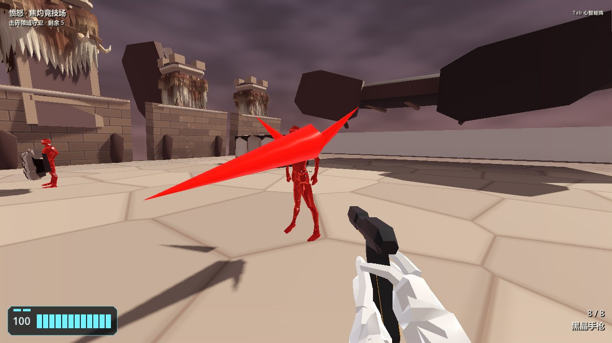 | 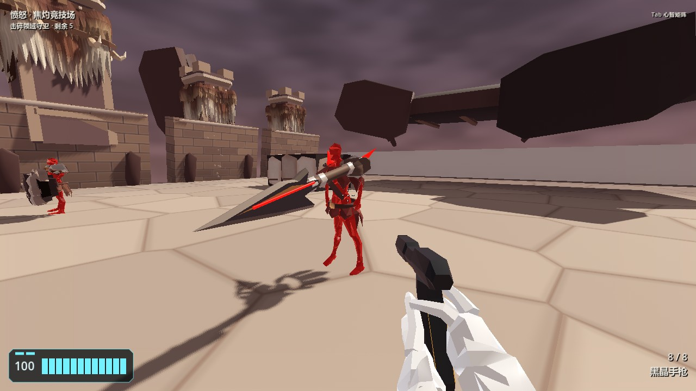 |
| 蓄压者 | 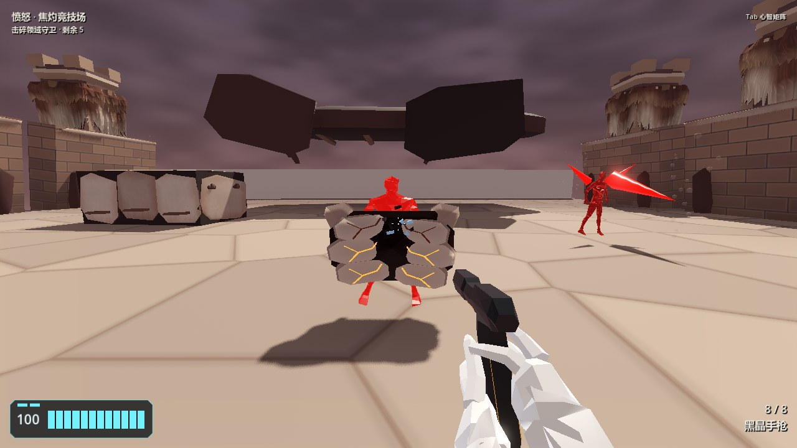 | 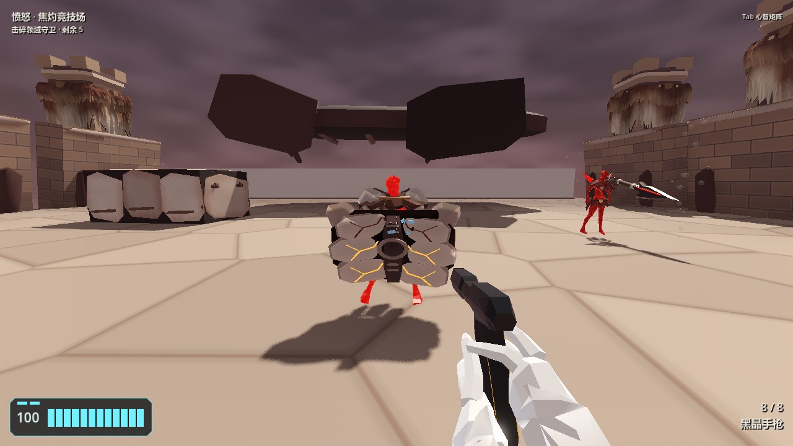 |
| 蓄压者侧面 | 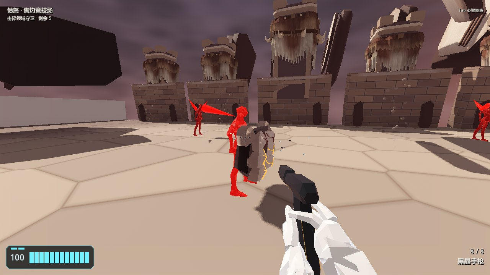 | 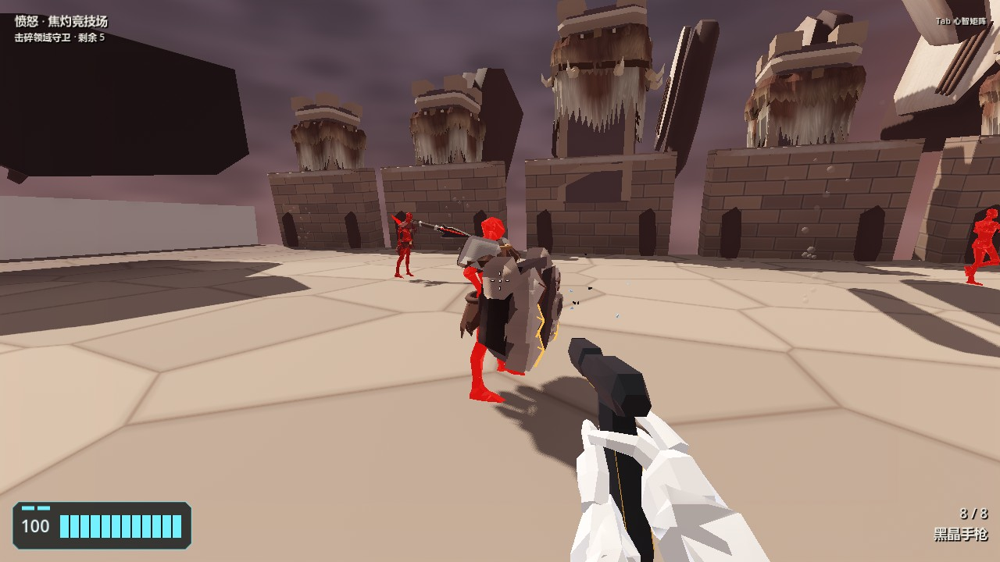 |
| 侵犯者 | 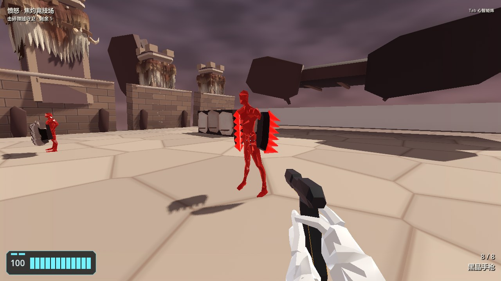 | 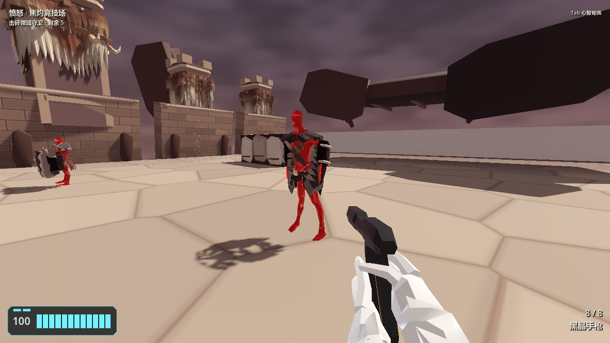 |

这些装备跟随原有晶体骨架。盾上的三段发光裂纹继续读取实际蓄压值。

## 熔窑与兽皮塔

| 第一小关入口 | 第二小关入口 | 右侧绕行路 |
| --- | --- | --- |
| 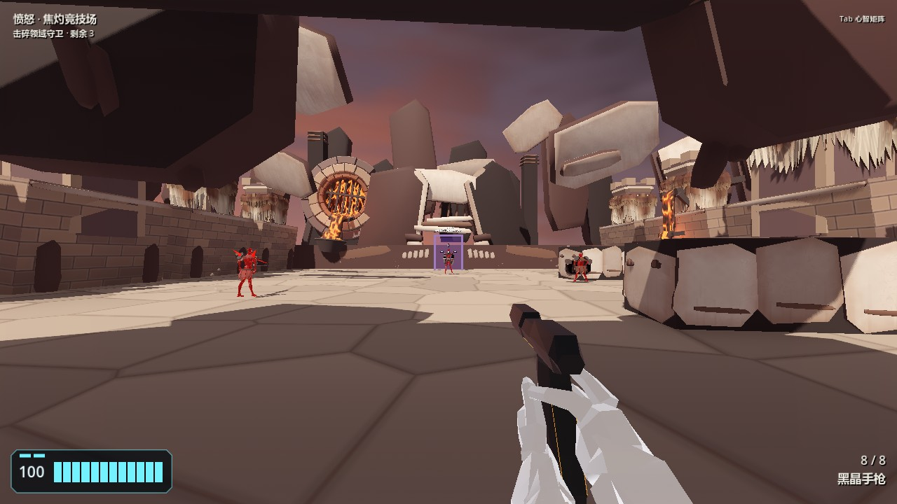 |  | 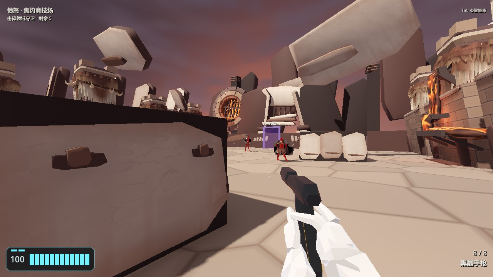 |

| 主炉与接浆钵 | 熔槽侧面 | 从下往上看熔流 |
| --- | --- | --- |
| 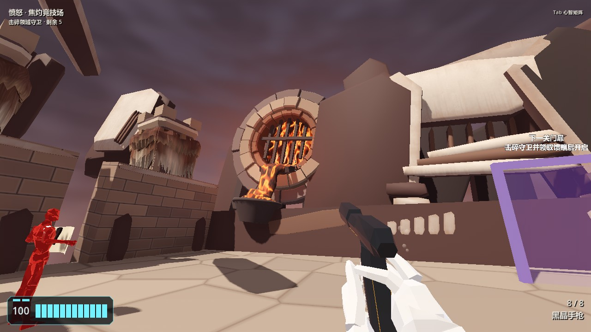 | 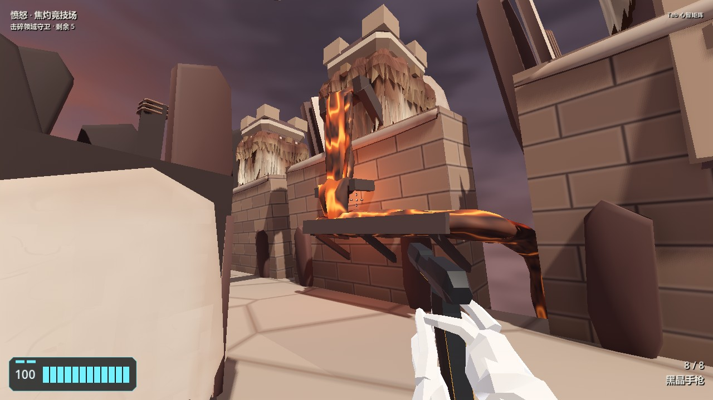 | 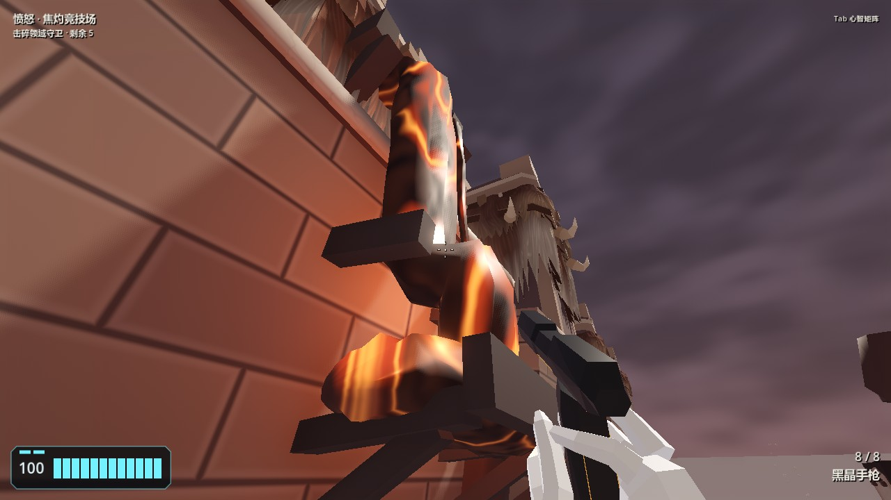 |

| 西排塔轮廓 | 东塔兽皮近景 |
| --- | --- |
| 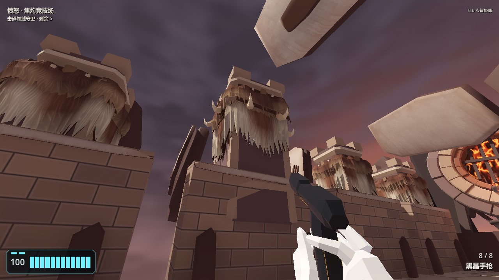 | 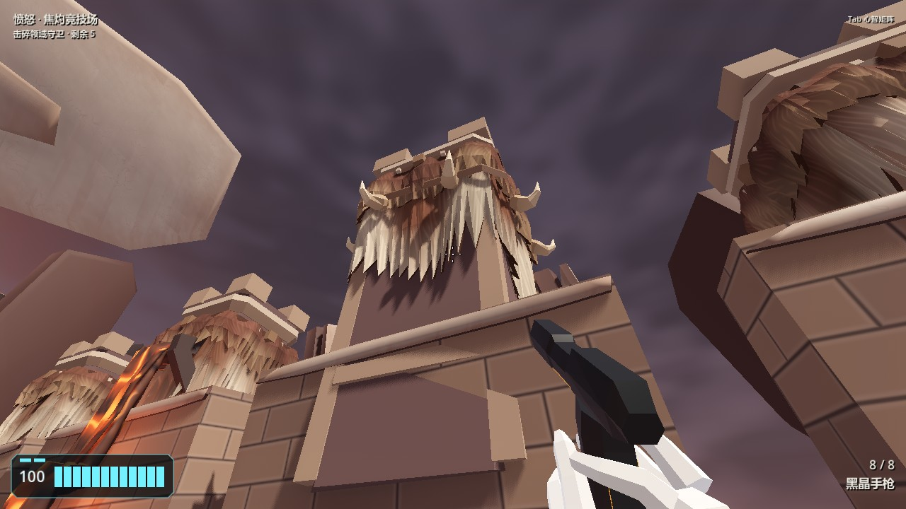 |

两侧各五座塔，共用两档塔身模型。岩浆由五段封闭几何组成，截面有 20 个顶点，转折处连续接合。落浆和支流受光、投影。失去愤怒时熔流停止、冷却，炉边局部光熄灭。以上装饰均位于环境视觉层。

## 实机与回归

- Godot 4.7.2 Forward+，Windows / RTX 4060 Laptop GPU，1280×720。66 项原生检查通过，含 16 个原生机位取图、服装与武器实拍、撕报与冲锋、封闭熔流、塔群及实际枪击。两关均核对了中央与侧面路线、AI 绕行、清场领卡和按 F 过门。[原生日志](native.log)
- 五组无界面回归共 229 项通过，其中愤怒敌人 41、正式房间 27、愤怒 Boss 23、完整战役 98、愤怒音频 40。读报者覆盖首发枪击、刀击、零伤害、真实伤害、冻结、接近即出拳、侧移、隔墙判定、单次伤害、恢复窗口及倍率。战役实际走完十二间房。[回归日志](regression.log)
- 玩家相机和敌人均来自正式场景。为便于比较，装备机位固定敌人位置，读报者冲拳机位启用了实际 AI。所有截图由原生 PNG 转为 JPEG。数值经过脚本驱动的交战验证，多敌自由战斗的手感和其他硬件的帧率留待试玩。
- 本轮开始时的旧场景和交付版，都曾在使用 Dummy 音频后端退出 Godot 时报告两个未释放对象。交付版详细退出日志指向一个 WAV 和它的播放对象。检查结果均在退出前写出。该音频清理问题仍待排查。

场景代码位于 `environments/wrath/` 和 `assets/materials/wrath_kiln_*`。入口选光和守卫编排位于 `zone/realm_stage.gd`。模型、姿态与读报机制位于 `actors/enemy/wrath/`。验证场景为 `tests/wrath_kiln_proof.tscn`、`tests/wrath_realm_test.tscn`。
