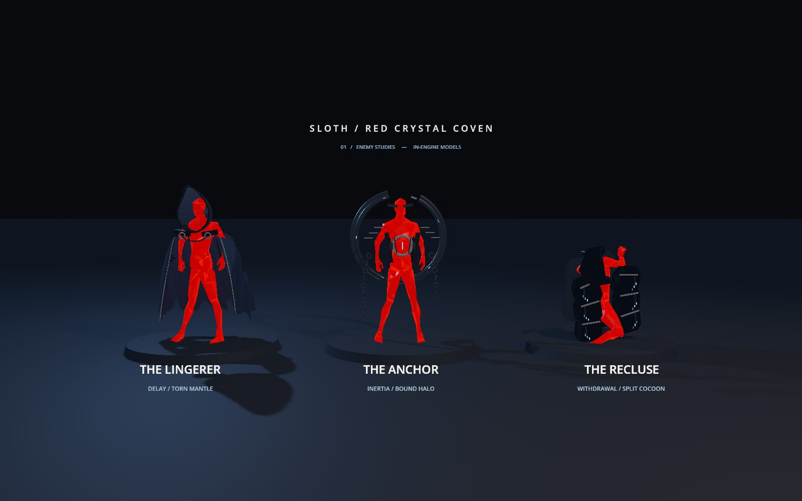
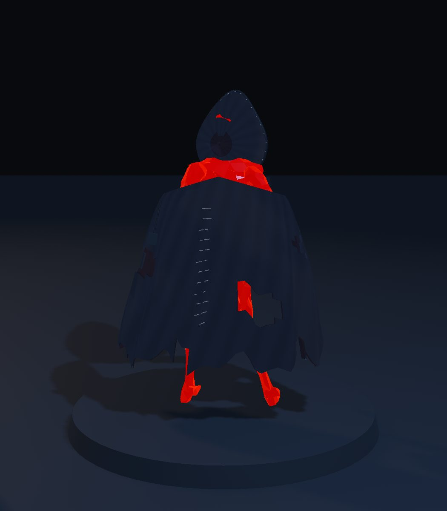

# Sloth 备用原型 · 实机与检查

2026-11-04，Godot 4.7.2 / Vulkan / Forward+ / RTX 4060。画面来自独立备用工程；JPEG仅对实机PNG作压缩编码，未重绘。正式工程没有接入本批敌人。

## 已有行为结果

- [无界面日志](functional-headless.log)：42/42通过、退出0。
- [原生窗口日志](functional-native.log)：40/42通过、退出1。双弹实际命中/锁点/侧移、领域不叠加/清理/遮挡、技能中断、真实SPACE跳跃、胸口弱点与暂停通过。原生冲刺控制组5.349米、减速组1.144米，两项严格距离断言未通过，未放宽容差或宣称已修复。
- [模型结构](visual-structure.log)：含本体11网格，三类分别21/16/40网格，39721/13962/7943顶点。

## 限制与评审状态

原生冲刺联动仍待定位。无界面固定帧退出有4个音频实例诊断；原生环境默认user://vulkan缓存目录不可写，但画面可生成。编辑器导入结束有宿主设置保存路径为空提示。它们如实保留在验证说明，不视为无错误发布。

## 还原与隔离结果

实际从固定基线还原后，无界面功能检查 **42/42通过**，原生模型展厅可渲染；16个overlay文件与原备用样本一致，地图可重新生成，输出保护与生成文档链接检查通过。

正式工程361个运行文件与基线逐字节一致，全局类缓存没有Sloth或overlay路径。原有31个测试场景中28个通过、3个配置文件读写检查失败；fixture两遍一致，FX-001为`91e7f1f7a1c5d232`，FX-002为`8d531b6cf8e98fb9`。完整范围和宿主诊断见 [打包验证](PACKAGE_VERIFICATION.md)。本次未再次执行原生功能全套，不把原有40/42改写成全通过。

保存本包不改变正式fixture或使 #47/#46 自动完成。此PR为备用草稿，真人平衡、性能、美术最终评审和正式接入另行决定。
