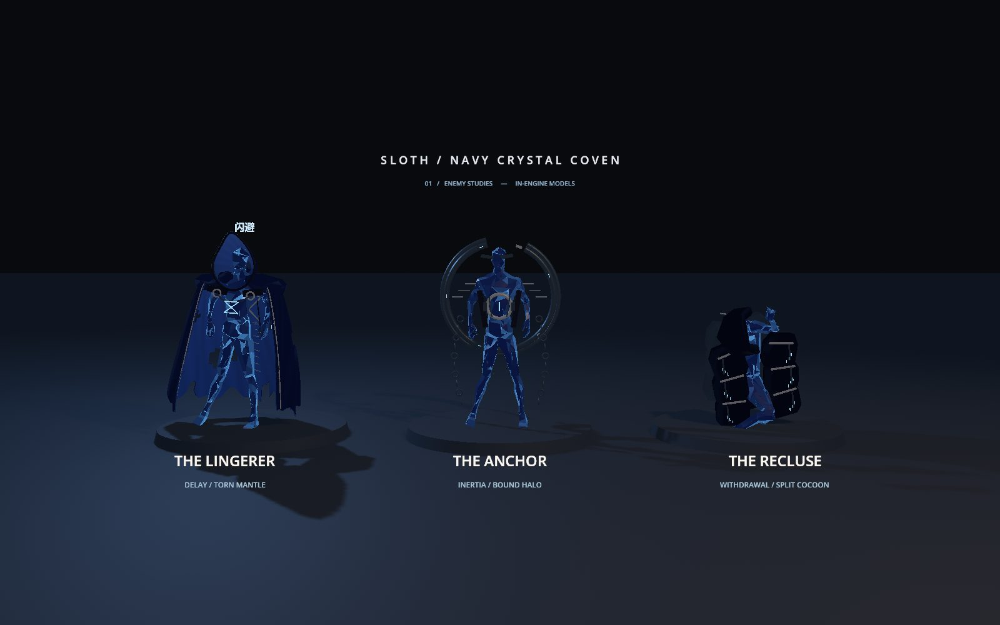
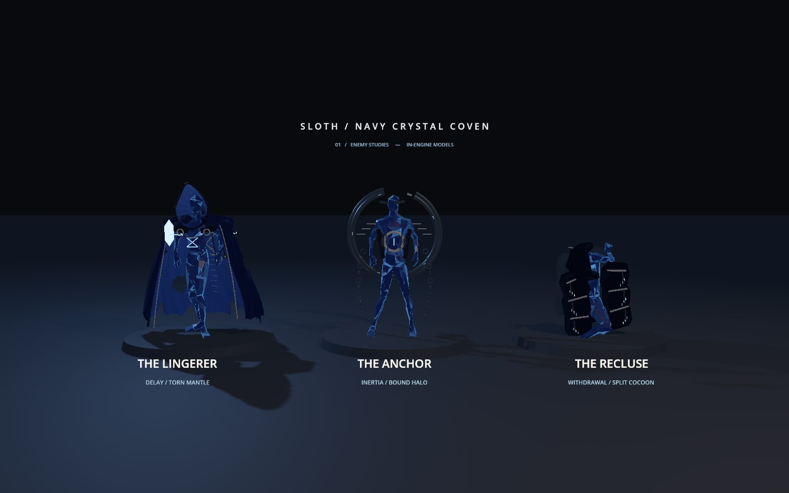
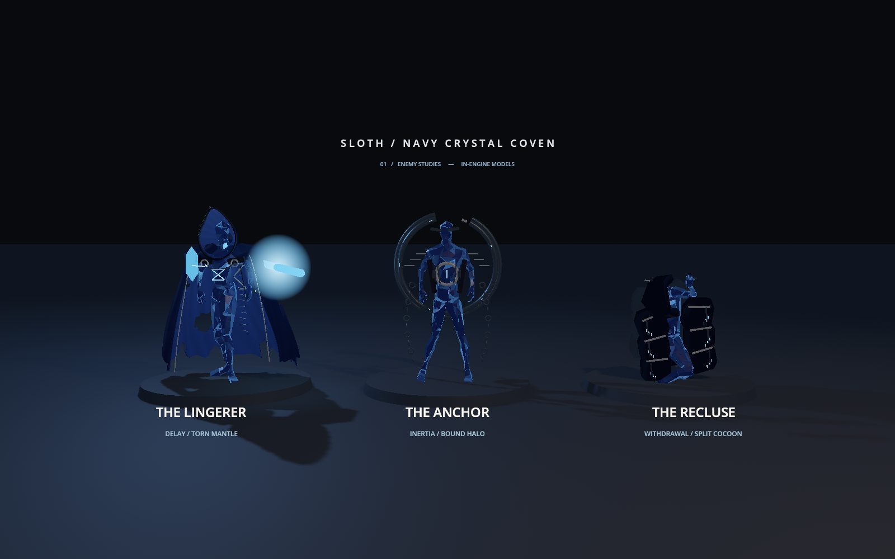

# 藏青敌人备用方案 · 当前实机与验证

基于main 438fa73（含危险弹匣#88、子弹弹道#91和入口修复#94），只应用到独立备用副本。2026-11-04增加披风30%单次子弹闪避/2.5秒成功冷却，并把双弹改为2秒凝聚、最后0.45秒锁向、40m/s释放。

此图通过同一真实Hitbox结算强制触发一次闪避，用于展示反馈；不是默认概率的统计证明。

## 当前结果

- `cloak_defense_test.tscn`：无界面21/21、原生21/21。真实枪械致命头部射线被闪避，不扣血、不误报命中、不污染碎裂点；冷却内下一弹实际击杀并按头部接触碎裂。覆盖近战/区域/开篷窗口、友伤/原有无敌、霰弹多颗粒、冷却/暂停及另两类不继承。
- 默认概率1000次独立合格命中（每次重置冷却）闪避282次；同种子64次序列可重现。此统计不等于含冷却的实战闪避率。
- `sloth_enemy_test.tscn`：无界面43/43、原生43/43。覆盖慢凝聚、最后锁向后不追踪、实际40m/s、闪避与掩体/打断等既有攻击反制；此处关闭概率防御隔离旧技能断言。固定测试视角，严格冲刺距离断言不变。
- `sloth_revision_test.tscn`：无界面27/27、原生27/27。真实头/腿命中、56片碎屑、起裂点/顺序、无倒地、暂停/回收、共享红材质、弱点和贴地标记不退化；此处同样隔离概率防御。
- 危险弹匣62项、武器及枪感回归通过。两组fixture各重复两次并换种子，0失败：FX-001为5d0e1503f50e1299，FX-002为9af355b642d0021f；这是备用敌人的结果，不替代正式main基准。

日志：functional-headless/native、navy-revision-headless/native、cloak-defense-headless/native、cloak-fixture。旧42项版日志位于history/navy-v2-*，更早40/42失败记录也保留，不作为当前结果。

## 实机与限制

Godot4.7.2 Forward+/Vulkan原生窗口，固定60步，Dummy音频驱动隔离本机设备失效，未覆盖音频硬件。三张新增JPEG来自实际技能/命中结算，仅重编码，无重绘。先前藏青剪影及56片碎裂图01–04仍保留。

宿主shader缓存目录/编辑器设置路径提示，以及无界面退出时ObjectDB/资源诊断仍存在，见cloak-host-diagnostics及相关日志。真人平衡、最终美术、性能和跨平台待做。侧身动作只是这次概率防御的视觉反馈，没有持续无敌。

[封装验证](PACKAGE_VERIFICATION.md) · [完整设计](../DESIGN.md)。正式入口和运行代码以main为准。
