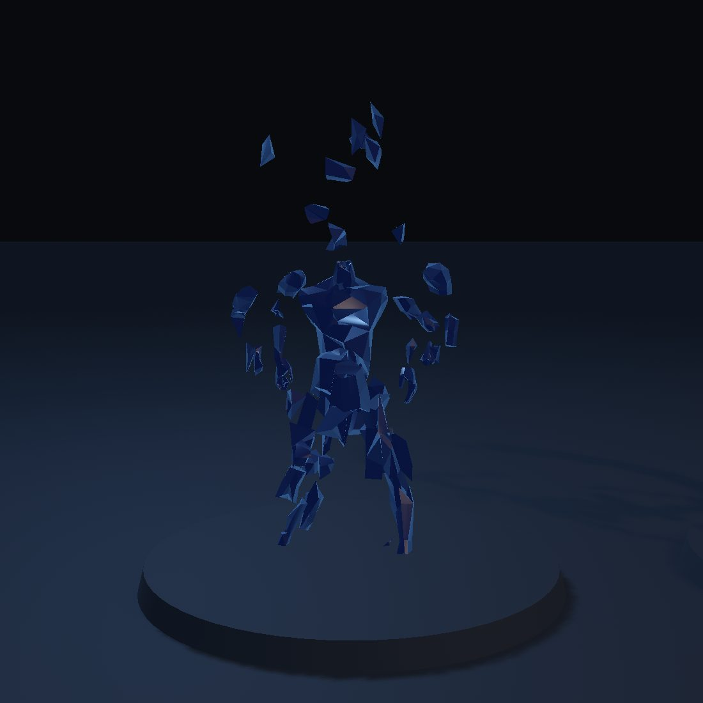
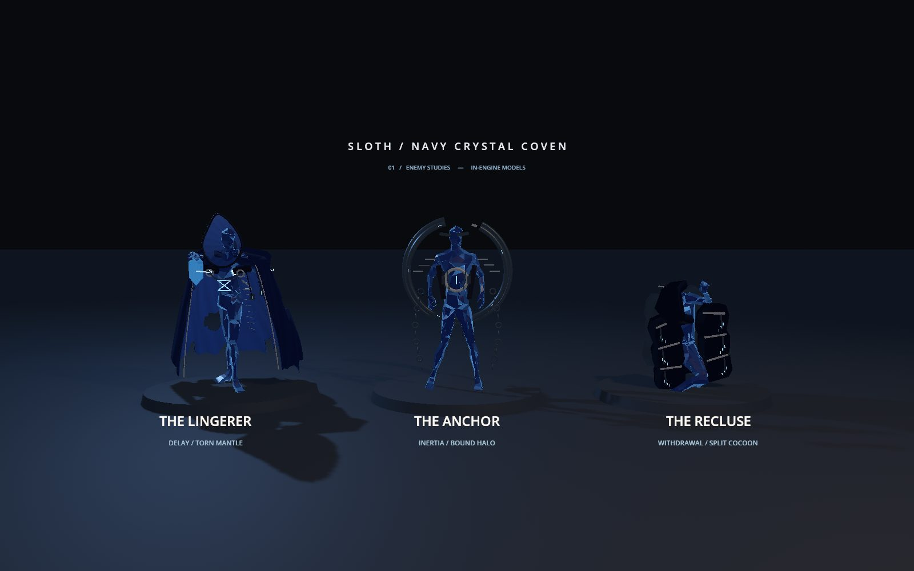

# 藏青敌人备用方案 · 当前实机与验证

基于已合并弹匣PR #88、弹道PR #91和入口修复PR #94后的main（438fa73）。本包不接入正式游戏。

## 当前结果

- `sloth_enemy_test.tscn`：无界面42/42、原生42/42通过，保留严格冲刺距离断言；固定测试视角且关闭角色鼠标视角输入后，减速/控制组均5.093米。
- `sloth_revision_test.tscn`：无界面27/27、原生27/27通过；真实枪械在头/腿不同位置击杀，验证接触点、56片碎屑、破裂起点/顺序、无倒地、暂停/回收、原红材质未污染、斗篷弱点/打断和贴地标记。
- 合并基线的主动弹匣62项、战斗特性、武器、枪感和敌弹检查通过；未覆盖音频硬件，原生功能用Dummy音频驱动。

日志见functional-headless.log、functional-native.log、navy-revision-headless.log、navy-revision-native.log。v1旧40/42日志保存在history，不抹去旧事实，也不作为当前结果。

## 保留的限制

宿主shader缓存目录不可写及编辑器设置保存路径为空的提示仍存在；无界面音频退出诊断保留，见native-host-diagnostics.log及相关日志。真人平衡、性能和跨平台未完成。图片均为Godot4.7.2原生截图，仅编码为JPEG，没有重绘。

[封装验证](PACKAGE_VERIFICATION.md)。正式入口、弹匣、地图等运行文件以main为准；这些敌人只存在于备用目录及其生成副本中。
